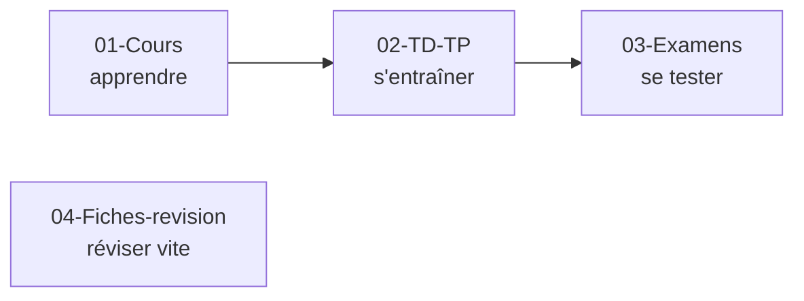
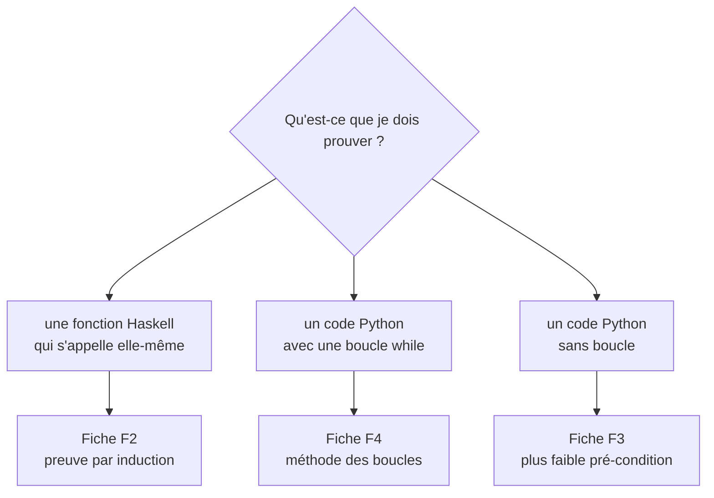

# 🧭 Commencer ici — Programmation et raisonnement (L2)

## Le module en une phrase

> On apprend à **être sûr** qu'un programme fait ce qu'il doit faire, **sans avoir à le tester sur toutes les valeurs**.

**Une image pour tout le module.** Un pont : on ne le teste pas en faisant passer tous les camions du monde. L'ingénieur fait un **calcul** qui **prouve** que le pont tient. Ici, on fait pareil avec les programmes.

## 📖 Dans quel ordre lire ?

Les dossiers et les fichiers sont **numérotés** : il suffit de suivre les numéros.

Chaque chapitre contient **deux fichiers** :

| Fichier | Rôle |
|---|---|
| `1-Cours.md` | l'explication, avec des exemples de la vie réelle |
| `2-Exemples-corriges.md` | des démonstrations expliquées ligne par ligne, à refaire seule |

## 🗓️ Le programme, semaine par semaine

| Semaine | Chapitre | L'image à retenir | TD |
|---|---|---|---|
| 1 | [Prouver par induction](01-Cours/Chapitre-1-Prouver-par-induction/1-Cours.md) | 🍬 partager des bonbons · 🚀 compte à rebours | [TD1](02-TD-TP/TD1-Induction-numerique/1-Enonce.md) |
| 2 | [Listes](01-Cours/Chapitre-2-Listes/1-Cours.md) | 🚂 un train de wagons | [TD2](02-TD-TP/TD2-Listes-tri-fusion/1-Enonce.md) |
| 3 | [Récursion terminale](01-Cours/Chapitre-3-Recursion-terminale/1-Cours.md) | 🧮 compter de tête au lieu de noter sur des post-it | [TD3](02-TD-TP/TD3-Recursion-terminale/1-Enonce.md) |
| 4 | [Arbres](01-Cours/Chapitre-4-Arbres/1-Cours.md) | 🎾 un tableau de tournoi · 📁 les dossiers de l'ordinateur | [TD4](02-TD-TP/TD4-Arbres-tournois/1-Enonce.md) |
| 5 | [Programmes impératifs](01-Cours/Chapitre-5-Programmes-imperatifs/1-Cours.md) | ⏰ calculer son heure de départ à partir de l'heure d'arrivée | [TD5](02-TD-TP/TD5-Programmes-imperatifs/1-Enonce.md) |
| 6 | [Tableaux](01-Cours/Chapitre-6-Tableaux/1-Cours.md) | 🥚 une boîte d'œufs numérotée | [TD6](02-TD-TP/TD6-Tableaux/1-Enonce.md) |

## 🔑 Les 5 mots du module

Ce sont toujours les mêmes, du premier au dernier chapitre :

| Mot | En clair | Dans la vie réelle |
|---|---|---|
| **Pré-condition** | ce que l'on suppose sur les entrées | « mettre une capsule dans la machine à café » |
| **Post-condition** | ce que le programme garantit | « on obtient un café » |
| **Variant** | un nombre ≥ 0 qui baisse à chaque étape, donc le calcul s'arrête | un compte à rebours |
| **Hypothèse d'induction** | « je suppose que ça marche pour les cas plus petits » | dans une file d'attente, chacun s'appuie sur les personnes devant lui |
| **Invariant** | ce qui reste vrai à chaque tour de boucle | « argent dépensé + argent restant = budget de départ » |

## 🧭 Quelle méthode pour quelle question ?

Les fiches : [F1 Haskell et Python](04-Fiches-revision/F1-Haskell-et-Python.md) · [F2 Preuve par induction](04-Fiches-revision/F2-Modele-preuve-induction.md) · [F3 Plus faible pré-condition](04-Fiches-revision/F3-Plus-faible-precondition.md) · [F4 Boucles](04-Fiches-revision/F4-Methode-boucles.md) · [F5 Notations](04-Fiches-revision/F5-Axiomes-et-notations.md) · [F6 Pièges et errata](04-Fiches-revision/F6-Pieges-et-errata.md)

## ✍️ Travailler un TD

Chaque dossier de TD contient :

| Fichier | À quoi il sert |
|---|---|
| `1-Enonce.md` | l'énoncé expliqué, avec des indices à déplier |
| `2-Mes-reponses.md` | **tes** réponses, avec un squelette déjà prêt |
| `code/` | **ton** code Python, testé avec `python3 code/tdX.py` |

**Ajouter un nouveau TD ou TP :** copier le dossier [TD-modele](02-TD-TP/TD-modele/1-Enonce.md), le renommer (par exemple `TD7-Mon-theme`) et le remplir.

## 📊 La notation

| Élément | Détail |
|---|---|
| Cours | 6 CM et 12 TD de 1h30, **présence obligatoire** |
| TPA | travail préparatoire en autonomie : donné en fin de CM, rendu au TD suivant |
| TR | travail de révision : donné en TD, rendu la semaine suivante (non rendu = 0) |
| Note finale | `(2 × DS + TxP × TxR × NTR) / 3` |
| 2ᵉ chance | `(3 × DS + TxP × TxR × NTR) / 4` |

`TxP` = taux de présence, `TxR` = taux de TPA rendus, `NTR` = note des TR.
En cas d'absence : prévenir le chargé de TD **et** le secrétariat (avec justificatif).

## 💡 Affichage

- Les schémas sont en **Mermaid** : dans VS Code, ouvre l'aperçu avec `Cmd+Shift+V`. S'ils ne s'affichent pas, installe l'extension *Markdown Preview Mermaid Support*.
- Les blocs **▶** se déplient : cherche d'abord, regarde la réponse ensuite.
