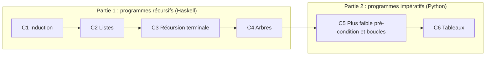
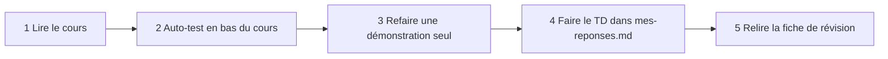

# 🧠 Programmation et raisonnement — L2 Informatique

> **Le but du module en une phrase :** apprendre à **démontrer** qu'un programme fait bien ce qu'il doit faire.
> Enseignant : Sylvain Salvati — Université de Lille.

## 🗺️ Le module en un coup d'œil

**L'idée qui relie tout le cours :** programmer et prouver, c'est la même démarche.

| Quand je programme… | …quand je prouve |
|---|---|
| le cas d'arrêt | le cas de base |
| l'appel récursif sur une donnée **plus petite** | l'hypothèse d'induction sur une valeur **plus petite** |
| ce qui diminue à chaque appel ou à chaque tour | le **variant** |
| ce qui reste vrai à chaque tour de boucle | l'**invariant** |
| les entrées autorisées / le résultat attendu | la **pré-condition** / la **post-condition** |

## 📁 Organisation

| Dossier | Contenu | Usage |
|---|---|---|
| [01-Cours](01-Cours/README.md) | 6 chapitres : un cours court + des démonstrations détaillées | **Apprendre** |
| [02-TD-TP](02-TD-TP/README.md) | Énoncés des TD + **ton espace de travail** (réponses, code) | **S'entraîner** |
| [03-Examens](03-Examens/README.md) | DS 2024-2025 + méthode pour le jour J | **Se tester** |
| [04-Fiches-revision](04-Fiches-revision/README.md) | Modèles de rédaction, règles, pièges | **Réviser vite** |

## 🚀 Méthode de travail (chaque semaine)

| Semaine | Cours | TD | Fiche utile |
|---|---|---|---|
| 1 | [C1 Induction](01-Cours/C1-Induction/README.md) | [TD1](02-TD-TP/TD1-Induction-numerique/enonce.md) | [F2 Modèle de preuve](04-Fiches-revision/F2-Modele-preuve-induction.md) |
| 2 | [C2 Listes](01-Cours/C2-Listes/README.md) | [TD2](02-TD-TP/TD2-Listes-tri-fusion/enonce.md) | [F5 Axiomes et notations](04-Fiches-revision/F5-Axiomes-et-notations.md) |
| 3 | [C3 Récursion terminale](01-Cours/C3-Recursion-terminale/README.md) | [TD3](02-TD-TP/TD3-Recursion-terminale/enonce.md) | [F1 Haskell ↔ Python](04-Fiches-revision/F1-Haskell-et-Python.md) |
| 4 | [C4 Arbres](01-Cours/C4-Arbres/README.md) | [TD4](02-TD-TP/TD4-Arbres-tournois/enonce.md) | [F5 Axiomes et notations](04-Fiches-revision/F5-Axiomes-et-notations.md) |
| 5 | [C5 Programmes impératifs](01-Cours/C5-Programmes-imperatifs/README.md) | [TD5](02-TD-TP/TD5-Programmes-imperatifs/enonce.md) | [F3 Plus faible pré-condition](04-Fiches-revision/F3-Plus-faible-precondition.md) |
| 6 | [C6 Tableaux](01-Cours/C6-Tableaux/README.md) | [TD6](02-TD-TP/TD6-Tableaux/enonce.md) | [F4 Méthode des boucles](04-Fiches-revision/F4-Methode-boucles.md) |

## 📊 Organisation et notation

| Élément | Détail |
|---|---|
| Volume | 6 CM + 12 TD de 1h30 = **27 h**, plus environ 27 h de travail personnel |
| TPA | Travail préparatoire en autonomie : donné en fin de CM, à rendre au TD suivant |
| TR | Travail de révision : donné chaque semaine en TD, à rendre la semaine suivante |
| Présence | CM et TD **obligatoires** |

- `TxP` (présence) = `(18 séances − absences injustifiées) / 18`
- `TxR` (rendus) = `(6 TPA − TPA non rendus) / 6`
- `NTR` = note des TR (un TR non rendu ⇒ **0**)

| Session | Note finale |
|---|---|
| 1ʳᵉ chance | `(2 × DS + TxP × TxR × NTR) / 3` |
| 2ᵉ chance | `(3 × DS + TxP × TxR × NTR) / 4` |

> ⚠️ Absence : prévenir le chargé de TD **et** le secrétariat (avec justificatif), puis rendre les travaux dès le retour.

## 💡 Affichage

- Schémas en **Mermaid** : dans VS Code, ouvre l'aperçu Markdown (`Cmd+Shift+V`). S'ils ne s'affichent pas, installe l'extension *Markdown Preview Mermaid Support*.
- Les blocs **▶ Réponse** se déplient : cherche d'abord, vérifie ensuite.
- Coquilles repérées dans les documents d'origine : voir [F6 Pièges et errata](04-Fiches-revision/F6-Pieges-et-errata.md).
