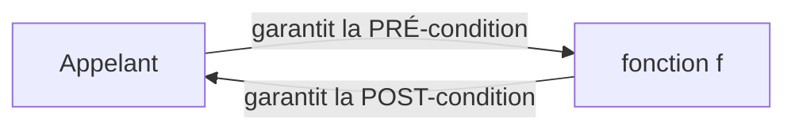
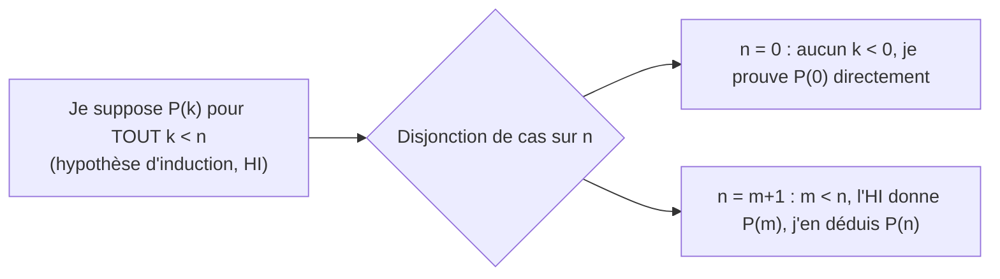
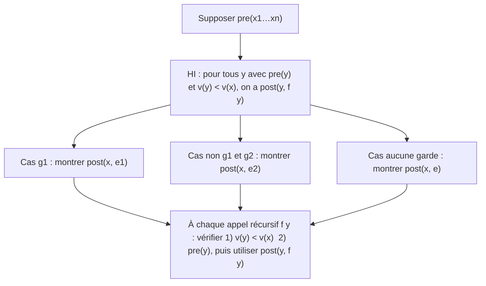

# C1 — Spécifier et prouver par induction

[⬅ Cours](../README.md) · [Démonstrations ➡](demonstrations.md) · TD : [TD1](../../02-TD-TP/TD1-Induction-numerique/enonce.md)

## 🎯 Objectifs

1. Lire et exécuter à la main une fonction Haskell.
2. Écrire une **spécification** : pré-condition et post-condition.
3. Rédiger une **preuve par induction** sur un **variant**.

## 💡 Pourquoi ?

Ces 4 fonctions disent toutes calculer `n!`. Seules 2 ont raison :

| Fonction | Départ | Condition | Corps | Calcule vraiment |
|---|---|---|---|---|
| `factoriel1` | `i=0, res=1` | `i <= n` | `i=i+1` puis `res=i*res` | `(n+1)!` ❌ |
| `factoriel2` | `i=1, res=1` | `i <= n` | `res=i*res` puis `i=i+1` | `n!` ✅ |
| `factoriel3` | `i=0, res=1` | `i < n` | `i=i+1` puis `res=res*i` | `n!` ✅ |
| `factoriel4` | `i=0, res=1` | `i < n` | `res=res*i` puis `i=i+1` | `0` si `n>0`, sinon `1` ❌ |

> Tester ne suffit pas : on veut **démontrer**. Pour raisonner simplement, on commence en **Haskell**.

---

## 1. Haskell en bref

| Python | Haskell |
|---|---|
| variables modifiables | ❌ jamais de modification |
| instructions, boucles | ❌ uniquement des **expressions** et la **récursivité** |
| `f(x, y)` | `f x y` |

```haskell
factoriel :: Int -> Int              -- type : Int vers Int
factoriel 0 = 1                      -- équations testées de haut en bas
factoriel n = n * factoriel (n-1)
```

**Exécuter = remplacer selon la définition :**

```text
factoriel 3 = 3 * factoriel 2 = 3 * (2 * factoriel 1)
            = 3 * (2 * (1 * factoriel 0)) = 3 * (2 * (1 * 1)) = 6
```

| Outil | Exemple | À savoir |
|---|---|---|
| Plusieurs arguments | `fibAux :: Int -> Int -> Int -> Int` | `a -> b -> c` = `a -> (b -> c)` |
| Gardes | `f n \| n < 2 = n` / `\| otherwise = …` | la **première** garde vraie gagne |
| `if` | `if n < 2 then n else …` | équivalent aux gardes |
| Tuples | `(q, r) :: (Int, Int)` | se décomposent par motif : `incr1 (q, r) = (q+1, r)` |
| Noms locaux | `where x = n^2` ou `let x = n^2 in …` | équivalents |

👉 Mémo complet : [F1 Haskell et Python](../../04-Fiches-revision/F1-Haskell-et-Python.md)

### L'exemple fil rouge : la division euclidienne

```haskell
incr1 :: (Int, Int) -> (Int, Int)
incr1 (q, r) = (q+1, r)

division :: Int -> Int -> (Int, Int)        -- (quotient, reste)
division a b | a < b     = (0, a)
             | otherwise = incr1 (division (a-b) b)
```

```text
division 23 5 = incr1 (division 18 5) = incr1 (incr1 (division 13 5)) = …
              = incr1 (incr1 (incr1 (incr1 (0, 3)))) = (4, 3)      -- 23 = 4×5 + 3
```

---

## 2. Spécifier = écrire un contrat



| | Porte sur | Exemple pour `division a b` |
|---|---|---|
| **Pré-condition** | les arguments | `a ≥ 0` et `b > 0` |
| **Post-condition** | les arguments **et** le résultat | avec `(q, r) = division a b` : `a = b × q + r` et `0 ≤ r < b` |

Si la pré-condition est vraie, la fonction **termine**, **ne plante pas** et **renvoie** une valeur.

> **Forme logique :** `∀x1 … ∀xn. pre(x1, …, xn) ⇒ post(x1, …, xn, f x1 … xn)`

On peut aussi spécifier une **propriété particulière**. Ex. : avec la même pré-condition, `q < a` **ssi** `a > 0` et `b > 1`.

---

## 3. Récurrence et induction

Il y a une infinité d'entrées à vérifier : on utilise un principe de raisonnement.

| Principe | Formule | Étapes |
|---|---|---|
| Récurrence | `(P(0) ∧ ∀n. P(n) ⇒ P(n+1)) ⇒ ∀n. P(n)` | initialisation + hérédité |
| Récurrence forte | `(P(0) ∧ ∀n. (∀k ≤ n. P(k)) ⇒ P(n+1)) ⇒ ∀n. P(n)` | initialisation + hérédité |
| **Induction** ⭐ | `(∀n. (∀k < n. P(k)) ⇒ P(n)) ⇒ ∀n. P(n)` | **une seule étape** |

Les trois sont **équivalents**, mais ⚠️ l'induction n'est **pas** la récurrence forte : il n'y a pas d'initialisation à part.



**Exemple** — `0 + 1 + … + n = n(n+1)/2`, par induction sur `n` :
- `n = 0` : les deux côtés valent 0. ✅
- `n = m+1` : par HI (`m < n`), `0 + … + m = m(m+1)/2`, donc `0 + … + m + (m+1) = m(m+1)/2 + (m+1) = (m+1)(m+2)/2`. ✅

> **Pourquoi l'induction est correcte ?** On applique la récurrence à `Q(n) = ∀k < n. P(k)`. `Q(0)` est toujours vrai, et `Q(n) ⇒ Q(n+1)` est exactement l'étape d'induction.

---

## 4. Le variant

Pour prouver une fonction récursive, on fait une induction sur une **mesure** qui diminue à chaque appel.

> Un **variant** de `f` est une expression `v x1 … xn` telle que, quand la pré-condition est vraie :
> 1. `v x1 … xn` est un **entier ≥ 0** ;
> 2. pour **chaque appel récursif** `f y1 … yn` : la **pré-condition** est vraie pour `y1 … yn` **et** `v y1 … yn < v x1 … xn`.

| Donnée parcourue | Variant habituel |
|---|---|
| entier `n` qui décroît | `n` |
| liste `l` | `length l` |
| deux listes | `length l1 + length l2` |
| arbre, formule | `taille t`, `hauteur t` |

Principe de programmation correspondant : **calculer sur des données strictement plus petites, puis assembler les résultats.**

---

## 5. ⭐ Le schéma de preuve d'une fonction

```haskell
f x1 … xn | g1        = e1
          | g2        = e2
          | otherwise = e
```



> ⚠️ **Erreur la plus fréquente** : vérifier que le variant diminue mais **oublier la pré-condition** de l'appel récursif. L'HI dit « pré ⇒ post » : sans pré, pas de post !

Modèle de rédaction à recopier : [F2 Modèle de preuve](../../04-Fiches-revision/F2-Modele-preuve-induction.md) — preuve complète de `division` : [démonstrations](demonstrations.md).

---

## ⚠️ Pièges

| Piège | Correction |
|---|---|
| `factoriel n-1` | c'est `(factoriel n) - 1` ; écrire `factoriel (n-1)` |
| Utiliser l'HI sur `n` lui-même | seulement sur des valeurs **strictement** plus petites |
| Oublier un cas de garde | un cas par garde, `otherwise` compris |
| Pré-condition trop faible | ex. `b = 0` ⇒ `division` boucle |

## ✅ À retenir

> **Prouver une fonction récursive** = induction sur le variant + un cas par équation/garde + pour chaque appel récursif : **variant ↓** et **pré ✓** ⇒ **post** de l'appel.

## 🧪 Auto-test

1. Exécute `pgcd 18 48` avec :

   ```haskell
   pgcd a 0 = a
   pgcd a b | b > a     = pgcd b a
            | otherwise = pgcd b (a `mod` b)
   ```

2. Donne une spécification de `factoriel n`.
3. Prouve par induction `2⁰ + … + 2ⁿ = 2ⁿ⁺¹ − 1`.

<details><summary>▶ Réponses</summary>

1. `pgcd 18 48 = pgcd 48 18 = pgcd 18 12 = pgcd 12 6 = pgcd 6 0 = 6`.
2. Pré : `n ≥ 0`. Post : `factoriel n = n!`. Variant : `n`.
3. `n = 0` : `1 = 2 − 1`. `n = m+1` : HI ⇒ `2⁰+…+2ᵐ = 2ᵐ⁺¹ − 1`, donc la somme jusqu'à `2ᵐ⁺¹` vaut `2·2ᵐ⁺¹ − 1 = 2ᵐ⁺² − 1`. ✅

</details>
