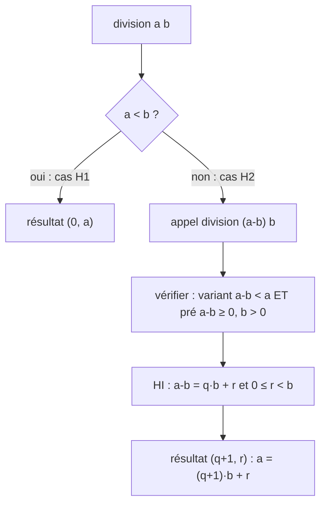

# C1 — Démonstration : la division par soustractions

[⬅ Cours C1](README.md)

> 🏋️ **Mode d'emploi** : lis l'énoncé, cache la suite, essaie seul, puis compare.

## Le code

```haskell
incr1 :: (Int, Int) -> (Int, Int)
incr1 (q, r) = (q+1, r)

division :: Int -> Int -> (Int, Int)
division a b | a < b     = (0, a)
             | otherwise = incr1 (division (a-b) b)
```

## La spécification

| Nom | Propriété |
|---|---|
| **Pre1** | `a ≥ 0` |
| **Pre2** | `b > 0` |
| **Post1** | en posant `(q, r) = division a b` : `a = q × b + r` |
| **Post2** | `0 ≤ r < b` |
| **Variant** | `a` — c'est un entier ≥ 0 grâce à Pre1 |

## Hypothèse d'induction (HI)

Pour tous `a'` et `b'` tels que **`a' < a`**, `a' ≥ 0` et `b' > 0`, en posant `(q', r') = division a' b'` :
`a' = q' × b' + r'` et `0 ≤ r' < b'`.

## Démonstration

On suppose Pre1 et Pre2, on montre Post1 et Post2. Deux cas, un par garde.



### Cas 1 : `a < b` (H1)

`division a b = (0, a)`.
- **Post1** : `a = 0 × b + a`. ✅
- **Post2** : `0 ≤ a` par Pre1 et `a < b` par H1. ✅

### Cas 2 : `a ≥ b` (H2)

Posons `(q, r) = division (a-b) b`. Alors `division a b = incr1 (q, r) = (q+1, r)`.

On veut utiliser l'HI sur `division (a-b) b`. **Deux vérifications** :

| Vérification | Justification |
|---|---|
| ① Le variant diminue : `a − b < a` | car `b > 0` (Pre2) |
| ② La pré-condition est vraie : `a − b ≥ 0` | car `a ≥ b` (H2) |
| ② La pré-condition est vraie : `b > 0` | Pre2 |

> ⚠️ ② est indispensable : l'HI dit « **si** la pré-condition est vraie **alors** la post-condition l'est ».

L'HI donne : (Post1') `a − b = q × b + r` et (Post2') `0 ≤ r < b`. Donc :
- **Post1** : `a = q × b + b + r = (q+1) × b + r`. ✅
- **Post2** : `0 ≤ r < b` par Post2'. ✅

**Ce qui achève la preuve par induction.** ∎

---

## 🔁 Variante à refaire seul

Prouve `somme n = n(n+1)/2` (pré : `n ≥ 0`, variant : `n`) pour :

```haskell
somme :: Int -> Int
somme 0 = 0
somme n = n + somme (n-1)
```

<details><summary>▶ Corrigé</summary>

HI : pour tout `n' < n` avec `n' ≥ 0`, `somme n' = n'(n'+1)/2`.
- **Cas `n = 0`** : `somme 0 = 0 = 0·1/2`. ✅
- **Cas `n ≠ 0`** : `somme n = n + somme (n-1)`. Appel récursif : variant `n − 1 < n` ✅, pré `n − 1 ≥ 0` car `n ≥ 0` et `n ≠ 0` ✅. Par HI `somme (n-1) = (n−1)n/2`, donc `somme n = n + (n−1)n/2 = n(n+1)/2`. ✅

Ce qui achève la preuve par induction.

</details>
