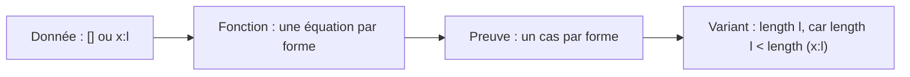
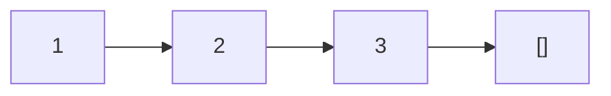
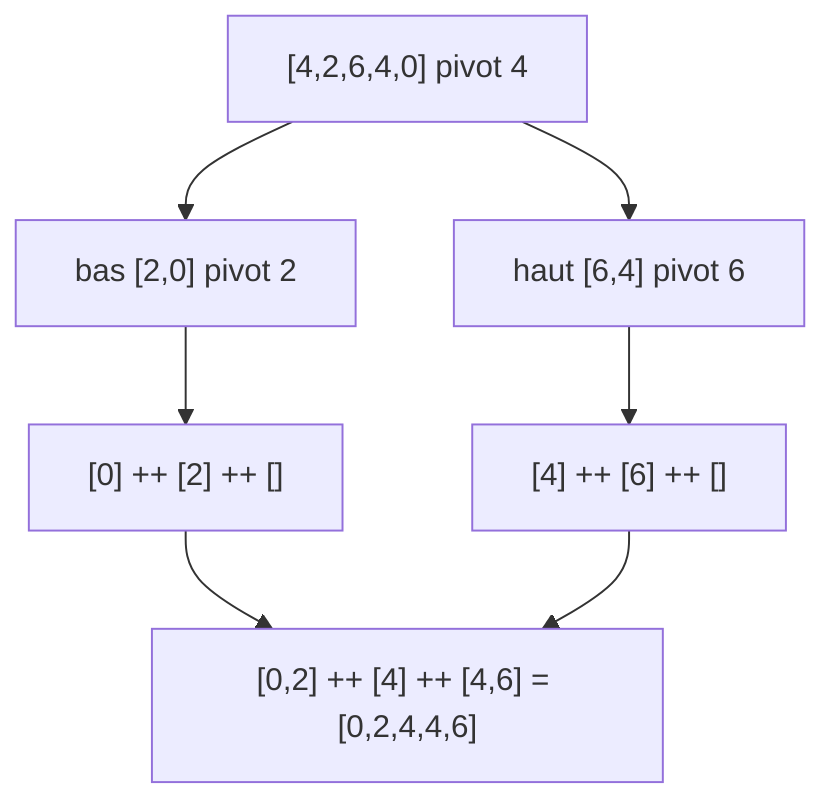

# C2 — Fonctions sur les listes

[⬅ Cours](../README.md) · [Démonstrations ➡](demonstrations.md) · TD : [TD2](../../02-TD-TP/TD2-Listes-tri-fusion/enonce.md)

## 🎯 Objectifs

1. Manipuler les listes Haskell : motifs, `length`, `++`, compréhension.
2. Prouver une propriété par **induction sur `length l`**.
3. Prouver qu'un **tri** est correct.

## 💡 L'idée

> La **preuve** suit la forme de la **fonction**, qui suit la forme de la **donnée** : une liste est soit `[]`, soit `x : l`.



---

## 1. Construire une liste

| Notation | Sens |
|---|---|
| `[a]` | type « liste d'éléments de type `a` » |
| `[]` | liste vide |
| `x : l` | `x` ajouté **en tête** de `l` |
| `[1,2,3]` | raccourci de `1 : (2 : (3 : []))` |
| `String` | synonyme de `[Char]` |

Les listes sont **chaînées** : accès direct au **premier** élément seulement.



## 2. Motifs

| Motif | Accepte | Lie |
|---|---|---|
| `_` | tout | rien |
| `[]` | liste vide | rien |
| `(x:l)` | ≥ 1 élément | `x` tête, `l` reste |
| `(x:_:l)` | ≥ 2 éléments | `x` 1ᵉʳ, `l` après le 2ᵉ |
| `(p:(a,b):l)` | liste de paires, ≥ 2 éléments | sur `[(1,2),(2,3)]` : `p=(1,2)`, `a=2`, `b=3`, `l=[]` |

```haskell
estOrdonnee :: [Int] -> Bool
estOrdonnee (x:y:l) | x <= y    = estOrdonnee (y:l)
                    | otherwise = False
estOrdonnee _ = True          -- 0 ou 1 élément
-- équivaut à : estOrdonnee (x:y:l) = x <= y && estOrdonnee (y:l)
```

## 3. Les deux fonctions de base

```haskell
length :: [a] -> Int          -- a : variable de type (liste de n'importe quoi)
length []    = 0
length (_:l) = 1 + length l

(++) :: [a] -> [a] -> [a]
[]     ++ l = l
(x:l') ++ l = x : (l' ++ l)
```

```text
[1,2] ++ [5,6] = 1 : ([2] ++ [5,6]) = 1 : 2 : ([] ++ [5,6]) = [1,2,5,6]
```

> 🔑 `++` parcourt **son premier argument** ⇒ toute preuve sur `l1 ++ l2` se fait par induction sur **`length l1`**.

## 4. Listes en compréhension

| Expression | Résultat |
|---|---|
| `[(i,j) \| i <- [1,2], j <- [4,5]]` | `[(1,4),(1,5),(2,4),(2,5)]` |
| ``[i*j \| i <- [1,2], j <- [4,5], j `rem` i == 0]`` | `[4,5,8]` (filtre) |
| `[… \| i <- [1,2], let k = i*i, j <- [1..k]]` | valeur intermédiaire `k` |

## 5. Le tri rapide

```haskell
triRapide :: [Int] -> [Int]
triRapide []    = []
triRapide (x:l) = triRapide bas ++ [x] ++ triRapide haut
  where bas  = [y | y <- l, y < x]
        haut = [y | y <- l, x <= y]
```



---

## 6. ⭐ Prouver sur les listes

| Partie | Contenu type |
|---|---|
| Objectif | « Pour toute liste `l` (vérifiant …), on a … » |
| Variant | `length l` — entier ≥ 0 |
| HI | « Pour toute liste `l'` avec `length l' < length l`, … » |
| Cas `l = []` | calcul direct avec les définitions |
| Cas `l = a : l'` | `length l = 1 + length l'` ⇒ variant ↓ ⇒ on applique l'HI à `l'` |
| Conclusion | « Ce qui achève la preuve par induction. » |

### Les propriétés démontrées en cours

| # | Propriété | Variant | Idée clé |
|---|---|---|---|
| 1 | `l ++ [] = l` | `length l` | `(a:l') ++ [] = a : (l' ++ [])` puis HI |
| 2 | `l1 ++ (l2 ++ l3) = (l1 ++ l2) ++ l3` | `length l1` | on développe les deux membres |
| 3 | `length (l1 ++ l2) = length l1 + length l2` | `length l1` | (auto-test) |
| 4 | `l1`, `l2` ordonnées et `l1 ≤ l2` ⇒ `l1 ++ l2` ordonnée | `length l1` | sous-cas car `estOrdonnee` regarde 2 éléments |
| 5 | `triRapide l` ordonnée et permutation de `l` | `length l` | HI sur `bas` et `haut` + propriété 4 |
| 6 | `triInsertion l` ordonnée et permutation de `l` | `length l` | prouver d'abord `inserer` |

👉 Toutes rédigées en détail : [démonstrations](demonstrations.md).

> 🔑 **Un tri est correct** ⇔ son résultat est **trié** **et** est une **permutation** de l'entrée. (Sans « permutation », `tri l = []` serait « correct » !)

---

## ⚠️ Pièges

| Piège | Correction |
|---|---|
| `x ++ l` avec `x` un élément | `x : l` (ou `[x] ++ l`) |
| Induction sur la mauvaise liste | sur celle que la fonction **parcourt** |
| `length bas < length l'` | faux en général : c'est `length bas ≤ length l' < length l` |
| `estOrdonnee _ = True` placé en premier | il capturerait tout : l'ordre des équations compte |

## ✅ À retenir

- Liste = `[]` ou `x : l` ; variant = `length` de la liste parcourue.
- On **réutilise** les propriétés déjà prouvées (lemmes).

## 🧪 Auto-test

1. `[x*2 | x <- [1,2,3], x /= 2]` = ?
2. Prouve `length (l1 ++ l2) = length l1 + length l2`.

<details><summary>▶ Réponses</summary>

1. `[2,6]`.
2. Induction sur `length l1`. Cas `[]` : `length ([] ++ l2) = length l2 = 0 + length l2`. Cas `a:l1'` : `length (a : (l1' ++ l2)) = 1 + length (l1' ++ l2) = 1 + length l1' + length l2` (HI, variant ↓, pré triviale) `= length l1 + length l2`. Ce qui achève la preuve par induction.

</details>
