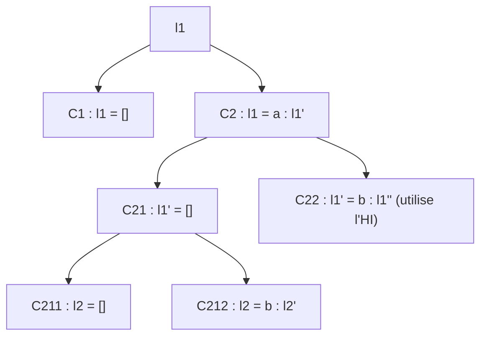

# C2 — Démonstrations sur les listes

[⬅ Cours C2](README.md)

> 🏋️ Pour chaque preuve : lis l'objectif, essaie seul, puis compare.

```haskell
(++) :: [a] -> [a] -> [a]
[]     ++ l2 = l2
(a:l1) ++ l2 = a : (l1 ++ l2)

estOrdonnee :: [Int] -> Bool
estOrdonnee (x:y:l) | x <= y    = estOrdonnee (y:l)
                    | otherwise = False
estOrdonnee _ = True
```

---

## 1. Neutralité à droite : `l ++ [] = l`

- **Variant** : `length l` (entier ≥ 0).
- **HI** : pour toute `l'` avec `length l' < length l`, `l' ++ [] = l'`.

| Cas | Raisonnement |
|---|---|
| **C1** `l = []` | `[] ++ [] = []` (définition de `++`). ✅ |
| **C2** `l = a : l'` | `l ++ [] = a : (l' ++ [])`. HI sur `l'` : ① `length l = 1 + length l'` donc variant ↓ ; ② pré triviale. Donc `l' ++ [] = l'` et `l ++ [] = a : l' = l`. ✅ |

Ce qui achève la preuve par induction. ∎

---

## 2. Associativité : `l1 ++ (l2 ++ l3) = (l1 ++ l2) ++ l3`

- **Variant** : `length l1`.
- **HI** : pour toutes `l1', l2', l3'` avec `length l1' < length l1`, `l1' ++ (l2' ++ l3') = (l1' ++ l2') ++ l3'`.

**C1 `l1 = []`**
- gauche : `[] ++ (l2 ++ l3) = l2 ++ l3`
- droite : `([] ++ l2) ++ l3 = l2 ++ l3` ✅

**C2 `l1 = a : l1'`**
- gauche : `(a:l1') ++ (l2 ++ l3) = a : (l1' ++ (l2 ++ l3))`
- droite : `((a:l1') ++ l2) ++ l3 = (a : (l1' ++ l2)) ++ l3 = a : ((l1' ++ l2) ++ l3)`
- HI sur `l1'` (variant ↓, pré triviale) : `l1' ++ (l2 ++ l3) = (l1' ++ l2) ++ l3`. Les deux membres sont égaux. ✅

Ce qui achève la preuve par induction. ∎

---

## 3. Ordre et concaténation

| | |
|---|---|
| **Pre1** | `estOrdonnee l1 = True` |
| **Pre2** | `estOrdonnee l2 = True` |
| **Pre3** | tout élément de `l1` est ≤ tout élément de `l2` |
| **Post** | `estOrdonnee (l1 ++ l2) = True` |
| **Variant** | `length l1` |

**HI** : pour toutes `l1', l2'` avec `length l1' < length l1` vérifiant Pre1-3, `estOrdonnee (l1' ++ l2') = True`.



- **C1** : `l1 ++ l2 = l2`, ordonnée par Pre2. ✅
- **C211** : `l1 ++ l2 = [a]`, ordonnée. ✅
- **C212** : `l1 ++ l2 = a : b : l2'`, donc `estOrdonnee (l1 ++ l2) = a ≤ b && estOrdonnee l2`. `estOrdonnee l2` par Pre2 ; `a ≤ b` par Pre3 (`a ∈ l1`, `b ∈ l2`). ✅
- **C22** : `estOrdonnee (l1 ++ l2) = a ≤ b && estOrdonnee (l1' ++ l2)`.
  - `a ≤ b` : car `estOrdonnee l1 = a ≤ b && estOrdonnee l1' = True`.
  - HI sur `(l1', l2)` :
    1. variant : `length l1' < length l1` ✅
    2. pré : `l1'` ordonnée (même égalité) ✅ ; `l2` ordonnée (Pre2) ✅ ; éléments de `l1'` ⊆ éléments de `l1` donc ≤ ceux de `l2` (Pre3) ✅
  - Donc `estOrdonnee (l1' ++ l2) = True` et la conjonction vaut `True`. ✅

Ce qui achève la preuve par induction. ∎

> 💡 La pré-condition de l'appel récursif demande ici **3 vérifications** : c'est souvent là que se trouvent les points du DS.

---

## 4. Correction du tri rapide

```haskell
triRapide []    = []
triRapide (x:l) = triRapide bas ++ [x] ++ triRapide haut
  where bas  = [y | y <- l, y < x]
        haut = [y | y <- l, x <= y]
```

- **Post** : (1) `estOrdonnee (triRapide l) = True` ; (2) `triRapide l` est une permutation de `l`.
- **Variant** : `length l`. **HI** : (1) et (2) pour toute `l'` plus courte.

**C1 `l = []`** : `triRapide [] = []` est ordonnée et permutation de `[]`. ✅

**C2 `l = x : l'`** : notons `lb = bas`, `lh = haut`, `tlb = triRapide lb`, `tlh = triRapide lh`.

| Étape | Justification |
|---|---|
| HI sur `lb` | `length lb ≤ length l' < length l` ✅ ⇒ `tlb` ordonnée, permutation de `lb` |
| HI sur `lh` | même argument ⇒ `tlh` ordonnée, permutation de `lh` |
| `tlb ++ [x]` ordonnée | propriété 3 : éléments de `tlb` (= ceux de `lb`) `< x` |
| `(tlb ++ [x]) ++ tlh` ordonnée | propriété 3 : éléments de `tlh` `≥ x` |
| Permutation | chaque élément de `l'` est dans `lb` **ou** dans `lh` ⇒ `lb ++ lh` permutation de `l'` ⇒ `tlb ++ [x] ++ tlh` permutation de `x : l'` |

Ce qui achève la preuve par induction. ∎

---

## 5. À faire seul : le tri par insertion

```haskell
inserer :: Int -> [Int] -> [Int]
inserer k []    = [k]
inserer k (n:l) | k <= n    = k : n : l
                | otherwise = n : inserer k l

triInsertion :: [Int] -> [Int]
triInsertion []    = []
triInsertion (n:l) = inserer n (triInsertion l)
```

1. Si `estOrdonnee l`, alors `estOrdonnee (inserer k l)` et `inserer k l` contient les éléments de `k : l`.
2. `triInsertion l` est ordonnée et est une permutation de `l`.

<details><summary>▶ Pistes</summary>

1. Induction sur `length l`. Dans le cas `k > n`, le résultat est `n : inserer k l` : pour savoir qu'il est ordonné, il faut savoir que **le premier élément** de `inserer k l` est ≥ `n` (c'est soit `k > n`, soit le premier élément de `l`, ≥ `n` car `n : l` est ordonnée).
2. Induction sur `length l`, en utilisant 1 pour l'appel `inserer n (triInsertion l)`.

</details>
