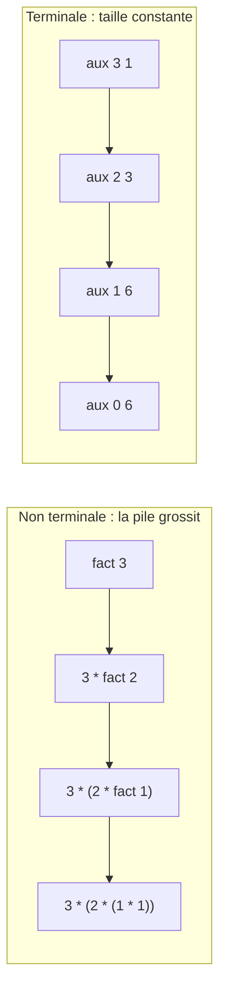
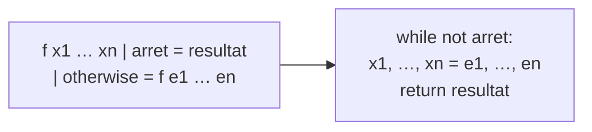

# C3 — Récursion terminale

[⬅ Cours](../README.md) · [Démonstrations ➡](demonstrations.md) · TD : [TD3](../../02-TD-TP/TD3-Recursion-terminale/enonce.md)

## 🎯 Objectifs

1. Reconnaître une fonction **récursive terminale**.
2. Transformer une fonction en version terminale grâce à un **accumulateur**.
3. Traduire une fonction récursive terminale en **boucle `while`** Python.
4. Prouver une fonction à accumulateur en **généralisant** sa spécification.

## 💡 L'idée

> La récursivité est élégante mais peut être **inefficace** : chaque appel en attente occupe de la mémoire (la pile).
> Une récursion **terminale** n'a **rien en attente** : elle se transforme directement en boucle.

---

## 1. Terminale ou pas ?

> Un appel récursif est **terminal** si son résultat **est directement** le résultat de la fonction (rien n'est fait après).

| Fonction | Appel récursif | Terminale ? |
|---|---|---|
| `factoriel n = n * factoriel (n-1)` | suivi de `n * …` | ❌ |
| `division a b = incr1 (division (a-b) b)` | suivi de `incr1` | ❌ |
| `reverse (n:l) = reverse l ++ [n]` | suivi de `++ [n]` | ❌ |
| `fibAux k n1 n2 = fibAux (k-1) (n1+n2) n1` | rien après | ✅ |
| `divAux a b acc = divAux (a-b) b (acc+1)` | rien après | ✅ |
| `nth n (_:ls) = nth (n-1) ls` | rien après | ✅ |



Les compilateurs (Haskell, OCaml…) **optimisent** la récursion terminale en boucle — **pas Python**. D'où l'intérêt de savoir la traduire soi-même.

## 2. La technique de l'accumulateur

On ajoute un argument `acc` qui **contient le travail déjà fait**.

| Non terminale | Terminale avec accumulateur |
|---|---|
| `division a b \| a < b = (0, a)` | `divAux a b acc \| a < b = (acc, a)` |
| `\| otherwise = incr1 (division (a-b) b)` | `\| otherwise = divAux (a-b) b (acc+1)` |
| | `divRT a b = divAux a b 0` |
| `reverse [] = []` | `revAux [] acc = acc` |
| `reverse (n:l) = reverse l ++ [n]` | `revAux (n:l) acc = revAux l (n:acc)` |
| | `revRT l = revAux l []` |

> Bonus : `reverse` coûte un temps quadratique (à cause de `++`), `revRT` un temps linéaire.

## 3. ⭐ Traduire en boucle `while` (méthode du cours)



**Règles :**
1. Les **arguments** deviennent des **variables**.
2. La condition d'**arrêt** devient la **négation** de la condition du `while`.
3. L'appel récursif `f e1 … en` devient une **affectation simultanée** `x1, …, xn = e1, …, en`.
4. Plusieurs gardes récursives ⇒ un `if / elif` dans le corps.
5. Listes : `x:l` se lit avec `l[0]` et `l[1:]` (tranches).

```python
def divAux(a, b, acc):                 # divAux a b acc | a < b     = (acc, a)
    while not (a < b):                 #                | otherwise = divAux (a-b) b (acc+1)
        a, b, acc = a - b, b, acc + 1
    return (acc, a)

def revAux(l, acc):                    # revAux []    acc = acc
    while l != []:                     # revAux (n:l) acc = revAux l (n:acc)
        l, acc = l[1:], [l[0]] + acc
    return acc
```

> ⚠️ **Affectation simultanée obligatoire** : `a = a - b` puis `acc = acc + 1` marche ici, mais pour `fibAux` (`n1, n2 = n1 + n2, n1`), deux affectations séparées donneraient un **faux** résultat.

C'est le lien direct avec le chapitre C5 : **une boucle `while` = une fonction récursive terminale**.

## 4. ⭐ Prouver une fonction à accumulateur

On ne peut pas prouver directement `divAux a b 0` : l'appel récursif utilise `acc+1`, pas `0`. Il faut **généraliser** la spécification pour **tout** `acc`.

| Fonction | Spécification généralisée (on prouve) | Conséquence (on déduit) |
|---|---|---|
| `divAux a b acc` | `acc × b + a = q × b + r` et `0 ≤ r < b` | avec `acc = 0` : `a = q × b + r` |
| `revAux l acc` | `revAux l acc = reverse l ++ acc` | avec `acc = []` : `revRT l = reverse l ++ [] = reverse l` |
| `expAux a b acc` (TD3) | `expAux a b acc = acc × aᵇ` | avec `acc = 1` : `expR a b = aᵇ` |

> 💡 **Comment trouver la spécification généralisée ?** Demande-toi : « quel lien relie l'accumulateur et ce qui reste à calculer ? » Cette quantité **ne change pas** d'un appel à l'autre (c'est déjà un **invariant**, cf. C5).

Preuves complètes de `divAux`, `revAux` et de `fusionne` : [démonstrations](demonstrations.md).

---

## ⚠️ Pièges

| Piège | Correction |
|---|---|
| Croire `n * f (n-1)` terminale | la multiplication est faite **après** l'appel |
| Affectations séquentielles au lieu de simultanées | `x, y = e1, e2` |
| Prouver seulement le cas `acc = 0` | l'HI doit valoir pour **tout** `acc` |

## ✅ À retenir

> **Terminale** = rien après l'appel. **Accumulateur** = le travail déjà fait. **Preuve** = spécification valable pour tout `acc`.

## 🧪 Auto-test

1. `fibAux` (C1) est-elle terminale ? Traduis-la en `while`.
2. Quelle spécification généralisée pour `sommeAux n acc` avec `sommeAux 0 acc = acc` et `sommeAux n acc = sommeAux (n-1) (acc+n)` ?

<details><summary>▶ Réponses</summary>

1. Oui.
   ```python
   def fibAux(k, n1, n2):
       while k != 0:
           k, n1, n2 = k - 1, n1 + n2, n1
       return n2
   ```
2. `sommeAux n acc = acc + n(n+1)/2` (pré : `n ≥ 0`, variant : `n`).

</details>
