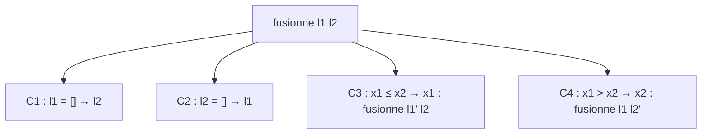

# C3 — Démonstrations : accumulateurs et tri fusion

[⬅ Cours C3](README.md) · Axiomes `triée` / `perm` : [F5](../../04-Fiches-revision/F5-Axiomes-et-notations.md)

---

## 1. Division récursive terminale

```haskell
divAux :: Int -> Int -> Int -> (Int, Int)
divAux a b acc | a < b     = (acc, a)
               | otherwise = divAux (a-b) b (acc+1)

divRT :: Int -> Int -> (Int, Int)
divRT a b = divAux a b 0
```

| | |
|---|---|
| **Pre1 / Pre2** | `a ≥ 0` / `b > 0` |
| **Post1** | avec `(q, r) = divAux a b acc` : `acc × b + a = q × b + r` |
| **Post2** | `0 ≤ r < b` |
| **Variant** | `a` |

**HI** : pour tous `a', b', acc'` avec `a' < a`, `a' ≥ 0`, `b' > 0`, en posant `(q', r') = divAux a' b' acc'` : `acc' × b' + a' = q' × b' + r'` et `0 ≤ r' < b'`.

**C1 `a < b`** : résultat `(acc, a)`. Post1 : `acc × b + a = acc × b + a` ✅. Post2 : `0 ≤ a` (Pre1), `a < b` (C1) ✅.

**C2 `a ≥ b`** : résultat `divAux (a-b) b (acc+1)`.
1. Variant : `a − b < a` car `b > 0`. ✅
2. Pré : `a − b ≥ 0` (C2), `b > 0` (Pre2). ✅

Par HI, avec `(q, r)` le résultat : `(acc+1) × b + (a−b) = q × b + r` et `0 ≤ r < b`.
Or `(acc+1) × b + a − b = acc × b + a`. Donc Post1 ✅ et Post2 ✅.

Ce qui achève la preuve par induction. ∎ **Conséquence** : `divRT a b` (`acc = 0`) vérifie `a = q × b + r` et `0 ≤ r < b`.

---

## 2. Miroir récursif terminal

```haskell
reverse :: [a] -> [a]              revAux :: [a] -> [a] -> [a]
reverse []    = []                 revAux []    acc = acc
reverse (n:l) = reverse l ++ [n]   revAux (n:l) acc = revAux l (n:acc)

revRT l = revAux l []
```

- **Objectif** : `revAux l acc = reverse l ++ acc`. **Variant** : `length l`.
- **HI** : pour toutes `l', acc'` avec `length l' < length l`, `revAux l' acc' = reverse l' ++ acc'`.

**C1 `l = []`** : `revAux [] acc = acc` et `reverse [] ++ acc = [] ++ acc = acc`. ✅

**C2 `l = x : l'`** :
- `revAux (x:l') acc = revAux l' (x:acc)`
- `reverse (x:l') ++ acc = (reverse l' ++ [x]) ++ acc = reverse l' ++ ([x] ++ acc) = reverse l' ++ (x:acc)` — par **associativité** de `++` (C2).
- HI sur `revAux l' (x:acc)` : variant ↓ (`length l = 1 + length l'`), pré triviale ⇒ `revAux l' (x:acc) = reverse l' ++ (x:acc)`. ✅

Ce qui achève la preuve par induction. ∎ **Conséquence** : `revRT l = reverse l ++ [] = reverse l`.

---

## 3. Fusion de deux listes triées

```haskell
fusionne :: [Int] -> [Int] -> [Int]
fusionne [] l = l
fusionne l [] = l
fusionne (y1:ys1) (y2:ys2) | y1 <= y2  = y1 : fusionne ys1 (y2:ys2)
                           | otherwise = y2 : fusionne (y1:ys1) ys2
```

| | |
|---|---|
| **Pre1 / Pre2** | `triée(l1)` / `triée(l2)` |
| **Post1** | `triée(fusionne l1 l2)` |
| **Post2** | `perm(fusionne l1 l2, l1 ++ l2)` |
| **Variant** | `length l1 + length l2` (les **deux** listes peuvent raccourcir) |



**C1** : résultat `l2`, triée (Pre2) ; `l1 ++ l2 = l2`, et `perm(l2, l2)` par **PRefl**. ✅
**C2** : symétrique, avec `l1 ++ [] = l1` (C2, propriété 1). ✅

**C3** `l1 = x1:l1'`, `l2 = x2:l2'`, `x1 ≤ x2` : résultat `x1 : fusionne l1' l2`.
1. Variant : `length l1' + length l2 < length l1 + length l2`. ✅
2. Pré : `triée(l1')` par **TCons** sur `l1` ; `triée(l2)` par Pre2. ✅

Par HI : `triée(fusionne l1' l2)` et `perm(fusionne l1' l2, l1' ++ l2)`.
- **Triée** : `x1` ≤ éléments de `l1'` (Pre1, TCons), `x1 ≤ x2` ≤ éléments de `l2'` (C3, Pre2) ⇒ `x1` ≤ tous les éléments de `l1' ++ l2`, donc (perm) de `fusionne l1' l2` ⇒ **TCons** donne `triée(x1 : fusionne l1' l2)`. ✅
- **Perm** : **PCons** sur `perm(fusionne l1' l2, l1' ++ l2)` donne `perm(x1 : fusionne l1' l2, x1 : (l1' ++ l2))`, et `x1 : (l1' ++ l2) = l1 ++ l2`. ✅

**C4** `x1 > x2` : résultat `x2 : fusionne l1 l2'`. Même démarche (variant ↓ par `l2`), seule la permutation change :
- **PCons** : `perm(x2 : fusionne l1 l2', x2 : (l1 ++ l2'))`
- **PPerm** : `perm(x2 : (l1 ++ l2'), l1 ++ (x2 : l2'))` et `l1 ++ (x2:l2') = l1 ++ l2`
- **PTrans** sur les deux ⇒ `perm(x2 : fusionne l1 l2', l1 ++ l2)`. ✅

Ce qui achève la preuve par induction. ∎
