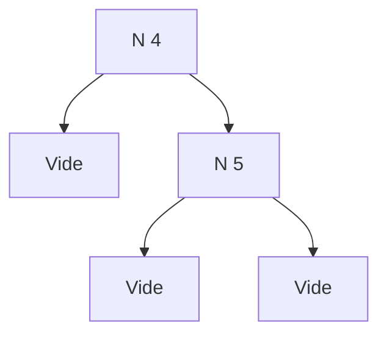
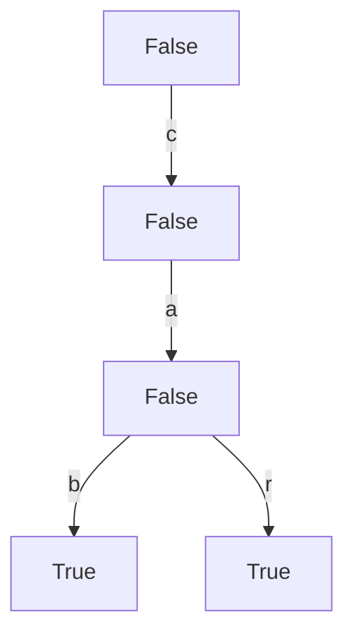

# C4 — Structures arborescentes

[⬅ Cours](../README.md) · [Démonstrations ➡](demonstrations.md) · [Code](code/) · TD : [TD4](../../02-TD-TP/TD4-Arbres-tournois/enonce.md)

## 🎯 Objectifs

1. Définir un **type algébrique** (`data`) et le parcourir par filtrage de motif.
2. Traduire un type algébrique en **Python objet**.
3. Exprimer une **propriété de bonne formation** (invariant de structure).
4. Prouver une fonction sur un arbre (variant : `taille`, `hauteur`, nombre d'éléments).

## 💡 L'idée

> Les arbres sont partout : systèmes de fichiers, interfaces graphiques, documents (HTML, Markdown, LaTeX), code source (syntaxe abstraite), structures de données (ensembles, files de priorité).
> En Haskell, on les décrit par des **types algébriques** : une liste de **constructeurs**.

---

## 1. Types algébriques

```haskell
data ABR = N Int ABR ABR    -- nœud interne : valeur, fils gauche, fils droit
         | Vide             -- feuille
```

`N` et `Vide` sont des **constructeurs**. Exemple : `N 4 Vide (N 5 Vide Vide)`



Les **listes** sont un cas particulier : `data Liste a = Cons a (Liste a) | LVide`, et `Cons 1 (Cons 2 LVide)` correspond à `1 : 2 : []`.

## 2. Filtrage de motif sur un arbre

Un **motif** est un terme avec des variables (une seule occurrence chacune) et des `_` pour ce qui ne sert pas.

```haskell
estElement :: Int -> ABR -> Bool
estElement _ Vide = False
estElement k (N p t1 t2) | k == p    = True
                         | k < p     = estElement k t1
                         | otherwise = estElement k t2
```

```text
estElement 5 (N 4 Vide (N 5 Vide Vide)) = estElement 5 (N 5 Vide Vide) = True
```

## 3. ⭐ Traduction en Python objet

| Haskell | Python |
|---|---|
| le type `ABR` | une **classe abstraite** `ABR` |
| chaque constructeur (`N`, `Vide`) | une **sous-classe** qui hérite de `ABR` |
| chaque argument du constructeur | un **attribut** |
| chaque fonction sur `ABR` | une **méthode** redéfinie dans chaque sous-classe |
| appel récursif sur un sous-arbre | appel de méthode sur un attribut |

```python
class ABR:
    def estElement(self, k: int) -> bool:
        pass

class Vide(ABR):
    def estElement(self, k: int) -> bool:
        return False

class N(ABR):
    def __init__(self, n: int, fg: ABR, fd: ABR):
        self.valeur = n
        self.fils_gauche = fg
        self.fils_droit = fd

    def estElement(self, k: int) -> bool:
        p = self.valeur
        return k == p or (k < p and self.fils_gauche.estElement(k)) \
                      or (k > p and self.fils_droit.estElement(k))

v = Vide()
t = N(5, N(3, v, v), v)
```

## 4. Ensembles et multi-ensembles

| | Ensembles `{a}` | Multi-ensembles `{\|a\|}` (avec répétitions) |
|---|---|---|
| vide | `∅`, `{}` | `∅`, `{\|\|}` |
| singleton | `{k}` | `{\|k\|}` |
| union, intersection, différence | `∪`, `∩`, `\` | `⊔`, `⊓`, `−` |
| appartenance, inclusion | `∈`, `⊆`, `⊂` | `∈`, `⊆`, `⊂` |

## 5. Invariant de structure : l'ABR bien formé

Ensemble représenté par un arbre :

```text
⟦Vide⟧      = ∅
⟦N k t1 t2⟧ = {k} ∪ ⟦t1⟧ ∪ ⟦t2⟧
```

> **bienFormé(t)** : pour tout sous-arbre `N k t1 t2` de `t`, tout élément de `⟦t1⟧` est `< k` et tout élément de `⟦t2⟧` est `> k`.

C'est cette propriété qui rend la recherche **rapide** (on ne descend que d'un côté) et qui sert de **pré-condition** aux fonctions.

## 6. Deux autres exemples du cours

### Formules de la logique propositionnelle (syntaxe abstraite)

```haskell
data Prop = Var String | Vrai | Faux
          | Et Prop Prop | Ou Prop Prop | Non Prop
type Valuation = [(String, Bool)]    -- liste associative : variable ↦ booléen
```

| Fonction | Rôle | Pré-condition |
|---|---|---|
| `taille p` | nombre de symboles (sert de **variant**) | aucune |
| `eval val p` | valeur de vérité de `p` | `vars p ⊆ dom val` |
| `pousseNeg p b` | pousse les négations vers les feuilles (`b` : « une négation est en attente ») | aucune |

Code complet : [Logique.hs](code/Logique.hs) · [logique.py](code/logique.py) (version corrigée et testée).

### Arbres préfixes (ensembles de mots)

```haskell
data ArbrePrefixe = Choix Bool [(Char, ArbrePrefixe)]
```

Dans `Choix b l` : `b` dit si le **mot vide** est dans l'ensemble ; `l` associe à chaque lettre `c` l'arbre des **suites** des mots commençant par `c`. Arbre contenant `"cab"` et `"car"` :



```haskell
estElement :: ArbrePrefixe -> String -> Bool
estElement (Choix True _) []     = True
estElement (Choix _ l)    (c:cs) | estAssocie l c = estElement (trouve l c) cs
                                 | otherwise      = False
estElement _ _ = False
```

> ℹ️ Le transparent écrit `trouve c l` : d'après le type `trouve :: [(Char, ArbrePrefixe)] -> Char -> ArbrePrefixe`, il faut `trouve l c`.

---

## 7. ⭐ Prouver sur un arbre

| Élément | Sur les arbres |
|---|---|
| Variant | `taille t`, `hauteur t`, ou nombre d'éléments de `⟦t⟧` |
| Cas | **un cas par constructeur** (puis par garde) |
| HI | s'applique aux **sous-arbres** (leur variant est plus petit) |
| Pré de l'appel récursif | souvent : « le sous-arbre est bien formé » (car `t` l'est) |

Propriétés prouvées dans les [démonstrations](demonstrations.md) :
1. Si `bienFormé(t)` : `estElement a t = True` **ssi** `a ∈ ⟦t⟧`.
2. `pousseNeg p b` garde les mêmes variables et vaut `not (eval val p)` si `b`, `eval val p` sinon.

---

## ⚠️ Pièges

| Piège | Correction |
|---|---|
| Oublier un constructeur dans une fonction ou une preuve | un cas **par constructeur** |
| Python : oublier `()` → `return Faux` | `return Faux()` (on crée un objet) |
| Python : `&&`, `\|\|` | `and`, `or` |
| Appliquer l'HI sans vérifier que le sous-arbre est bien formé | la pré-condition se **transmet** aux sous-arbres : il faut le dire |

## ✅ À retenir

> Type algébrique = constructeurs. **Haskell → Python** : type → classe abstraite, constructeur → sous-classe, argument → attribut, fonction → méthode.

## 🧪 Auto-test

1. Écris `taille :: ABR -> Int` (nombre de nœuds `N`).
2. Pourquoi `N 5 (N 7 Vide Vide) Vide` n'est-il pas bien formé ?

<details><summary>▶ Réponses</summary>

1. `taille Vide = 0` ; `taille (N _ t1 t2) = 1 + taille t1 + taille t2`.
2. `7 ∈ ⟦t1⟧` mais `7 > 5` : un élément du fils gauche doit être `< 5`.

</details>
