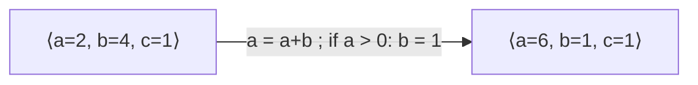
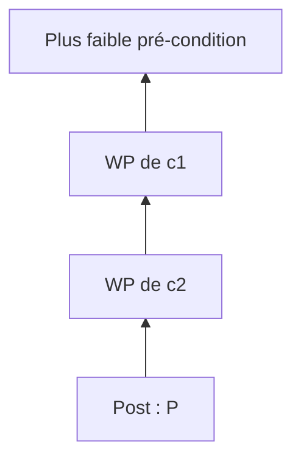
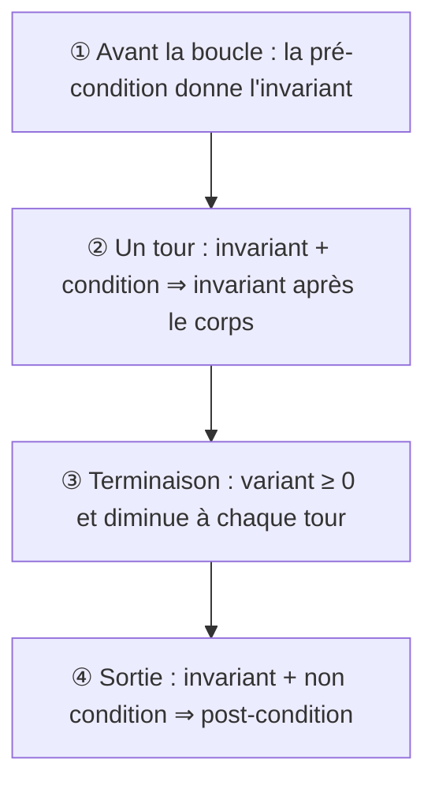

# C5 — Raisonner sur les programmes impératifs

[⬅ Cours](../README.md) · [Démonstrations ➡](demonstrations.md) · TD : [TD5](../../02-TD-TP/TD5-Programmes-imperatifs/enonce.md)

## 🎯 Objectifs

1. Voir une commande comme une **fonction sur les environnements**.
2. Calculer la **plus faible pré-condition** (WP) d'un code sans boucle.
3. Prouver une boucle `while` avec un **variant** et un **invariant**.

## 💡 L'idée

> Tout ce qu'on a vu sur les fonctions récursives **se transpose** : une boucle `while` **est** une fonction récursive terminale. Ses arguments sont les variables, sa pré/post-condition commune est l'**invariant**.

---

## 1. Le langage étudié

Un sous-ensemble de Python : **valeurs** booléens et nombres ; **instructions** affectation, séquence, `if/else`, `while`.

## 2. Commandes = fonctions sur les environnements

> Un **environnement** associe des valeurs aux variables : `⟨a = 2, b = 4, c = 1⟩`.



Pré- et post-conditions deviennent des **propriétés d'environnement** (relations entre variables).
Ex. : `b % a = 0 ⇒ c = 3` est vraie pour `⟨a=2, b=4, c=3⟩` et `⟨a=3, b=7, c=8⟩`, fausse pour `⟨a=5, b=20, c=7⟩`.

---

## 3. ⭐ La plus faible pré-condition (Dijkstra)

> **WP(commande, Post)** = la condition **nécessaire et suffisante** avant la commande pour que `Post` soit vraie après.
> On la calcule **de bas en haut** (on remonte le code).

| Commande | Plus faible pré-condition de `P` |
|---|---|
| `x = e` | `P` où l'on **remplace `x` par `e`** : `P(e)` |
| `c1` puis `c2` | `WP(c1, WP(c2, P))` — on remonte instruction par instruction |
| `if e: c1 else: c2` | `(e et WP(c1, P)) ou (non e et WP(c2, P))` |



### Exemple 1 : séquence d'affectations (lire de bas en haut)

```python
# b divise a+1        <- résultat
a = a + 1
# b divise a
c = a
# b divise c
a = b
# a divise c
b = c
# a divise b          <- post-condition
```

### Exemple 2 : conditionnelle

```python
# (a % 2 == 0 et a+4 pair) ou (a % 2 != 0 et a+1 pair)   <- toujours vrai !
if a % 2 == 0:
    # a + 4 pair
    a = a + 4
    # a pair
else:
    # a + 1 pair
    a = a + 1
    # a pair
# a pair
```

Conclusion : après ce code, `a` est **toujours** pair.

> **Prouver un code sans boucle** = montrer que la pré-condition donnée **implique** la WP calculée.

---

## 4. Boucles `while` = fonctions récursives

```python
while cond:
    corps
```

```haskell
whileForm :: (a1, …, an) -> (a1, …, an)
whileForm (x1, …, xn) | cond      = whileForm (corps (x1, …, xn))
                      | otherwise = (x1, …, xn)
```

Version générique : `while cond corps env | cond env = while cond corps (corps env) | otherwise = env`.

| Fonction récursive | Boucle `while` |
|---|---|
| arguments | variables (l'environnement) |
| variant | **variant** de boucle : diminue à chaque tour |
| pré-condition = post-condition (même propriété) | **invariant** |
| cas d'arrêt | condition de boucle **fausse** |

---

## 5. ⭐ Prouver une boucle : les 4 obligations

```text
# Pré-condition
initialisation
# ① Pré ⇒ WP(initialisation, Invariant)
while cond:
    # ② Invariant et cond ⇒ WP(corps, Invariant)
    # ③ Variant ≥ 0 et strictement décroissant
    corps
# ④ Invariant et non cond ⇒ WP(finalisation, Post)
finalisation
# Post-condition
```



### Comment montrer que le variant diminue ?

On prend une **variable fraîche** `a` et on calcule `WP(corps, variant = a)`. Si on obtient « `variant = a + quelque chose > 0` au début », le variant **diminue**.

```python
# n = a et i = b - 1      <- au début, variant n-i+1 = a-b+2
res = res * i
# n = a et i + 1 = b
i = i + 1
# n = a et i = b          <- à la fin, variant = a-b+1 : il a baissé de 1 ✅
```

### Bien choisir l'invariant

L'invariant doit être **assez fort** pour donner la post-condition à la sortie. On y ajoute souvent une **borne** :

| Programme | Invariant | Partie « borne » | Elle sert à conclure |
|---|---|---|---|
| factoriel | `res = (i−1)!` et `n − i + 1 ≥ 0` | `n − i + 1 ≥ 0` | `i > n` et `i ≤ n+1` ⇒ `i = n+1` ⇒ `res = n!` |
| exponentiation rapide | `rem × resⁱ = aⁿ` et `i > 0` | `i > 0` | `i ≤ 1` et `i > 0` ⇒ `i = 1` ⇒ `rem × res = aⁿ` |

Les deux exemples entièrement rédigés : [démonstrations](demonstrations.md). Modèle de rédaction : [F4 Méthode des boucles](../../04-Fiches-revision/F4-Methode-boucles.md).

---

## ⚠️ Pièges

| Piège | Correction |
|---|---|
| Calculer la WP de **haut en bas** | toujours de **bas en haut** |
| Remplacer `x` par `e` **avant** l'affectation | on remplace dans la propriété **d'après** |
| Oublier un cas du `if` | `(e et Q1) ou (non e et Q2)` |
| Invariant sans borne | impossible de conclure `i = n+1` à la sortie |
| Utiliser la condition de boucle dans ④ | à la sortie, c'est sa **négation** qui est vraie |

## ✅ À retenir

> **Sans boucle** : WP de bas en haut, puis `Pré ⇒ WP`.
> **Avec boucle** : ① initialisation ② conservation ③ terminaison ④ sortie.

## 🧪 Auto-test

Calcule la plus faible pré-condition de `x > 10` pour :

```python
y = x * 2
if y > 8:
    x = y + 1
else:
    x = 0
```

<details><summary>▶ Réponse</summary>

- Branche `if` : `WP(x = y+1, x > 10)` = `y + 1 > 10` = `y > 9`.
- Branche `else` : `WP(x = 0, x > 10)` = `0 > 10` = faux.
- `if` : `(y > 8 et y > 9) ou (y ≤ 8 et faux)` = `y > 9`.
- `y = x*2` : `2x > 9`, c'est-à-dire `x ≥ 5` (entiers).

</details>
