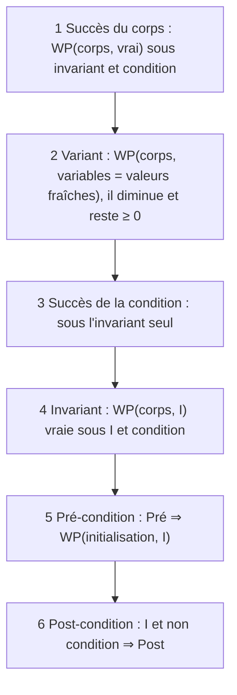

# C6 — Programmes impératifs avec tableaux

[⬅ Cours](../README.md) · [Démonstrations ➡](demonstrations.md) · TD : [TD6](../../02-TD-TP/TD6-Tableaux/enonce.md)

## 🎯 Objectifs

1. Garantir qu'une commande **réussit** (pas de division par 0, pas d'indice hors du tableau…).
2. Calculer les conditions de succès d'une expression avec `and` / `or` **paresseux**.
3. Raisonner sur un tableau **modifié** (`l[i → v]`, `val(l)`).
4. Appliquer la méthode complète en **6 étapes** (format du TD6 et du DS).

## 💡 L'idée

> Jusqu'ici, « réussir » voulait dire « terminer ». Mais une commande peut aussi **planter** : `a/b` avec `b = 0`, `sqrt(c)` avec `c < 0`, `l[i]` hors limites. On ajoute donc à la WP les **conditions de succès**.

---

## 1. Rappel : propriétés d'une commande

Une propriété = une relation entre les valeurs des variables, **à un point précis** du code. On veut : si la pré-condition est vraie avant, alors la commande **réussit** et la post-condition est vraie après.

## 2. ⭐ WP avec conditions de succès

| Commande | Plus faible pré-condition de `P` |
|---|---|
| `x = e` | `P(e)` **ET** `e` ne plante pas |
| `if e: c1 else: c2` | `((e et Q1) ou (non e et Q2))` **ET** `e` ne plante pas |
| `l[i] = e` | `P(l[i → e])` **ET** `0 ≤ i < len(l)` **ET** `e` ne plante pas |

(`Q1`, `Q2` : WP de `P` à travers `c1`, `c2`, en incluant leur succès.)

| Expression | Réussit ssi |
|---|---|
| `a / b`, `a // b`, `a % b` | `b ≠ 0` |
| `sqrt(x)` | `x ≥ 0` |
| `log(x)` | `x > 0` |
| `l[i]` | `0 ≤ i < len(l)` (on ignore les indices négatifs de Python) |

### Exemple

```python
# (sqrt(c) > 2 et a/b > c et a/b + b != 0 et b != 0
#   ou sqrt(c) <= 2 et log(b) > c et log(b) + b != 0 et b > 0)
# ET c >= 0
if sqrt(c) > 2:
    # a/b > c  et  a/b + b != 0  ET  b != 0
    a = a / b
    # a > c  et  a + b != 0
else:
    # log(b) > c  et  log(b) + b != 0  ET  b > 0
    a = log(b)
    # a > c  et  a + b != 0
# a > c  et  a + b != 0
```

## 3. `and` / `or` sont paresseux

Ils évaluent **d'abord la gauche**, et la **droite seulement si nécessaire** :
- `e1 and e2` : si `e1` est faux, `e2` n'est **pas** évalué ;
- `e1 or e2` : si `e1` est vrai, `e2` n'est **pas** évalué.

Ainsi `x != 0 and y/x > 42` **réussit toujours**.

| Expression | Réussit ssi (P1, P2 : succès de e1, e2) |
|---|---|
| `e1 and e2` | `P1` et (`non e1` ou `P2`) |
| `e1 or e2` | `P1` et (`e1` ou `P2`) |

**Exemples**

| Expression | Condition de succès |
|---|---|
| `log(x) > 0 and y/x <= 17` | `x > 0` et (`log(x) ≤ 0` ou `x ≠ 0`) ⇔ `x > 0` |
| `sqrt(x) < 20 or x > 10 and 45/x < 1` | `x ≥ 0` et (`sqrt(x) < 20` ou `x ≤ 10` ou `x ≠ 0`) |

## 4. Succès d'une boucle

- Le **corps** réussit, sous l'hypothèse **invariant + condition vraie**.
- La **condition** réussit, sous l'hypothèse **invariant** seul.

---

## 5. Tableaux

| Opération | Exemple | Condition |
|---|---|---|
| Lecture | `a = l[i] * 2` | `0 ≤ i < len(l)` |
| Écriture | `l[i] = x * 45` | `0 ≤ i < len(l)` |
| Les deux | `l[i] = l[i-1] + l[i-2]` | les **trois** indices valides |

**Notations**

| Notation | Sens |
|---|---|
| `l[i1 → v1, …, ik → vk]` | le tableau `l` où la case `i1` vaut `v1`, …, la case `ik` vaut `vk` |
| `val(l)` | le **multi-ensemble** des valeurs de `l` (pour dire « mêmes éléments ») |

> 🔑 **WP d'une écriture** : pour avoir `P(l)` après `l[i] = e`, il faut `P(l[i → e])` avant.

---

## 6. ⭐ La méthode complète en 6 étapes

C'est **l'ordre exact des questions du TD6 et du DS**.



> 💡 Une fois l'étape 1 faite, on peut calculer les autres WP **sans se soucier des erreurs**.

## 7. Exemples du cours

### Plus petit indice du minimum

```python
i = 0
res = 0
while i < len(l):
    if l[res] > l[i]:
        res = i
    i = i + 1
```

| | |
|---|---|
| **Pré** | `len(l) > 0` |
| **Variant** | `len(l) − i` |
| **Invariant** | `0 ≤ i ≤ len(l)`, `0 ≤ res ≤ i`, `res < len(l)` et `ind_min(l, i, res)` |
| **Post** | `ind_min(l, len(l), res)` |

avec `ind_min(l, i, res)` : pour tout `k ∈ [0, i−1]`, `l[k] ≥ l[res]` et (`l[k] = l[res]` ⇒ `k ≥ res`).

### Tri par insertion en place

```python
def insertion(l, i):                      def tri_insertion(l):
    j = i                                     i = 0
    while j > 0 and l[j-1] > l[j]:            while i < len(l):
        v = l[j]                                  insertion(l, i)
        l[j] = l[j-1]                             i = i + 1
        l[j-1] = v
        j = j - 1
```

| | `insertion(l, i)` | `tri_insertion(l)` |
|---|---|---|
| **Pré** | `i < len(l)`, `l[0..i−1]` trié, `val(l) = m` | `val(l) = m` |
| **Variant** | `j` | `len(l) − i` |
| **Invariant** | `0 ≤ j ≤ i < len(l)` ; trié sauf en `j` ; `l[j] < l[k]` pour `j < k ≤ i` ; `val(l) = m` | `0 ≤ i ≤ len(l)` ; `l[0..i−1]` trié ; `val(l) = m` |
| **Post** | `l[0..i]` trié, `val(l) = m` | `l` trié, `val(l) = m` |

Preuves complètes : [démonstrations](demonstrations.md).

---

## ✅ À retenir (bilan du module)

| Notions | Méthodes |
|---|---|
| pré-condition, post-condition | prouver une fonction par induction sur un variant simple |
| variant : terminaison + raisonnement par induction | programmer récursivement des algorithmes simples |
| invariant de boucle | analyser une boucle : variant + invariant |
| structures arborescentes | calculer une WP sans boucle à partir d'une post-condition |

**Pour aller plus loin** : les **logiques de séparation** étendent ces raisonnements aux programmes qui manipulent la mémoire, aux programmes concurrents, probabilistes… et des outils prouvent automatiquement des programmes. Le **typage** est la forme de spécification la plus simple et la plus utile (Haskell, OCaml, Rust, Ada…).

## 🧪 Auto-test

1. Condition de succès de `i < len(l) and l[i] > 0` ?
2. WP de `l[0] ≤ l[1]` à travers `l[1] = l[0] + 1` ?

<details><summary>▶ Réponses</summary>

1. `i < len(l)` réussit toujours ; donc : `i ≥ len(l)` ou `0 ≤ i < len(l)`, c'est-à-dire `i ≥ 0` (en ignorant les indices négatifs).
2. `l' = l[1 → l[0]+1]` : `l'[0] ≤ l'[1]` devient `l[0] ≤ l[0] + 1` (toujours vrai), ET succès : `0 ≤ 1 < len(l)` et `0 < len(l)`, soit `len(l) ≥ 2`.

</details>
