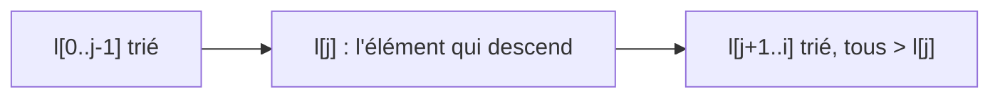

# C6 — Démonstrations : minimum et tri par insertion

[⬅ Cours C6](README.md) · Méthode : [F4](../../04-Fiches-revision/F4-Methode-boucles.md)

---

## 1. Plus petit indice de la valeur minimale

```python
i = 0
res = 0
while i < len(l):
    if l[res] > l[i]:
        res = i
    i = i + 1
```

**Invariant** : (I1) `0 ≤ i ≤ len(l)`, `0 ≤ res ≤ i`, `res < len(l)` ; (I2) `ind_min(l, i, res)` : pour tout `k` avec `0 ≤ k ≤ i−1`, (I21) `l[k] ≥ l[res]` et (I22) `l[k] = l[res]` ⇒ `k ≥ res`.

### 1. Succès du corps

```python
# 0 ≤ res < len(l)  et  0 ≤ i < len(l)
if l[res] > l[i]:
    res = i
i = i + 1
# vrai
```

Conséquences directes de I1 et de la condition `i < len(l)`. ✅

### 2. Variant `len(l) − i`

```python
# i + 1 = a
if l[res] > l[i]:
    res = i
i = i + 1
# i = a
```

Le variant passe de `len(l) − a + 1` à `len(l) − a` : il diminue. Il est ≥ 0 car `i ≤ len(l)` (I1). ✅

### 3. Succès de la condition

`i < len(l)` réussit toujours. ✅

### 4. Invariant

```python
# (l[res] > l[i]  et  0 ≤ i < len(l)  et  ind_min(l, i+1, i))
#   ou (l[res] ≤ l[i]  et  0 ≤ i+1 ≤ len(l), 0 ≤ res ≤ i+1, res < len(l)  et  ind_min(l, i+1, res))
if l[res] > l[i]:
    res = i
# 0 ≤ i+1 ≤ len(l), 0 ≤ res ≤ i+1, res < len(l)  et  ind_min(l, i+1, res)
i = i + 1
# 0 ≤ i ≤ len(l), 0 ≤ res ≤ i, res < len(l)  et  ind_min(l, i, res)
```

Hypothèses : (CB) `i < len(l)`, I1, I2. Les bornes viennent de CB et I1.

- **C1 `l[res] > l[i]`** : il faut `ind_min(l, i+1, i)`. Pour `k ≤ i−1` : `l[k] ≥ l[res] > l[i]` (I21, C1), donc `l[k] > l[i]` ; et pour `k = i` : `l[i] ≥ l[i]`. Le seul `k` avec `l[k] = l[i]` est `k = i ≥ i`. ✅
- **C2 `l[res] ≤ l[i]`** : il faut `ind_min(l, i+1, res)`. Pour `k ≤ i−1` : c'est I2. Pour `k = i` : `l[i] ≥ l[res]` (C2) et `i ≥ res` (I1). ✅

### 5. Pré-condition

```python
# 0 ≤ 0 ≤ len(l)  et  0 < len(l)  et  ind_min(l, 0, 0)
i = 0
res = 0
```

`0 < len(l)` est la pré-condition ; `ind_min(l, 0, 0)` porte sur les `k` avec `0 ≤ k ≤ −1` : **il n'y en a aucun**, c'est vrai. ✅

### 6. Post-condition

À la sortie : `i ≥ len(l)` et `i ≤ len(l)` (I1) ⇒ `i = len(l)`. Donc I2 donne `ind_min(l, len(l), res)`. ✅

---

## 2. Insertion en place

```python
j = i
while j > 0 and l[j-1] > l[j]:
    v = l[j]
    l[j] = l[j-1]
    l[j-1] = v
    j = j - 1
```

`pseudo_tri(l, i, j)` :
- (a) pour tous `0 ≤ k1 < k2 ≤ i` avec `k1 ≠ j` et `k2 ≠ j` : `l[k1] ≤ l[k2]` (trié **en ignorant** la case `j`) ;
- (b) pour tout `j < k ≤ i` : `l[j] < l[k]` (la valeur en `j` est plus petite que tout ce qui est à sa droite).

**Invariant** : (I1) `0 ≤ j ≤ i` et `0 ≤ i < len(l)` ; (I2) `pseudo_tri(l, i, j)` ; (I3) `val(l) = m`.



### 1. Succès du corps

Il faut `0 ≤ j−1` et `j < len(l)` : `j > 0` par la condition, `j ≤ i < len(l)` par I1. ✅

### 2. Variant `j`

WP de `j = a` à travers le corps : `j − 1 = a`. Le variant passe de `a + 1` à `a` ; il est ≥ 0 par I1. ✅

### 3. Succès de la condition

`j > 0 and l[j-1] > l[j]` : si `j ≤ 0`, la droite n'est pas évaluée ; sinon `0 ≤ j−1` et `j ≤ i < len(l)` (I1). ✅

### 4. Invariant

Notons `l' = l[j−1 → l[j], j → l[j−1]]` (l'échange). La WP de l'invariant est : `0 ≤ j−1 ≤ i < len(l')`, `pseudo_tri(l', i, j−1)`, `val(l') = m`.

> ℹ️ Les notes d'origine écrivent `l[j-1 -> l[i], …]` : c'est une coquille, la valeur placée en `j−1` est `v = l[j]`.

Hypothèses : I1, I2, I3, (CB1) `j > 0`, (CB2) `l[j−1] > l[j]`.

- **Bornes** : `len(l') = len(l)` ; `j−1 ≥ 0` (CB1) ; `j−1 ≤ i` (I1). ✅
- **`val(l') = m`** : un échange ne change pas les valeurs (I3). ✅
- **(a) pour `l'` en ignorant `j−1`** : prenons `k1 < k2`, tous deux `≠ j−1`.
  - aucun n'est `j` : cases inchangées, I2(a). ✅
  - `k1 = j` : `l'[j] = l[j−1] ≤ l[k2]` par I2(a) (`j−1` et `k2` sont `≠ j`). ✅
  - `k2 = j` : alors `k1 < j−1`, et `l'[k1] = l[k1] ≤ l[j−1] = l'[j]` par I2(a). ✅
- **(b) `l'[j−1] < l'[k]` pour `j−1 < k ≤ i`** : `l'[j−1] = l[j]`.
  - `k = j` : `l'[j] = l[j−1] > l[j]` (CB2). ✅
  - `k > j` : `l'[k] = l[k] > l[j]` par I2(b). ✅

### 5. Pré-condition

WP à travers `j = i` : `pseudo_tri(l, i, i)`, bornes, `val(l) = m`. Avec la pré-condition (P1) `0 ≤ i < len(l)`, (P2) `l[0..i−1]` trié, (P3) `val(l) = m` :
- (a) en ignorant `i` : c'est P2 ;
- (b) aucun `k` avec `i < k ≤ i` : vrai. ✅

### 6. Post-condition : `l[0..i]` trié

À la sortie : `j ≤ 0` **ou** `l[j−1] ≤ l[j]`. Prenons `0 ≤ k1 < k2 ≤ i`.

- **C1 `j = 0`** : si `k1 ≠ 0`, I2(a) ; si `k1 = 0 = j`, I2(b) donne `l[0] < l[k2]`. ✅
- **C2 `j > 0` et `l[j−1] ≤ l[j]`** :
  - ni `k1` ni `k2` n'est `j` : I2(a) ;
  - `k1 = j` : I2(b) ;
  - `k2 = j`, `k1 = j−1` : C2 ;
  - `k2 = j`, `k1 < j−1` : `l[k1] ≤ l[j−1] ≤ l[j]` (I2(a) puis C2). ✅

`val(l) = m` par I3. ✅
