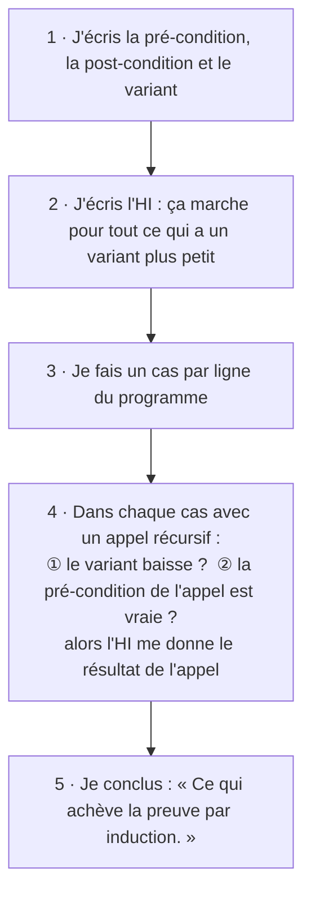

# Chapitre 1 — Prouver qu'un programme est correct

[🏠 Accueil](../../00-Commencer-ici.md) · Suite : [Exemples corrigés ➡](2-Exemples-corriges.md) · S'entraîner : [TD1](../../02-TD-TP/TD1-Induction-numerique/1-Enonce.md)

## ⏱️ Le chapitre en 30 secondes

1. Un programme peut **avoir l'air juste** et être faux.
2. On écrit d'abord **ce qu'il doit faire** : c'est la **spécification**.
3. Puis on le **démontre**, une fois pour toutes, avec l'**induction**.

---

## 🎬 Pour commencer : 4 programmes, 2 menteurs

Ces 4 fonctions Python disent toutes « je calcule `n!` » (factorielle : `3! = 1 × 2 × 3 = 6`).
On les teste avec `n = 3` :

| Fonction | Départ | Condition | Corps de la boucle | Résultat pour `n = 3` |
|---|---|---|---|---|
| `factoriel1` | `i=0, res=1` | `i <= n` | `i = i+1` puis `res = i*res` | **24** ❌ (elle calcule `(n+1)!`) |
| `factoriel2` | `i=1, res=1` | `i <= n` | `res = i*res` puis `i = i+1` | **6** ✅ |
| `factoriel3` | `i=0, res=1` | `i < n` | `i = i+1` puis `res = res*i` | **6** ✅ |
| `factoriel4` | `i=0, res=1` | `i < n` | `res = res*i` puis `i = i+1` | **0** ❌ (on multiplie par 0 dès le départ) |

> 💡 **Leçon :** inverser deux lignes ou écrire `<` au lieu de `<=` suffit à rendre un programme faux. Un test ne montre qu'**un** cas. Une **preuve** couvre **tous** les cas.

---

## Étape 1 — Lire un programme Haskell

En Haskell, un programme ressemble à une **définition de maths**. Pas de boucle, pas de variable qu'on modifie : une fonction **s'appelle elle-même** sur un cas plus petit.

```haskell
factoriel :: Int -> Int              -- prend un entier, renvoie un entier
factoriel 0 = 1                      -- « la factorielle de 0, c'est 1 »
factoriel n = n * factoriel (n-1)    -- « sinon, c'est n fois la factorielle de n-1 »
```

**Calculer à la main = remplacer, comme en maths :**

```text
factoriel 3 = 3 * factoriel 2
            = 3 * (2 * factoriel 1)
            = 3 * (2 * (1 * factoriel 0))
            = 3 * (2 * (1 * 1))  =  6
```

Les lignes sont essayées **de haut en bas** : la première qui correspond est utilisée.
Les autres notations (`where`, `let`, `` `mod` ``, plusieurs arguments) sont dans la [fiche F1](../../04-Fiches-revision/F1-Haskell-et-Python.md).

### Les « gardes » : un « si / sinon si / sinon »

```haskell
signe :: Int -> Int
signe n | n > 0     = 1        -- si n > 0
        | n < 0     = -1       -- sinon, si n < 0
        | otherwise = 0        -- sinon
```

### 🍬 L'exemple fil rouge : partager des bonbons

> **Situation :** j'ai **23 bonbons** et **5 enfants**. Je fais des tours : à chaque tour, je donne 1 bonbon à chaque enfant (donc 5 bonbons). Je m'arrête quand il reste **moins de 5** bonbons.
> Résultat : **4 tours** (le quotient) et **3 bonbons restants** (le reste). C'est la **division euclidienne** : `23 = 4 × 5 + 3`.

```haskell
division :: Int -> Int -> (Int, Int)        -- renvoie (quotient, reste)
division a b | a < b     = (0, a)            -- moins de b bonbons : 0 tour, tout reste
             | otherwise = incr1 (division (a-b) b)   -- je fais un tour, puis je recommence

incr1 :: (Int, Int) -> (Int, Int)
incr1 (q, r) = (q+1, r)                      -- un tour de plus, même reste
```

| Appel | Bonbons restants | Ce qui se passe |
|---|---|---|
| `division 23 5` | 23 | 23 ≥ 5 : un tour, puis on continue avec 18 |
| `division 18 5` | 18 | un tour, on continue avec 13 |
| `division 13 5` | 13 | un tour, on continue avec 8 |
| `division 8 5` | 8 | un tour, on continue avec 3 |
| `division 3 5` | 3 | 3 < 5 : **stop**, résultat `(0, 3)` |
| on remonte | | `incr1` ajoute 1 tour à chaque niveau : `(1,3)`, `(2,3)`, `(3,3)`, **`(4,3)`** |

`(q, r)` est un **couple** (un « tuple ») : une façon de renvoyer deux valeurs à la fois.

---

## Étape 2 — Spécifier : écrire le contrat

### ☕ L'image : la machine à café

> Sur la machine, il est écrit : **« Si vous mettez une capsule et qu'il y a de l'eau, vous obtenez un café. »**
> - « une capsule et de l'eau » : c'est ce que **l'utilisateur** doit garantir → la **pré-condition** ;
> - « vous obtenez un café » : c'est ce que **la machine** garantit → la **post-condition**.
>
> Sans capsule, la machine ne promet **rien**.

### Pour la division

| | En français | En maths |
|---|---|---|
| **Pré-condition** | au moins 0 bonbon, et au moins 1 enfant | `a ≥ 0` et `b > 0` |
| **Post-condition** | on retrouve tous les bonbons, et il en reste moins que d'enfants | avec `(q, r) = division a b` : `a = b × q + r` et `0 ≤ r < b` |

> ❓ **Pourquoi `b > 0` ?** Avec **0 enfant**, on ne donne jamais rien : `a − 0 = a`, le partage ne s'arrête **jamais**. La pré-condition protège contre ce cas.

**Pour la copie, on écrit :** « pour toutes les entrées, **si** la pré-condition est vraie, **alors** la post-condition est vraie ».
En symboles : `∀x. pré(x) ⇒ post(x, f x)` (`∀` se lit « pour tout », `⇒` se lit « implique »).

---

## Étape 3 — L'induction : prouver pour une infinité de cas

On voudrait prouver la spécification pour **toutes** les valeurs de `a` : 0, 1, 2, … jusqu'à l'infini. Impossible de les tester une par une. Il faut un **raisonnement**.

### 🁢 La récurrence (vue au lycée) : les dominos

> 1. Le **premier** domino tombe.
> 2. Chaque domino qui tombe **fait tomber le suivant**.
>
> Donc **tous** les dominos tombent.

### 🧍🧍🧍 L'induction (version du cours) : la file d'attente

> Dans une file, chacun veut savoir **combien de personnes sont devant lui**.
> La règle : « Je regarde la personne juste devant moi : je prends **sa** réponse et j'ajoute 1. »
> - La **première** personne n'a personne devant elle : elle répond **0** toute seule.
> - Toutes les autres s'appuient sur des personnes **placées avant elles**.
>
> Donc **tout le monde** a sa réponse.

**L'induction, c'est exactement ça :**

> « Je **suppose** que la propriété est vraie pour **tous les cas plus petits** que `n`.
> Avec ça, je montre qu'elle est vraie pour `n`. »

La supposition s'appelle l'**hypothèse d'induction** (on écrit **HI**).

| | Récurrence | Induction |
|---|---|---|
| Ce que je suppose | vrai pour `n` | vrai pour **tous** les `k < n` |
| Ce que je montre | vrai pour `n + 1` | vrai pour `n` |
| Le cas 0 | une étape à part (« initialisation ») | un **cas** parmi d'autres, traité sans l'HI |

Les deux méthodes prouvent les mêmes choses. **Dans ce cours, on utilise toujours l'induction.**

### Exemple simple : `0 + 1 + 2 + … + n = n(n+1)/2`

Vérifions d'abord : pour `n = 4`, `0+1+2+3+4 = 10` et `4 × 5 / 2 = 10` ✅.

**Preuve.** HI : la formule est vraie pour tout nombre plus petit que `n`. Deux cas :

- **Cas `n = 0` :** à gauche `0`, à droite `0 × 1 / 2 = 0`. ✅
- **Cas `n ≥ 1` :** je retire le dernier terme. `n − 1` est plus petit que `n`, donc l'HI dit : `0 + … + (n−1) = (n−1)n/2`. Alors :
  `0 + … + (n−1) + n = (n−1)n/2 + n = n(n+1)/2`. ✅

Ce qui achève la preuve par induction. ∎

---

## Étape 4 — Le variant : le compte à rebours

### 🚀 L'image

> Une fusée : **10, 9, 8, …, 1, 0, décollage !** On ne peut pas descendre sous 0, donc le compte à rebours **finit toujours**.

Le **variant** est un nombre qui joue ce rôle pour une fonction :

1. il est **toujours ≥ 0** ;
2. il **baisse** à chaque appel récursif.

**À quoi il sert :**
- il prouve que la fonction **s'arrête** ;
- il permet de faire l'**induction sur lui** : « plus petit » veut dire « variant plus petit ».

| Fonction | Ce qui diminue | Variant |
|---|---|---|
| `division a b` | les bonbons restants (`a` devient `a − b`) | `a` |
| `factoriel n` | `n` devient `n − 1` | `n` |
| une fonction sur une liste (chapitre 2) | la liste raccourcit | la longueur de la liste |
| une fonction sur un arbre (chapitre 4) | on descend dans un sous-arbre | la taille de l'arbre |

---

## Étape 5 — La méthode de preuve, en 5 étapes



> ⚠️ **Le point le plus important : vérifier les DEUX conditions ① et ②.**
> Retour à la machine à café : l'HI est une garantie du type « **si** capsule, **alors** café ».
> Avant d'utiliser le résultat d'un appel récursif, il faut vérifier qu'on lui a bien **donné sa capsule** (sa pré-condition).

👉 La preuve complète de la division, expliquée ligne par ligne : [Exemples corrigés](2-Exemples-corriges.md).

---

## ⚠️ Les erreurs classiques

| Erreur | Ce qu'il faut faire |
|---|---|
| Écrire `factoriel n-1` | c'est lu comme `(factoriel n) - 1` : écrire `factoriel (n-1)` |
| Utiliser l'HI sur `n` lui-même | seulement sur des valeurs **strictement plus petites** |
| Oublier un cas | **un cas par ligne** du programme (`otherwise` compris) |
| Vérifier que le variant baisse, mais pas la pré-condition | vérifier **① et ②** à chaque appel récursif |

## ✅ À retenir

- **Spécification** = pré-condition (ce qu'on suppose) + post-condition (ce qu'on garantit).
- **Variant** = un compte à rebours : un nombre ≥ 0 qui baisse à chaque appel.
- **Induction** = « je suppose que ça marche pour les cas plus petits, je le montre pour `n` ».
- À chaque appel récursif : **① variant ↓ ② pré ✓**, puis on utilise le résultat de l'appel.

## 🧪 Je vérifie que j'ai compris

1. Calcule à la main `division 14 4`.
2. Donne la pré-condition, la post-condition et le variant de `factoriel n`.
3. Pourquoi `factoriel (-1)` ne s'arrête-t-il jamais ?

<details><summary>▶ Réponses</summary>

1. `14 → 10 → 6 → 2` : 3 tours, puis `2 < 4` donne `(0, 2)`. En remontant : `(3, 2)`. Vérification : `14 = 3 × 4 + 2` ✅
2. Pré : `n ≥ 0`. Post : `factoriel n = n!`. Variant : `n`.
3. `-1` ne vaut jamais `0` en descendant : `-1, -2, -3, …` Le compte à rebours ne s'arrête pas, car le variant n'est pas ≥ 0. C'est pour ça que la pré-condition exige `n ≥ 0`.

</details>
