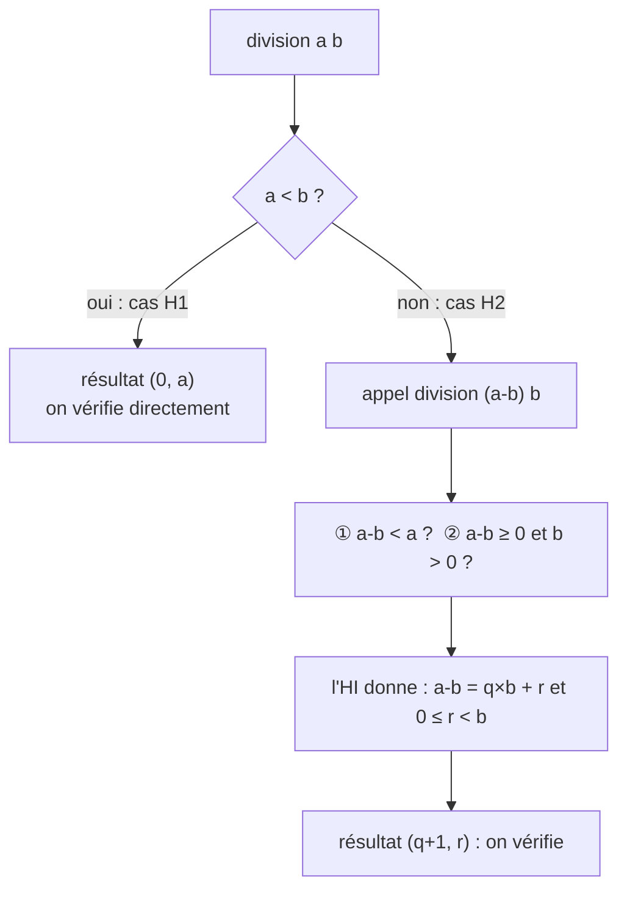

# Chapitre 1 — Exemples corrigés

[⬅ Cours du chapitre 1](1-Cours.md) · [🏠 Accueil](../../README.md) · Suite : [Exercices ➡](3-Exercices.md)

> 🏋️ **Comment utiliser cette page :** lis l'énoncé, **cache la suite**, essaie seule, puis compare.
> Les encadrés **💬 Pourquoi ?** expliquent chaque étape.

---

## Exemple 1 — La factorielle (le plus simple)

```haskell
factoriel :: Int -> Int
factoriel 0 = 1
factoriel n = n * factoriel (n-1)
```

### 1. Le contrat

| | |
|---|---|
| **Pré-condition** | `n ≥ 0` |
| **Post-condition** | `factoriel n = n!` |
| **Variant** | `n` (c'est un entier ≥ 0 grâce à la pré-condition) |

### 2. L'hypothèse d'induction

> **HI :** pour tout `k` tel que `k < n` et `k ≥ 0`, on a `factoriel k = k!`.

> 💬 **Pourquoi ?** On s'autorise à utiliser le résultat pour tous les cas plus petits, comme les personnes devant nous dans la file.

### 3. Les cas (un par ligne du programme)

**Cas `n = 0`** (1ʳᵉ ligne) : `factoriel 0 = 1 = 0!` ✅

**Cas `n ≠ 0`** (2ᵉ ligne) : `factoriel n = n * factoriel (n-1)`. Il y a un appel récursif sur `n − 1`. Je vérifie :

| Vérification | Justification |
|---|---|
| ① le variant baisse : `n − 1 < n` | évident |
| ② la pré-condition de l'appel : `n − 1 ≥ 0` | `n ≥ 0` (pré-condition) et `n ≠ 0` (cas) donc `n ≥ 1` |

> 💬 **Pourquoi ② ?** Si on oubliait `n ≠ 0`, on pourrait appeler `factoriel (-1)`, qui n'est pas couvert par le contrat.

L'HI donne `factoriel (n-1) = (n−1)!`, donc `factoriel n = n × (n−1)! = n!` ✅

**Ce qui achève la preuve par induction.** ∎

---

## Exemple 2 — La division (l'exemple du cours) 🍬

```haskell
incr1 :: (Int, Int) -> (Int, Int)
incr1 (q, r) = (q+1, r)

division :: Int -> Int -> (Int, Int)
division a b | a < b     = (0, a)
             | otherwise = incr1 (division (a-b) b)
```

### 1. Le contrat

| Nom | Propriété | En français |
|---|---|---|
| **Pre1** | `a ≥ 0` | au moins 0 bonbon |
| **Pre2** | `b > 0` | au moins 1 enfant |
| **Post1** | avec `(q, r) = division a b` : `a = q × b + r` | on retrouve tous les bonbons |
| **Post2** | `0 ≤ r < b` | il en reste moins que d'enfants |
| **Variant** | `a` | les bonbons restants (≥ 0 par Pre1) |

> 💬 **Pourquoi nommer chaque propriété (Pre1, Post2…) ?** Pour pouvoir écrire « par Pre2 » dans la preuve : c'est plus clair et le correcteur le valorise.

### 2. L'hypothèse d'induction

> **HI :** pour tous `a'`, `b'` tels que `a' < a`, `a' ≥ 0` et `b' > 0`, en posant `(q', r') = division a' b'`, on a `a' = q' × b' + r'` et `0 ≤ r' < b'`.

### 3. Les cas



#### Cas 1 : `a < b` (on le nomme H1)

Le résultat est `(0, a)`, donc `q = 0` et `r = a`.
- **Post1 :** `a = 0 × b + a` ✅
- **Post2 :** `0 ≤ a` par Pre1, et `a < b` par H1 ✅

> 💬 En bonbons : moins de bonbons que d'enfants, on ne fait aucun tour et tout reste.

#### Cas 2 : `a ≥ b` (on le nomme H2)

Posons `(q, r) = division (a-b) b`. Le résultat est `incr1 (q, r) = (q+1, r)`.

Avant d'utiliser l'HI sur l'appel `division (a-b) b`, **deux vérifications** :

| Vérification | Justification |
|---|---|
| ① le variant baisse : `a − b < a` | car `b > 0` (Pre2) |
| ② la pré-condition de l'appel : `a − b ≥ 0` | car `a ≥ b` (H2) |
| ② la pré-condition de l'appel : `b > 0` | Pre2 |

L'HI donne : `a − b = q × b + r` (Post1') et `0 ≤ r < b` (Post2').

- **Post1 :** `a = (a − b) + b = q × b + r + b = (q + 1) × b + r` ✅
- **Post2 :** `0 ≤ r < b`, c'est Post2' ✅

> 💬 En bonbons : après un tour, il reste `a − b` bonbons. Le partage de ce qui reste donne `q` tours et `r` restants. En comptant le tour déjà fait, on a `q + 1` tours, avec le même reste.

**Ce qui achève la preuve par induction.** ∎

---

## Exemple 3 — À toi : la somme des entiers

```haskell
somme :: Int -> Int
somme 0 = 0
somme n = n + somme (n-1)
```

Prouve : pré `n ≥ 0`, post `somme n = n(n+1)/2`, variant `n`.

<details><summary>▶ Corrigé</summary>

**HI :** pour tout `k < n` avec `k ≥ 0`, `somme k = k(k+1)/2`.

- **Cas `n = 0`** : `somme 0 = 0 = 0 × 1 / 2` ✅
- **Cas `n ≠ 0`** : `somme n = n + somme (n-1)`.
  ① `n − 1 < n` ✅ ② `n − 1 ≥ 0` car `n ≥ 0` et `n ≠ 0` ✅
  L'HI donne `somme (n-1) = (n−1)n/2`, donc `somme n = n + (n−1)n/2 = n(n+1)/2` ✅

Ce qui achève la preuve par induction. ∎

</details>

---

➡ **À toi de jouer :** [Exercices du chapitre](3-Exercices.md) · puis les [corrections](4-Corrections.md).
