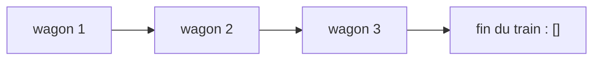
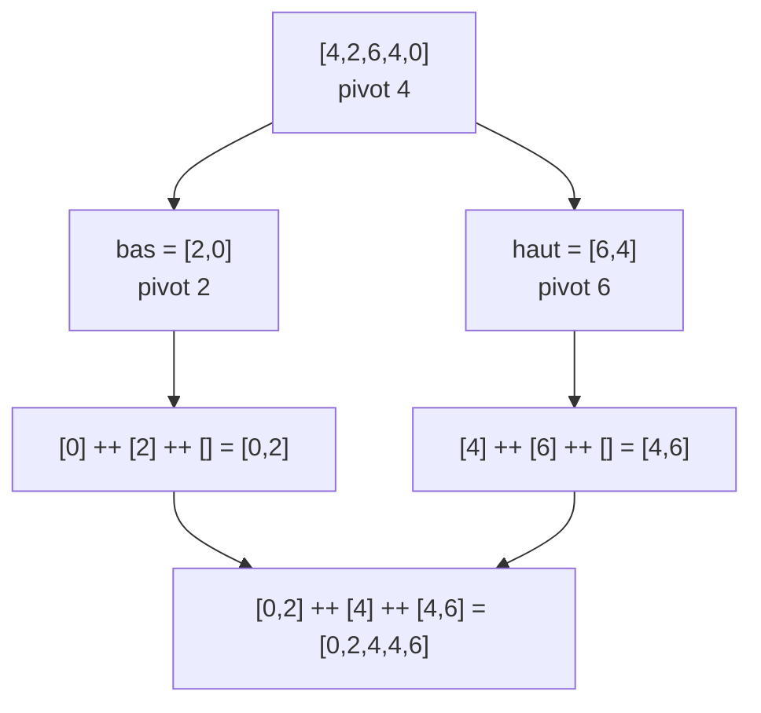

# Chapitre 2 — Les listes

[🏠 Accueil](../../README.md) · Suite : [Exemples corrigés ➡](2-Exemples-corriges.md) · [Exercices](3-Exercices.md) · S'entraîner : [TD2](../../02-TD-TP/TD2-Listes-tri-fusion/1-Enonce.md)

## ⏱️ Le chapitre en 30 secondes

1. Une liste Haskell est comme un **train** : soit vide, soit **un wagon de tête + le reste du train**.
2. Les fonctions sur les listes traitent ces **deux cas**.
3. Les preuves aussi ont **deux cas**, et le variant est la **longueur** de la liste.

---

## Étape 1 — Une liste, c'est un train 🚂

> Imagine un train de wagons numérotés. Depuis le quai, tu ne vois que **le premier wagon**. Pour atteindre le dernier, il faut **traverser tout le train**.



| Haskell | Le train | Exemple |
|---|---|---|
| `[]` | pas de wagon (train vide) | `[]` |
| `x : l` | accrocher le wagon `x` **devant** le train `l` | `1 : [2,3]` donne `[1,2,3]` |
| `[1,2,3]` | raccourci pour `1 : (2 : (3 : []))` | |
| `[Int]` | le type « liste d'entiers » | `String` = liste de caractères |

> 🔑 **Toute liste est de l'une de ces deux formes :** `[]` **ou** `x : l`.

## Étape 2 — Regarder le début du train : les motifs

Un **motif** dit « à quoi doit ressembler le début de la liste » :

| Motif | Veut dire | Sur `[7,8,9]` |
|---|---|---|
| `[]` | le train est vide | ne correspond pas |
| `(x:l)` | au moins 1 wagon | `x = 7`, `l = [8,9]` |
| `(x:y:l)` | au moins 2 wagons | `x = 7`, `y = 8`, `l = [9]` |
| `_` | n'importe quoi | correspond toujours |

### Exemple : « les wagons sont-ils rangés dans l'ordre ? »

On compare les wagons **deux par deux**, comme un contrôleur qui avance dans le train :

```haskell
estOrdonnee :: [Int] -> Bool
estOrdonnee (x:y:l) | x <= y    = estOrdonnee (y:l)   -- ces deux-là sont bien rangés, on avance
                    | otherwise = False               -- deux wagons mal rangés : faux
estOrdonnee _ = True                                  -- 0 ou 1 wagon : forcément rangé
```

```text
estOrdonnee [1,3,2] → 1 ≤ 3, on avance → estOrdonnee [3,2] → 3 ≤ 2 ? non → False
```

## Étape 3 — Compter et accrocher

### Compter les wagons : `length`

> « Le nombre de wagons, c'est **1** (le premier) **+** le nombre de wagons derrière. »

```haskell
length :: [a] -> Int
length []    = 0
length (_:l) = 1 + length l
```

```text
length [7,8,9] = 1 + length [8,9] = 1 + 1 + length [9] = 1 + 1 + 1 + length [] = 3
```

### Accrocher deux trains : `++`

> Pour accrocher le train B **derrière** le train A, il faut **traverser tout le train A** pour trouver son dernier wagon.

```haskell
(++) :: [a] -> [a] -> [a]
[]     ++ l2 = l2                  -- A est vide : le résultat, c'est B
(x:l1) ++ l2 = x : (l1 ++ l2)      -- je garde le 1er wagon de A, j'accroche le reste
```

```text
[1,2] ++ [5,6] = 1 : ([2] ++ [5,6]) = 1 : 2 : ([] ++ [5,6]) = [1,2,5,6]
```

> 🔑 `++` avance dans **la première liste** seulement. Donc, dans les preuves sur `l1 ++ l2`, on raisonne sur **`l1`**.

## Étape 4 — Filtrer une liste (« listes en compréhension »)

> 🎵 « Dans ma playlist, garde les chansons de moins de 3 minutes » s'écrit presque pareil en Haskell :

```haskell
[c | c <- playlist, duree c < 3]
```

| Expression | Résultat |
|---|---|
| `[y \| y <- [5,1,8,3], y < 4]` | `[1,3]` (on garde ceux qui sont < 4) |
| `[x * 2 \| x <- [1,2,3]]` | `[2,4,6]` (on transforme chaque élément) |
| `[(i,j) \| i <- [1,2], j <- [4,5]]` | `[(1,4),(1,5),(2,4),(2,5)]` (toutes les combinaisons) |

## Étape 5 — Un vrai algorithme : le tri rapide

> 📝 **Situation :** un professeur range un paquet de copies par note.
> 1. Il prend **une copie au hasard** : le **pivot** (disons la note 12).
> 2. Il fait **deux tas** : les notes **< 12** à gauche, les notes **≥ 12** à droite.
> 3. Il **range chaque tas** de la même façon.
> 4. Il pose : tas de gauche rangé, puis le pivot, puis tas de droite rangé.

```haskell
triRapide :: [Int] -> [Int]
triRapide []    = []
triRapide (x:l) = triRapide bas ++ [x] ++ triRapide haut
  where bas  = [y | y <- l, y < x]       -- le tas de gauche
        haut = [y | y <- l, x <= y]      -- le tas de droite
```



---

## Étape 6 — Prouver sur les listes

C'est la **même méthode qu'au chapitre 1**. Seuls changent les cas et le variant :

| Étape | Sur les listes |
|---|---|
| Variant | `length l` (le nombre de wagons, toujours ≥ 0) |
| HI | « pour toute liste **plus courte** que `l`, c'est vrai » |
| Cas 1 | `l = []` : on calcule directement |
| Cas 2 | `l = x : l'` : `l'` a **un wagon de moins**, donc on peut utiliser l'HI sur `l'` |

> 🔑 La phrase à écrire dans le cas 2 : « `length l = 1 + length l'`, donc `length l' < length l` : le variant baisse. »

### 🃏 Qu'est-ce qu'un tri « correct » ?

> Tu donnes un jeu de cartes mélangé à quelqu'un pour qu'il le range. Il te rend… **3 cartes bien rangées** : il a jeté les autres !
> Les cartes sont rangées, mais **ce n'est pas un vrai tri**.

Un tri est correct s'il vérifie **deux choses** :
1. le résultat est **trié** ;
2. le résultat contient **exactement les mêmes éléments** que l'entrée. On dit que c'est une **permutation** de l'entrée.

👉 Les preuves complètes (`l ++ [] = l`, la longueur, l'ordre, le tri rapide) : [Exemples corrigés](2-Exemples-corriges.md).

---

## ⚠️ Les erreurs classiques

| Erreur | Ce qu'il faut faire |
|---|---|
| `x ++ l` avec `x` un seul élément | `x : l` (ou `[x] ++ l`) |
| Raisonner sur `l2` pour `l1 ++ l2` | `++` avance dans **`l1`** : variant `length l1` |
| Mettre `estOrdonnee _ = True` en premier | il attraperait tout : l'ordre des lignes compte |
| Pour un tri, prouver seulement « trié » | prouver **aussi** « mêmes éléments » (permutation) |

## ✅ À retenir

- Une liste est `[]` **ou** `x : l` ; donc une preuve a souvent **2 cas**.
- Variant = **longueur** de la liste que la fonction parcourt.
- Tri correct = **trié** + **permutation**.

## 🧪 Je vérifie que j'ai compris

1. Que vaut `[x | x <- [3,8,1,9], x > 2]` ?
2. Calcule `length ([1,2] ++ [3])` en détaillant.
3. Dans `triRapide [5,3,7]`, quels sont `bas` et `haut` ?

<details><summary>▶ Réponses</summary>

1. `[3,8,9]`
2. `[1,2] ++ [3] = [1,2,3]`, puis `length [1,2,3] = 1 + 1 + 1 + 0 = 3`.
3. Pivot `5` : `bas = [3]`, `haut = [7]`. Résultat `[3] ++ [5] ++ [7] = [3,5,7]`.

</details>
