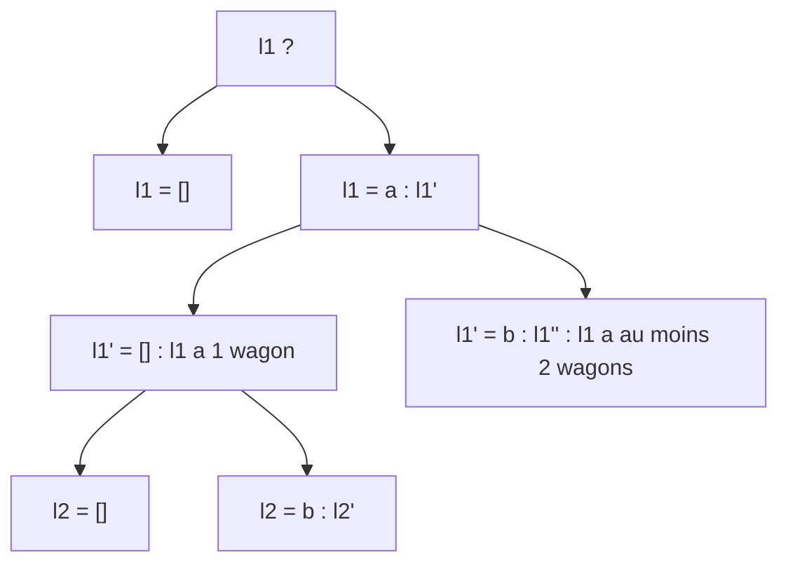

# Chapitre 2 — Exemples corrigés

[⬅ Cours du chapitre 2](1-Cours.md) · [🏠 Accueil](../../README.md) · Suite : [Exercices ➡](3-Exercices.md)

> 🏋️ Lis l'objectif, essaie seule, puis compare. Les exemples vont du **plus facile** au **plus difficile**.

Les définitions utilisées :

```haskell
length []    = 0                    [] ++ l2     = l2
length (_:l) = 1 + length l         (a:l1) ++ l2 = a : (l1 ++ l2)

estOrdonnee (x:y:l) | x <= y    = estOrdonnee (y:l)
                    | otherwise = False
estOrdonnee _ = True
```

---

## Exemple 1 ⭐ — Accrocher un train vide : `l ++ [] = l`

> 💬 En clair : accrocher un « train vide » derrière un train ne change rien.

| | |
|---|---|
| **Objectif** | pour toute liste `l`, `l ++ [] = l` |
| **Variant** | `length l` |
| **HI** | pour toute liste `l'` avec `length l' < length l`, `l' ++ [] = l'` |

**Cas `l = []`** : `[] ++ [] = []` (1ʳᵉ ligne de `++`). ✅

**Cas `l = a : l'`** :
- `(a : l') ++ [] = a : (l' ++ [])` (2ᵉ ligne de `++`)
- ① `length l = 1 + length l'` donc le variant baisse ; ② pas de pré-condition à vérifier.
- L'HI donne `l' ++ [] = l'`, donc `l ++ [] = a : l' = l`. ✅

Ce qui achève la preuve par induction. ∎

---

## Exemple 2 ⭐ — La longueur de deux trains accrochés

> 💬 En clair : un train de 3 wagons accroché à un train de 2 wagons fait 5 wagons.

| | |
|---|---|
| **Objectif** | `length (l1 ++ l2) = length l1 + length l2` |
| **Variant** | `length l1` (car `++` avance dans `l1`) |
| **HI** | pour toute `l1'` plus courte que `l1` (et toute `l2`), l'égalité est vraie |

**Cas `l1 = []`** : `length ([] ++ l2) = length l2 = 0 + length l2 = length [] + length l2`. ✅

**Cas `l1 = a : l1'`** :

```text
length ((a:l1') ++ l2) = length (a : (l1' ++ l2))      définition de ++
                       = 1 + length (l1' ++ l2)        définition de length
                       = 1 + length l1' + length l2    HI (variant ↓)
                       = length l1 + length l2         définition de length
```

Ce qui achève la preuve par induction. ∎

---

## Exemple 3 ⭐⭐ — L'associativité : `l1 ++ (l2 ++ l3) = (l1 ++ l2) ++ l3`

> 💬 En clair : accrocher A à (B+C), ou (A+B) à C, donne le même train.

**Variant** : `length l1`. **HI** : vrai pour toute `l1'` plus courte que `l1`.

| Cas | Côté gauche | Côté droit |
|---|---|---|
| `l1 = []` | `[] ++ (l2 ++ l3) = l2 ++ l3` | `([] ++ l2) ++ l3 = l2 ++ l3` |
| `l1 = a : l1'` | `a : (l1' ++ (l2 ++ l3))` | `(a : (l1' ++ l2)) ++ l3 = a : ((l1' ++ l2) ++ l3)` |

Dans le 2ᵉ cas, l'HI sur `l1'` (le variant baisse) dit que les parenthèses donnent le même résultat : les deux côtés sont égaux. ✅ ∎

---

## Exemple 4 ⭐⭐⭐ — Deux trains rangés, accrochés, restent rangés

> 💬 En clair : wagons 1, 3, 5 (rangés) accrochés devant 6, 8 (rangés) donnent 1, 3, 5, 6, 8 (rangés).
> **Attention :** il faut que les wagons de A soient **tous plus petits** que ceux de B. Sinon, 1, 9 accroché devant 2, 3 donne 1, 9, 2, 3, qui n'est pas rangé !

| | |
|---|---|
| **Pre1** | `l1` est ordonnée |
| **Pre2** | `l2` est ordonnée |
| **Pre3** | chaque élément de `l1` est ≤ chaque élément de `l2` |
| **Post** | `l1 ++ l2` est ordonnée |
| **Variant** | `length l1` |

`estOrdonnee` regarde **deux** wagons à la fois, donc il faut découper en **sous-cas** :



| Cas | Résultat `l1 ++ l2` | Pourquoi c'est ordonné |
|---|---|---|
| `l1 = []` | `l2` | Pre2 |
| `l1 = [a]`, `l2 = []` | `[a]` | un seul wagon |
| `l1 = [a]`, `l2 = b : l2'` | `a : b : l2'` | `a ≤ b` par Pre3, et `l2` ordonnée par Pre2 |
| `l1 = a : b : l1''` | `a : (l1' ++ l2)` | voir ci-dessous |

**Dernier cas, en détail.** On a `estOrdonnee (l1 ++ l2) = (a ≤ b) && estOrdonnee (l1' ++ l2)`.
- `a ≤ b` : vrai car `l1` est ordonnée (Pre1).
- Pour `estOrdonnee (l1' ++ l2)`, on utilise l'HI sur `(l1', l2)` :
  - ① variant : `length l1' < length l1` ✅
  - ② pré-conditions :
    - `l1'` ordonnée : c'est la fin d'un train ordonné ✅
    - `l2` ordonnée : Pre2 ✅
    - éléments de `l1'` ≤ éléments de `l2` : les wagons de `l1'` sont aussi dans `l1` (Pre3) ✅

Les deux morceaux sont vrais, donc `l1 ++ l2` est ordonnée. Ce qui achève la preuve par induction. ∎

> 💡 **Leçon :** la vérification ② (pré-condition de l'appel) peut demander **plusieurs** petits arguments. C'est souvent là que sont les points au DS.

---

## Exemple 5 ⭐⭐⭐ — Le tri rapide est correct

```haskell
triRapide []    = []
triRapide (x:l) = triRapide bas ++ [x] ++ triRapide haut
  where bas  = [y | y <- l, y < x]
        haut = [y | y <- l, x <= y]
```

**Objectif** : (1) `triRapide l` est ordonnée ; (2) `triRapide l` contient les mêmes éléments que `l`.
**Variant** : `length l`.

**Cas `l = []`** : `triRapide [] = []`, qui est ordonnée et contient les mêmes éléments (aucun). ✅

**Cas `l = x : l'`** — on suit le professeur qui range ses copies 📝 :

| Étape | Justification |
|---|---|
| L'HI s'applique au tas `bas` | `bas` est pris dans `l'`, donc `length bas ≤ length l' < length l` |
| L'HI s'applique au tas `haut` | même raison |
| `triRapide bas` est rangé, avec les éléments de `bas` | HI |
| `triRapide haut` est rangé, avec les éléments de `haut` | HI |
| `triRapide bas ++ [x]` est rangé | Exemple 4 : tout ce qui est dans `bas` est `< x` |
| `… ++ triRapide haut` est rangé | Exemple 4 : tout ce qui est dans `haut` est `≥ x` |
| Mêmes éléments que `l` | chaque élément de `l'` va dans `bas` **ou** dans `haut`, et `x` est remis au milieu |

Ce qui achève la preuve par induction. ∎

> 💡 **Leçon :** on **réutilise** une propriété déjà prouvée (l'exemple 4) au lieu de tout refaire.

---

## Exemple 6 — À toi : le tri par insertion 🃏

> C'est la façon dont on range des cartes **dans sa main** : on prend les cartes une par une et on **insère** chacune à sa place.

```haskell
inserer :: Int -> [Int] -> [Int]
inserer k []    = [k]
inserer k (n:l) | k <= n    = k : n : l          -- k se place ici
                | otherwise = n : inserer k l    -- k va plus loin

triInsertion :: [Int] -> [Int]
triInsertion []    = []
triInsertion (n:l) = inserer n (triInsertion l)
```

À prouver :
1. si `l` est ordonnée, alors `inserer k l` est ordonnée et contient les éléments de `k : l` ;
2. `triInsertion l` est ordonnée et contient les mêmes éléments que `l`.

<details><summary>▶ Pistes</summary>

1. Induction sur `length l`. Dans le cas `k > n`, le résultat est `n : inserer k l`. Pour qu'il soit rangé, il faut que **le premier élément** de `inserer k l` soit ≥ `n`. C'est soit `k` (et `k > n`), soit le premier élément de `l` (≥ `n` car `n : l` est rangée).
2. Induction sur `length l`, en utilisant le point 1 pour `inserer n (triInsertion l)`.

</details>

> ✅ La correction complète du point 1 est dans l'[exercice 12](4-Corrections.md).

---

➡ **À toi de jouer :** [Exercices du chapitre](3-Exercices.md) · puis les [corrections](4-Corrections.md).
