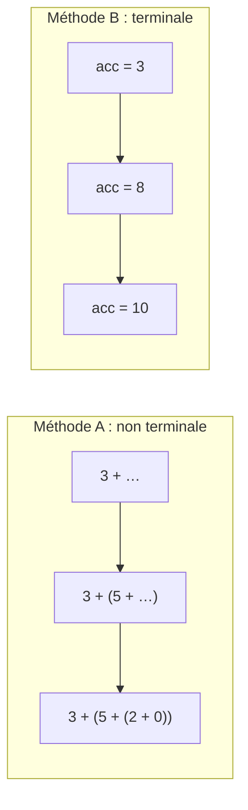

# Chapitre 3 — La récursion terminale

[🏠 Accueil](../../README.md) · Suite : [Exemples corrigés ➡](2-Exemples-corriges.md) · [Exercices](3-Exercices.md) · S'entraîner : [TD3](../../02-TD-TP/TD3-Recursion-terminale/1-Enonce.md)

## ⏱️ Le chapitre en 30 secondes

1. Une fonction récursive peut **garder du travail en attente** : ça prend de la mémoire.
2. Avec un **accumulateur**, on fait le travail **au fur et à mesure** : plus rien n'est en attente.
3. Une telle fonction (dite **terminale**) se traduit **directement** en boucle `while`.
4. Pour la prouver, on écrit une spécification qui marche pour **n'importe quelle valeur** de l'accumulateur.

---

## Étape 1 — Deux façons de faire le total d'un panier 🛒

> Tu passes à la caisse avec 3 articles : **3 €, 5 €, 2 €**.

### Méthode A : les post-it (non terminale)

> « Le total, c'est 3 € **+ le total du reste**. » Je colle un post-it « ajouter 3 ». Puis : « le total du reste, c'est 5 € + le total du reste ». Encore un post-it…
> Une fois arrivée au bout, je **reprends tous mes post-it** pour additionner.

```haskell
total []    = 0
total (x:l) = x + total l        -- après l'appel, il reste « x + … » à faire
```

```text
total [3,5,2] = 3 + total [5,2]
              = 3 + (5 + total [2])
              = 3 + (5 + (2 + total []))      ← la ligne s'allonge : les post-it s'empilent
              = 3 + (5 + (2 + 0)) = 10
```

### Méthode B : la calculatrice (terminale)

> J'ai une **calculatrice** dans la main. Je tape chaque prix **au fur et à mesure**. À la fin, le total est **déjà affiché**.

```haskell
totalAux []    acc = acc                  -- fini : la calculatrice affiche le total
totalAux (x:l) acc = totalAux l (acc + x) -- j'ajoute x, puis je passe au reste

total l = totalAux l 0                    -- la calculatrice commence à 0
```

```text
totalAux [3,5,2] 0 = totalAux [5,2] 3 = totalAux [2] 8 = totalAux [] 10 = 10
                   ← la ligne garde toujours la même taille : rien n'est en attente
```

Le paramètre `acc` (la calculatrice) s'appelle un **accumulateur** : il contient **le travail déjà fait**.



---

## Étape 2 — Reconnaître une fonction terminale

> ❓ **La seule question à se poser :** « Une fois que l'appel récursif a répondu, est-ce qu'il reste **quelque chose à faire** ? »
> - **Oui** → **non terminale** (il y a un post-it).
> - **Non**, sa réponse **est** directement le résultat → **terminale**.

| Fonction | Après l'appel, il reste… | Terminale ? |
|---|---|---|
| `factoriel n = n * factoriel (n-1)` | à multiplier par `n` | ❌ |
| `division a b = incr1 (division (a-b) b)` | à appliquer `incr1` | ❌ |
| `reverse (n:l) = reverse l ++ [n]` | à ajouter `[n]` | ❌ |
| `totalAux (x:l) acc = totalAux l (acc + x)` | rien | ✅ |
| `divAux a b acc = divAux (a-b) b (acc+1)` | rien | ✅ |
| `nth n (_:ls) = nth (n-1) ls` | rien | ✅ |

> 💡 Pourquoi c'est utile : les compilateurs Haskell ou OCaml transforment **automatiquement** une fonction terminale en boucle, ce qui économise la mémoire. **Python ne le fait pas** : c'est donc à nous de traduire.

---

## Étape 3 — Traduire en boucle `while` : la recette

| Dans la fonction Haskell | Devient en Python |
|---|---|
| les **arguments** | des **variables** |
| la condition d'**arrêt** | `while not (condition d'arrêt):` |
| l'**appel récursif** `f e1 e2 e3` | `x1, x2, x3 = e1, e2, e3` (tout en **une** ligne) |
| le résultat du cas d'arrêt | `return …` après la boucle |

### Exemple : la division avec accumulateur

```haskell
divAux :: Int -> Int -> Int -> (Int, Int)
divAux a b acc | a < b     = (acc, a)                  -- arrêt
               | otherwise = divAux (a-b) b (acc+1)    -- appel récursif
```

```python
def divAux(a, b, acc):
    while not (a < b):                 # tant qu'on ne doit pas s'arrêter
        a, b, acc = a - b, b, acc + 1  # les nouveaux arguments
    return (acc, a)                    # le résultat de l'arrêt
```

Sur une liste, `x : l` se lit avec `l[0]` (le premier) et `l[1:]` (le reste) :

```python
def totalAux(l, acc):
    while l != []:
        l, acc = l[1:], acc + l[0]
    return acc
```

### ⚠️ Pourquoi tout écrire en UNE ligne ?

```haskell
fibAux 0 n1 n2 = n2
fibAux k n1 n2 = fibAux (k-1) (n1+n2) n1      -- le nouveau n2 est l'ANCIEN n1
```

| Python | `fibAux(4, 1, 0)` |
|---|---|
| `k, n1, n2 = k-1, n1+n2, n1` (une ligne) | **3** ✅ |
| `n1 = n1+n2` puis `n2 = n1` (deux lignes) | **8** ❌ car `n2` reçoit le **nouveau** `n1` |

> 🔑 Lien avec le chapitre 5 : **une boucle `while`, c'est une fonction récursive terminale**, et inversement.

---

## Étape 4 — Prouver une fonction avec accumulateur

### Le problème

On veut prouver `total l = totalAux l 0`. Mais l'appel récursif est `totalAux l (acc + x)` : l'accumulateur **ne vaut plus 0** ! Une propriété qui ne parle que de `acc = 0` ne peut pas servir d'HI.

### La solution : parler de n'importe quel `acc`

> 🧮 Avec la calculatrice : à tout moment,
> **(ce qui est affiché) + (la somme des articles pas encore tapés) = le total final**.
> C'est vrai au début, au milieu, à la fin, **quelle que soit** la valeur affichée.

On prouve donc la **version générale** :

> `totalAux l acc = acc + (somme des éléments de l)`, **pour tout `acc`**.

Puis on en **déduit** le cas voulu en mettant `acc = 0` : `totalAux l 0 = somme de l`. ✅

| Fonction | Ce qu'on prouve (pour tout `acc`) | Ce qu'on en déduit |
|---|---|---|
| `totalAux l acc` | `= acc + somme de l` | `acc = 0` : le total |
| `divAux a b acc` | `acc × b + a = q × b + r` et `0 ≤ r < b` | `acc = 0` : `a = q × b + r` |
| `revAux l acc` | `= reverse l ++ acc` | `acc = []` : `reverse l` |
| `expAux a b acc` (TD3) | `= acc × aᵇ` | `acc = 1` : `aᵇ` |

> 💡 **Comment trouver la version générale ?** Pose-toi la question : « **déjà fait** + **reste à faire** = **résultat final** ». Cette égalité ne change pas d'un appel à l'autre.

### 📚 Exemple : retourner une pile de livres

> Pour inverser l'ordre d'une pile de livres : je prends le livre du dessus et je le pose sur une **deuxième pile**, et je recommence. À la fin, la deuxième pile est **dans l'ordre inverse**.

```haskell
revAux []    acc = acc                -- plus de livre : la 2ᵉ pile est le résultat
revAux (x:l) acc = revAux l (x:acc)   -- je déplace le livre du dessus
```

```text
revAux [1,2,3] [] = revAux [2,3] [1] = revAux [3] [2,1] = revAux [] [3,2,1] = [3,2,1]
```

Version générale : `revAux l acc = reverse l ++ acc`. Avec `acc = []`, on obtient `reverse l`.

👉 Les preuves complètes (`divAux`, `revAux`, et `fusionne` pour le tri fusion) : [Exemples corrigés](2-Exemples-corriges.md).

---

## ⚠️ Les erreurs classiques

| Erreur | Ce qu'il faut faire |
|---|---|
| Croire `n * f (n-1)` terminale | la multiplication est faite **après** l'appel : non terminale |
| Traduire avec plusieurs lignes d'affectation | **une seule** ligne : `x, y = e1, e2` |
| Prouver seulement pour `acc = 0` | prouver pour **tout** `acc`, puis remplacer |

## ✅ À retenir

- **Terminale** = rien à faire après l'appel.
- **Accumulateur** = la calculatrice : le travail déjà fait.
- **Traduction** : arguments → variables ; arrêt → `while not` ; appel → affectation en une ligne.
- **Preuve** : « déjà fait + reste à faire = résultat », pour **tout** `acc`.

## 🧪 Je vérifie que j'ai compris

1. `longueur (_:l) = 1 + longueur l` est-elle terminale ? Écris une version avec accumulateur.
2. Traduis ta version en boucle `while`.
3. Quelle propriété générale faut-il prouver ?

<details><summary>▶ Réponses</summary>

1. Non (il reste `1 + …`). Version terminale : `longAux [] acc = acc` et `longAux (_:l) acc = longAux l (acc + 1)`.
2. ```python
   def longAux(l, acc):
       while l != []:
           l, acc = l[1:], acc + 1
       return acc
   ```
3. `longAux l acc = acc + length l`, pour tout `acc`. Puis `acc = 0` donne `length l`.

</details>
