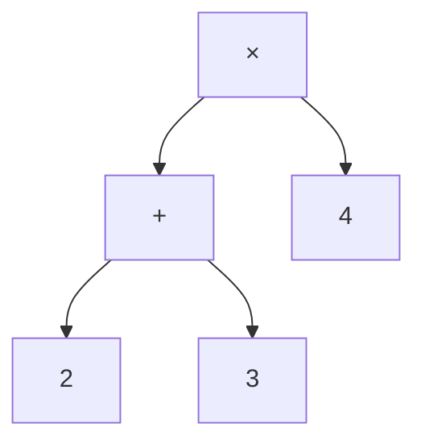
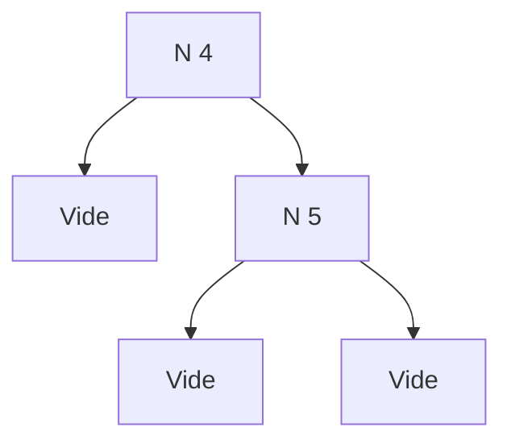
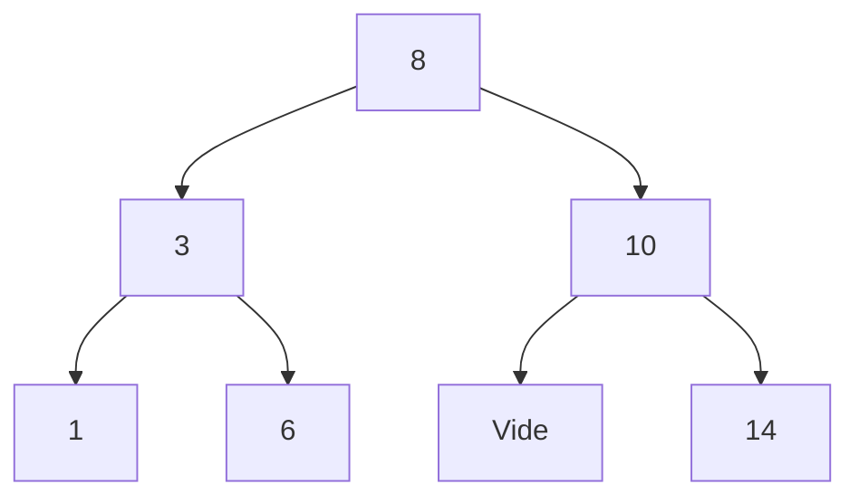
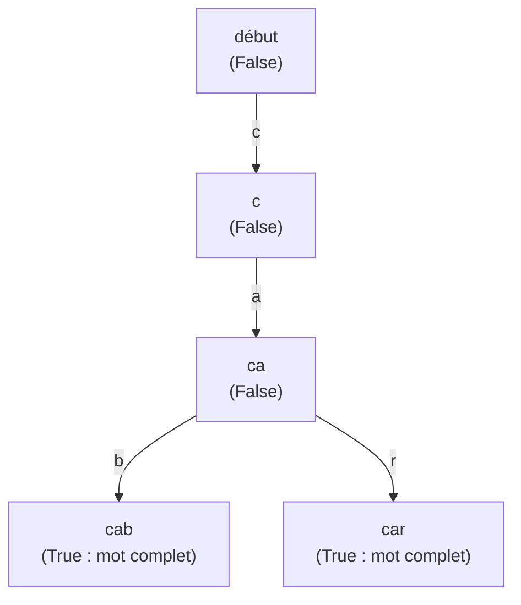

# Chapitre 4 — Les arbres

[🏠 Accueil](../../README.md) · Suite : [Exemples corrigés ➡](2-Exemples-corriges.md) · [Exercices](3-Exercices.md) · Code : [Logique.hs](code/Logique.hs) · [logique.py](code/logique.py) · S'entraîner : [TD4](../../02-TD-TP/TD4-Arbres-tournois/1-Enonce.md)

## ⏱️ Le chapitre en 30 secondes

1. Beaucoup de données sont **hiérarchiques** : ce sont des **arbres**.
2. En Haskell, on les décrit avec `data` : une liste des **formes possibles** (les **constructeurs**).
3. Une fonction sur un arbre a **un cas par forme**, et s'appelle sur les **sous-arbres**.
4. En Python, chaque forme devient une **classe**.

---

## Étape 1 — Des arbres partout autour de nous 🌳

| Dans la vie réelle | Le « nœud » | Ses « enfants » |
|---|---|---|
| 📁 les dossiers de l'ordinateur | un dossier | ses sous-dossiers et fichiers |
| 🎾 un tableau de tournoi | un match | les deux matchs d'avant |
| 👪 un arbre généalogique | une personne | ses parents |
| 📄 une page web (HTML) | une balise | les balises qu'elle contient |
| 🧮 une expression `(2 + 3) × 4` | une opération | ses deux opérandes |



> Vocabulaire : le nœud du haut est la **racine** ; les nœuds sans enfant sont les **feuilles** ; un **sous-arbre** est un enfant avec tout ce qu'il y a en dessous.

---

## Étape 2 — Décrire un arbre en Haskell : `data`

> 🧱 Un type `data`, c'est comme une boîte de **Lego avec quelques modèles de briques**. Chaque brique s'appelle un **constructeur**.

L'arbre binaire de recherche (ABR) a **deux** sortes de briques :

```haskell
data ABR = N Int ABR ABR    -- un nœud : une valeur, un sous-arbre gauche, un sous-arbre droit
         | Vide             -- une place vide
```

`N 4 Vide (N 5 Vide Vide)` se dessine :



> 💡 Les listes du chapitre 2 sont aussi un type `data`, avec deux briques : `[]` et `x : l`. Une liste, c'est un arbre où chaque nœud n'a **qu'un** enfant.

---

## Étape 3 — L'ABR : le jeu « plus grand / plus petit » 🔢

> **Le jeu :** « Je pense à un nombre. » — « 50 ? » — « Plus petit. » — « 25 ? » — « Plus grand. »…
> À chaque réponse, on élimine **la moitié** des possibilités.

Un **ABR** range les nombres pour jouer à ce jeu :
- tout ce qui est **à gauche** d'un nœud est **plus petit** que lui ;
- tout ce qui est **à droite** est **plus grand**.



**Chercher 6 :** `6 < 8` → à gauche ; `6 > 3` → à droite ; `6 = 6` → **trouvé** en 3 étapes.

```haskell
estElement :: Int -> ABR -> Bool
estElement _ Vide = False                          -- place vide : pas trouvé
estElement k (N p t1 t2) | k == p    = True        -- trouvé
                         | k < p     = estElement k t1   -- plus petit : à gauche
                         | otherwise = estElement k t2   -- plus grand : à droite
```

Cette règle de rangement s'appelle la **bonne formation** (« bien formé »). C'est un **invariant de structure** : la fonction ne marche **que si** l'arbre la respecte. On la met donc dans la **pré-condition**.

---

## Étape 4 — Passer en Python : une brique = une classe

| Haskell | Python | Exemple |
|---|---|---|
| le type `ABR` | une classe « modèle » | `class ABR` |
| chaque brique (`N`, `Vide`) | une classe qui hérite du modèle | `class N(ABR)`, `class Vide(ABR)` |
| ce qu'il y a dans la brique | des attributs | `self.valeur`, `self.fils_gauche` |
| une fonction sur `ABR` | une méthode dans **chaque** classe | `estElement` |

```python
class ABR:
    def estElement(self, k): pass

class Vide(ABR):
    def estElement(self, k):
        return False                     # 1ʳᵉ ligne Haskell

class N(ABR):
    def __init__(self, n, fg, fd):
        self.valeur = n
        self.fils_gauche = fg
        self.fils_droit = fd

    def estElement(self, k):             # 2ᵉ ligne Haskell
        if k == self.valeur:
            return True
        if k < self.valeur:
            return self.fils_gauche.estElement(k)
        return self.fils_droit.estElement(k)

v = Vide()
t = N(8, N(3, v, v), N(10, v, v))
print(t.estElement(3))                   # True
```

> 💡 Pas besoin de `if` pour savoir si l'arbre est `Vide` : Python appelle **automatiquement** la bonne méthode selon la classe de l'objet.

---

## Étape 5 — Ensembles et « sacs » (multi-ensembles)

Pour dire **ce que contient** un arbre, on utilise :

| | 🏷️ Ensemble | 🎒 Multi-ensemble |
|---|---|---|
| Image | une collection d'autocollants, **sans doublon** | un sac de billes : on compte les **doublons** |
| Exemple | `{1, 2}` | `{\|1, 2, 2\|}` (deux billes « 2 ») |
| Ajouter | `∪` (union) | `⊔` : `{\|1,2\|} ⊔ {\|2\|} = {\|1,2,2\|}` |
| Retirer | `\` | `−` : `{\|1,2,2\|} − {\|2\|} = {\|1,2\|}` (une seule bille enlevée) |

`⟦t⟧` désigne le contenu de l'arbre `t`. Pour un ABR : `⟦Vide⟧ = ∅` et `⟦N k t1 t2⟧ = {k} ∪ ⟦t1⟧ ∪ ⟦t2⟧`.

---

## Étape 6 — Deux autres arbres du cours

### 💬 Les formules logiques

> « **Il pleut ET je n'ai PAS de parapluie** » est un arbre : `Et (Var "pleut") (Non (Var "parapluie"))`.

```haskell
data Prop = Var String | Vrai | Faux | Et Prop Prop | Ou Prop Prop | Non Prop
```

| Fonction | Rôle |
|---|---|
| `eval val p` | dit si `p` est vraie, connaissant la valeur de chaque variable (`val`) |
| `taille p` | compte les symboles de `p` (sert de variant) |
| `pousseNeg p b` | fait descendre les `Non` jusqu'aux variables |

**`pousseNeg` applique les lois de De Morgan, qu'on utilise tous les jours :**

> « Ce n'est pas vrai que **j'ai faim ET soif** » = « je **n'ai pas faim OU** je **n'ai pas soif** ».
> « Ce n'est pas vrai que **je prends le bus OU le métro** » = « je **ne prends pas le bus ET pas le métro** ».

`Non (Et a b)` devient `Ou (Non a) (Non b)` ; `Non (Ou a b)` devient `Et (Non a) (Non b)` ; `Non (Non a)` devient `a`.

### 📱 L'arbre préfixe : l'autocomplétion du téléphone

> Tu tapes « c », puis « a » : le téléphone propose « cab » et « car ». Il range les mots dans un arbre, **lettre par lettre**.

```haskell
data ArbrePrefixe = Choix Bool [(Char, ArbrePrefixe)]
-- Bool : « un mot se termine-t-il ici ? »   liste : une branche par lettre suivante
```



---

## Étape 7 — Prouver sur un arbre

Toujours la **même méthode** (chapitre 1), avec :

| Étape | Sur un arbre |
|---|---|
| Variant | `taille t`, `hauteur t` ou le nombre d'éléments |
| Cas | **un cas par brique** (`Vide`, `N …`), puis un par garde |
| HI | s'utilise sur les **sous-arbres** (ils sont plus petits) |
| Pré-condition de l'appel | souvent « le sous-arbre est bien formé » : vrai car l'arbre entier l'est |

👉 Preuves complètes (`estElement` et `pousseNeg`) : [Exemples corrigés](2-Exemples-corriges.md).

---

## ⚠️ Les erreurs classiques

| Erreur | Ce qu'il faut faire |
|---|---|
| Oublier une brique (ex. `Vide`) | **un cas par constructeur** |
| Python : `return Faux` | `return Faux()` : on **crée** un objet |
| Python : `&&`, `\|\|` | `and`, `or` |
| Appliquer l'HI sans dire que le sous-arbre est bien formé | l'écrire : « `t1` est bien formé car `t` l'est » |

## ✅ À retenir

- Arbre = données hiérarchiques ; `data` = la liste des formes possibles.
- **Haskell → Python** : type → classe modèle ; brique → sous-classe ; contenu → attributs ; fonction → méthode.
- **Bien formé** = la règle de rangement, à mettre en pré-condition.
- Preuve : un cas par brique, HI sur les sous-arbres.

## 🧪 Je vérifie que j'ai compris

1. Dessine `N 5 (N 2 Vide Vide) Vide`. Est-ce un ABR bien formé ?
2. Et `N 5 (N 7 Vide Vide) Vide` ?
3. Écris `taille :: ABR -> Int` qui compte les nœuds `N`.

<details><summary>▶ Réponses</summary>

1. 5 a un enfant gauche 2 (et un Vide à droite). Oui : `2 < 5` à gauche.
2. Non : 7 est à **gauche** de 5 mais il est plus grand.
3. `taille Vide = 0` et `taille (N _ t1 t2) = 1 + taille t1 + taille t2`.

</details>
