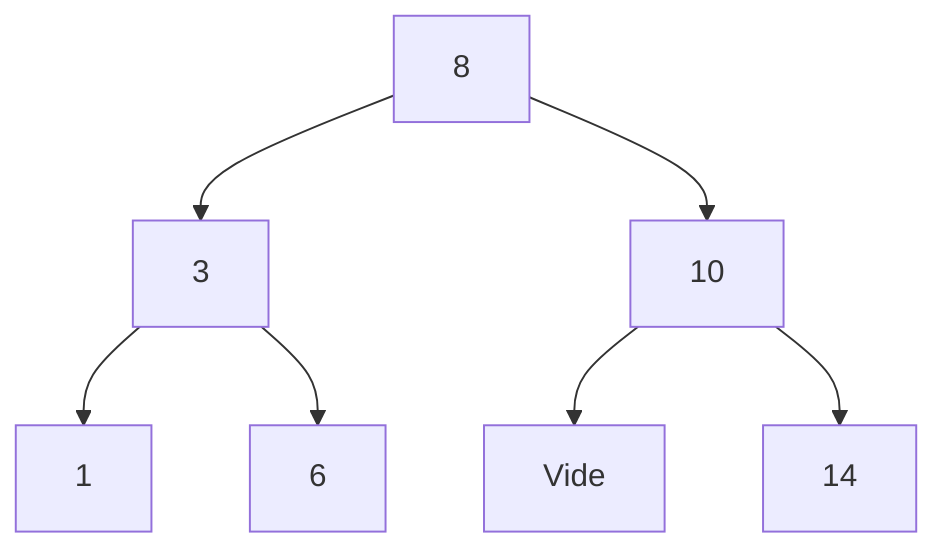

# Chapitre 4 — Exercices

[🏠 Accueil](../../README.md) · [⬅ Cours](1-Cours.md) · [Exemples corrigés](2-Exemples-corriges.md) · **Corrections : [4-Corrections.md](4-Corrections.md)**

> ⭐ = échauffement · ⭐⭐ = entraînement · ⭐⭐⭐ = niveau DS

Rappels :

```haskell
data ABR = N Int ABR ABR | Vide

estElement :: Int -> ABR -> Bool
estElement _ Vide = False
estElement k (N p t1 t2) | k == p    = True
                         | k < p     = estElement k t1
                         | otherwise = estElement k t2
```

---

## Exercice 1 ⭐ — Dessiner et vérifier

Dessine chaque arbre. Est-il **bien formé** (petits à gauche, grands à droite, **partout**) ?

1. `N 5 (N 2 Vide Vide) (N 9 Vide Vide)`
2. `N 5 (N 2 Vide (N 7 Vide Vide)) Vide`
3. `N 4 Vide (N 6 (N 5 Vide Vide) Vide)`

---

## Exercice 2 ⭐ — Jouer à « plus grand / plus petit » 🔢

Avec l'arbre du cours :



Exécute pas à pas `estElement 6 t`, puis `estElement 9 t`. Combien de comparaisons pour chacun ?

---

## Exercice 3 ⭐ — Mesurer un arbre

Écris en Haskell :
1. `taille :: ABR -> Int` : le nombre de nœuds `N` ;
2. `hauteur :: ABR -> Int` : le nombre de niveaux (`hauteur Vide = 0`) ;
3. `somme :: ABR -> Int` : la somme des valeurs ;
4. `maxABR :: ABR -> Int` : la plus grande valeur d'un ABR **bien formé et non vide**. (Indice : où se trouve le plus grand nombre ?)

---

## Exercice 4 ⭐ — La calculatrice 🧮

```haskell
data Expr = Nb Int | Plus Expr Expr | Fois Expr Expr
```

1. Écris `(2 + 3) × 4` et `2 + 3 × 4` avec ce type, et dessine les deux arbres.
2. Écris `eval :: Expr -> Int`.
3. Calcule `eval` des deux expressions. Pourquoi les résultats sont-ils différents ?

---

## Exercice 5 ⭐⭐ — La calculatrice en Python

Traduis le type `Expr` et la fonction `eval` en **Python objet**, avec la méthode du cours. Construis l'objet qui représente `(2 + 3) × 4` et affiche sa valeur.

---

## Exercice 6 ⭐⭐ — Ranger un nouveau nombre

1. Écris `insererABR :: Int -> ABR -> ABR` qui ajoute un nombre dans un ABR en respectant la règle de rangement (si le nombre est déjà présent, on ne change rien).
2. En partant de `Vide`, insère dans l'ordre `5`, puis `3`, puis `8`, puis `4`. Dessine l'arbre après chaque insertion.
3. Donne la `taille` et la `hauteur` de l'arbre final.

---

## Exercice 7 ⭐⭐ — Compter les places vides

```haskell
nbVides :: ABR -> Int
nbVides Vide        = 1
nbVides (N _ t1 t2) = nbVides t1 + nbVides t2
```

1. Combien de `Vide` dans l'arbre final de l'exercice 6 ?
2. Démontre que `nbVides t = taille t + 1` pour tout arbre `t`.

---

## Exercice 8 ⭐⭐ — Faire descendre la négation 💬

On note `a` = « il pleut » et `b` = « il fait froid ».

1. Calcule pas à pas `pousseNeg (Non (Ou (Var "a") (Non (Var "b")))) False`.
2. Traduis la formule de départ et le résultat en français.
3. Vérifie qu'ils ont la même valeur quand `a = False` et `b = True`.

---

## Exercice 9 ⭐⭐ — Le dictionnaire du téléphone 📱

Dessine l'arbre préfixe qui contient exactement les mots `"la"`, `"le"` et `"les"`, puis écris-le en Haskell avec `Choix`.

```haskell
data ArbrePrefixe = Choix Bool [(Char, ArbrePrefixe)]
```

---

## Exercice 10 ⭐⭐⭐ — L'arbre dans le miroir 🪞

```haskell
miroir :: ABR -> ABR
miroir Vide        = Vide
miroir (N k t1 t2) = N k (miroir t2) (miroir t1)
```

1. Dessine `miroir (N 5 (N 2 Vide Vide) (N 9 Vide Vide))`. Est-il encore bien formé ?
2. Démontre que `taille (miroir t) = taille t`.
3. Démontre que `miroir (miroir t) = t`.

---

## Exercice 11 ⭐⭐⭐ — L'insertion ajoute bien le nombre

Avec ta fonction `insererABR` (exercice 6), démontre que pour tout arbre `t` (pas besoin qu'il soit bien formé) :

```text
⟦insererABR k t⟧ = {k} ∪ ⟦t⟧
```

Rappel : `⟦Vide⟧ = ∅` et `⟦N p t1 t2⟧ = {p} ∪ ⟦t1⟧ ∪ ⟦t2⟧`.
