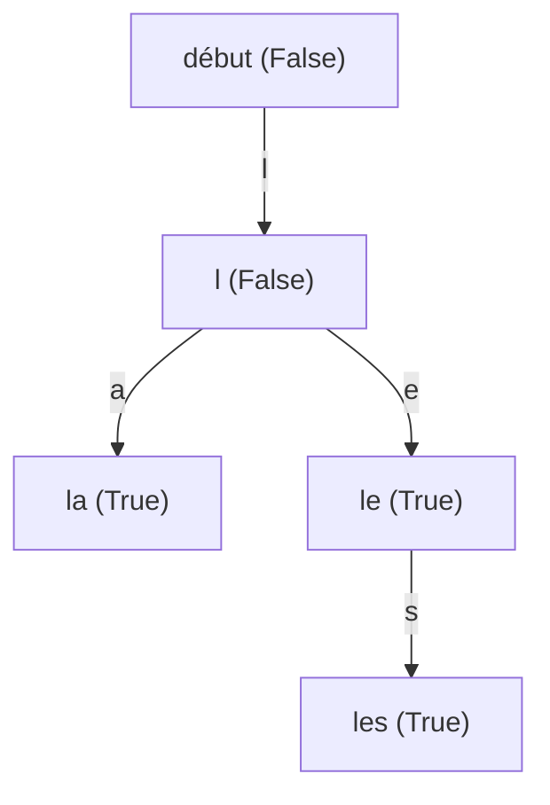

# Chapitre 4 — Corrections

[🏠 Accueil](../../README.md) · [⬅ Exercices](3-Exercices.md) · [Cours](1-Cours.md)

> ⚠️ As-tu cherché au moins 10 minutes ?

---

## Exercice 1 ⭐ — Dessiner et vérifier

| Arbre | Dessin | Bien formé ? |
|---|---|---|
| 1 | `5` avec `2` à gauche et `9` à droite | ✅ `2 < 5 < 9` |
| 2 | `5` avec `2` à gauche ; `2` a `7` à sa droite | ❌ `7` est dans le sous-arbre **gauche** de `5`, mais `7 > 5` |
| 3 | `4` avec `6` à droite ; `6` a `5` à sa gauche | ✅ `5 < 6`, et `5` et `6` sont `> 4` |

> 💡 Le piège de l'arbre 2 : localement, `7 > 2` est bien à droite de `2`. Mais la règle doit être vraie pour **tous** les ancêtres : `7` est aussi sous `5`, du côté gauche.

---

## Exercice 2 ⭐ — Plus grand / plus petit

| Recherche | Étapes | Comparaisons |
|---|---|---|
| `estElement 6 t` | `6 < 8` → gauche (`3`) ; `6 > 3` → droite (`6`) ; `6 == 6` → **`True`** | 3 nœuds visités |
| `estElement 9 t` | `9 > 8` → droite (`10`) ; `9 < 10` → gauche : `Vide` → **`False`** | 2 nœuds visités |

> 💬 On ne visite jamais tout l'arbre : seulement **un chemin** de la racine vers le bas.

---

## Exercice 3 ⭐ — Mesurer un arbre

```haskell
taille :: ABR -> Int
taille Vide        = 0
taille (N _ t1 t2) = 1 + taille t1 + taille t2

hauteur :: ABR -> Int
hauteur Vide        = 0
hauteur (N _ t1 t2) = 1 + max (hauteur t1) (hauteur t2)

somme :: ABR -> Int
somme Vide        = 0
somme (N k t1 t2) = k + somme t1 + somme t2

maxABR :: ABR -> Int                 -- pré : t bien formé et t ≠ Vide
maxABR (N k _ Vide) = k              -- rien à droite : k est le plus grand
maxABR (N _ _ t2)   = maxABR t2      -- sinon, le plus grand est à droite
```

> 💬 Pour `maxABR`, on descend **toujours à droite**, comme dans le jeu : « encore plus grand ? ».

---

## Exercice 4 ⭐ — La calculatrice

1. ```haskell
   e1 = Fois (Plus (Nb 2) (Nb 3)) (Nb 4)      -- (2 + 3) × 4
   e2 = Plus (Nb 2) (Fois (Nb 3) (Nb 4))      -- 2 + 3 × 4
   ```

   ```mermaid
   flowchart TD
       subgraph E1["(2 + 3) × 4"]
           A["Fois"] --> B["Plus"]
           A --> C["Nb 4"]
           B --> D["Nb 2"]
           B --> E["Nb 3"]
       end
       subgraph E2["2 + 3 × 4"]
           F["Plus"] --> G["Nb 2"]
           F --> H["Fois"]
           H --> I["Nb 3"]
           H --> J["Nb 4"]
       end
   ```

2. ```haskell
   eval :: Expr -> Int
   eval (Nb n)       = n
   eval (Plus e1 e2) = eval e1 + eval e2
   eval (Fois e1 e2) = eval e1 * eval e2
   ```

3. `eval e1 = (2 + 3) × 4 = 20` et `eval e2 = 2 + 12 = 14`. Les arbres sont **différents** : l'arbre dit dans quel ordre faire les calculs, comme les parenthèses. (C'est ce que fait une calculatrice quand elle lit une expression.)

---

## Exercice 5 ⭐⭐ — En Python objet

```python
class Expr:
    def eval(self) -> int:
        pass

class Nb(Expr):
    def __init__(self, n: int):
        self.n = n
    def eval(self) -> int:
        return self.n

class Plus(Expr):
    def __init__(self, e1: Expr, e2: Expr):
        self.e1 = e1
        self.e2 = e2
    def eval(self) -> int:
        return self.e1.eval() + self.e2.eval()

class Fois(Expr):
    def __init__(self, e1: Expr, e2: Expr):
        self.e1 = e1
        self.e2 = e2
    def eval(self) -> int:
        return self.e1.eval() * self.e2.eval()

e = Fois(Plus(Nb(2), Nb(3)), Nb(4))
print(e.eval())    # 20
```

| Haskell | Python |
|---|---|
| le type `Expr` | `class Expr` |
| les briques `Nb`, `Plus`, `Fois` | trois sous-classes |
| `eval (Plus e1 e2) = …` | la méthode `eval` de la classe `Plus` |

---

## Exercice 6 ⭐⭐ — Ranger un nouveau nombre

1. ```haskell
   insererABR :: Int -> ABR -> ABR
   insererABR k Vide = N k Vide Vide
   insererABR k (N p t1 t2) | k == p    = N p t1 t2                    -- déjà là
                            | k < p     = N p (insererABR k t1) t2     -- à gauche
                            | otherwise = N p t1 (insererABR k t2)     -- à droite
   ```

2. | Après | Arbre |
   |---|---|
   | `5` | `5` seul |
   | `3` | `5` avec `3` à gauche |
   | `8` | `5` avec `3` à gauche et `8` à droite |
   | `4` | `4 < 5` → gauche ; `4 > 3` → à droite de `3` |

   ```mermaid
   flowchart TD
       A["5"] --> B["3"]
       A --> C["8"]
       B --> D["Vide"]
       B --> E["4"]
   ```

   En Haskell : `N 5 (N 3 Vide (N 4 Vide Vide)) (N 8 Vide Vide)`.

3. `taille = 4` et `hauteur = 3` (5 → 3 → 4).

---

## Exercice 7 ⭐⭐ — Les places vides

1. **5** places vides (`3` en a une à gauche, `4` en a deux, `8` en a deux). Et `taille + 1 = 4 + 1 = 5` ✅

2. **Variant** `taille t`. **HI** : pour tout arbre `t'` avec `taille t' < taille t`, `nbVides t' = taille t' + 1`.
   - **Cas `t = Vide`** : `nbVides Vide = 1 = 0 + 1 = taille Vide + 1` ✅
   - **Cas `t = N k t1 t2`** : `taille t1 < taille t` et `taille t2 < taille t` (il manque au moins le nœud `k`). L'HI donne :

     ```text
     nbVides t = nbVides t1 + nbVides t2
               = (taille t1 + 1) + (taille t2 + 1)
               = (1 + taille t1 + taille t2) + 1
               = taille t + 1   ✅
     ```

   Ce qui achève la preuve par induction. ∎

---

## Exercice 8 ⭐⭐ — La négation

1. ```text
   pousseNeg (Non (Ou a (Non b))) False
   = pousseNeg (Ou a (Non b)) True                         un Non : on inverse b
   = Et (pousseNeg a True) (pousseNeg (Non b) True)        Ou avec négation → Et
   = Et (Non a) (pousseNeg b False)                        Var avec négation ; Non : on inverse
   = Et (Non (Var "a")) (Var "b")
   ```

2. - Départ : « Ce n'est pas vrai que (il pleut **ou** il ne fait pas froid). »
   - Résultat : « Il ne pleut pas **et** il fait froid. »

3. Avec `a = False`, `b = True` :
   - départ : `Ou False (Non True) = Ou False False = False`, donc `Non (…) = True` ;
   - résultat : `Et (Non False) True = Et True True = True` ✅

---

## Exercice 9 ⭐⭐ — Le dictionnaire



```haskell
dico = Choix False
         [ ('l', Choix False
                   [ ('a', Choix True [])
                   , ('e', Choix True [('s', Choix True [])]) ]) ]
```

> 💬 Le nœud « le » est marqué `True` (c'est un mot) **et** il a un enfant « s » : un mot peut être le début d'un autre.

---

## Exercice 10 ⭐⭐⭐ — Le miroir

1. `miroir` donne `5` avec `9` à gauche et `2` à droite : **plus bien formé** (les grands sont à gauche). C'est un ABR rangé « à l'envers ».

2. **Variant** `taille t`. HI sur les sous-arbres (plus petits).
   - `Vide` : `taille (miroir Vide) = taille Vide` ✅
   - `N k t1 t2` : `taille (N k (miroir t2) (miroir t1)) = 1 + taille (miroir t2) + taille (miroir t1) = 1 + taille t2 + taille t1` (HI) `= taille t` ✅

3. **Variant** `taille t`. HI : pour tout `t'` plus petit, `miroir (miroir t') = t'`.
   - `Vide` : `miroir (miroir Vide) = miroir Vide = Vide` ✅
   - `N k t1 t2` :

     ```text
     miroir (miroir (N k t1 t2)) = miroir (N k (miroir t2) (miroir t1))
                                 = N k (miroir (miroir t1)) (miroir (miroir t2))
                                 = N k t1 t2        (HI sur t1 et t2)  ✅
     ```

   Ce qui achève les preuves par induction. ∎

> 🪞 Se regarder deux fois dans un miroir redonne l'image de départ.

---

## Exercice 11 ⭐⭐⭐ — L'insertion ajoute bien le nombre

**Variant** `taille t`. **HI** : pour tout `t'` avec `taille t' < taille t`, `⟦insererABR k t'⟧ = {k} ∪ ⟦t'⟧`.

| Cas | Calcul |
|---|---|
| `t = Vide` | `⟦N k Vide Vide⟧ = {k} ∪ ∅ ∪ ∅ = {k} = {k} ∪ ⟦Vide⟧` ✅ |
| `t = N p t1 t2`, `k == p` | le résultat est `t`, et `k = p ∈ ⟦t⟧`, donc `{k} ∪ ⟦t⟧ = ⟦t⟧` ✅ |
| `t = N p t1 t2`, `k < p` | `⟦N p (insererABR k t1) t2⟧ = {p} ∪ ({k} ∪ ⟦t1⟧) ∪ ⟦t2⟧` (HI sur `t1`, plus petit) `= {k} ∪ ⟦t⟧` ✅ |
| `t = N p t1 t2`, `k > p` | même calcul avec `t2` ✅ |

Ce qui achève la preuve par induction. ∎

> 💡 Pour aller plus loin : on peut aussi montrer que si `t` est **bien formé**, `insererABR k t` l'est encore. Il faut alors utiliser ce résultat : les éléments du nouveau sous-arbre gauche sont ceux de `t1` plus `k`, tous `< p`.
