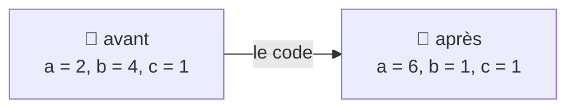
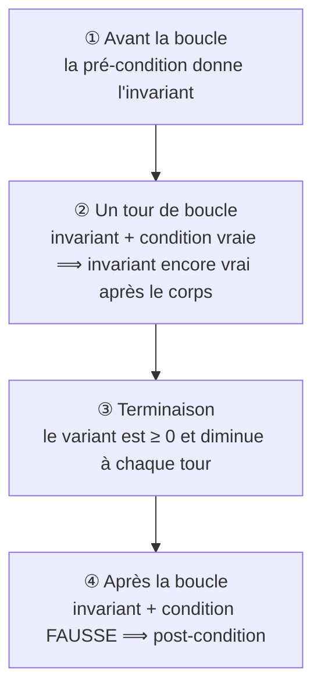

# Chapitre 5 — Raisonner sur un programme Python

[🏠 Accueil](../../00-Commencer-ici.md) · Suite : [Exemples corrigés ➡](2-Exemples-corriges.md) · S'entraîner : [TD5](../../02-TD-TP/TD5-Programmes-imperatifs/1-Enonce.md)

## ⏱️ Le chapitre en 30 secondes

1. On revient à Python : des variables qui **changent**, des `if`, des `while`.
2. **Sans boucle** : on raisonne **à l'envers**, de la fin vers le début (**plus faible pré-condition**).
3. **Avec une boucle** : on trouve ce qui **reste vrai à chaque tour** (l'**invariant**) et ce qui **diminue** (le **variant**).

---

## Étape 1 — L'état du programme : une photo de l'ardoise 📸

> Imagine que chaque variable est écrite sur une **ardoise**. À chaque ligne exécutée, on efface et on réécrit.
> Une **photo** de l'ardoise à un moment donné s'appelle un **environnement**.

```python
a = a + b
if a > 0:
    b = 1
```



Pré- et post-conditions deviennent des **phrases sur la photo**, par exemple « `a` est pair » ou « `res = n!` ».

---

## Étape 2 — Raisonner à l'envers : la plus faible pré-condition ⏰

### L'image : à quelle heure partir ?

> Je dois être à la fac **avant 8h00**. Le trajet dure **40 minutes**.
> Je ne commence pas par le départ : je pars de **l'objectif** et je **remonte** : je dois partir **avant 7h20**.
> « Partir avant 7h20 » est **exactement** la condition qu'il faut au départ : ni plus, ni moins.

C'est la **plus faible pré-condition** (on l'abrège **WP**) : la condition **nécessaire et suffisante** au départ pour que l'objectif soit atteint à la fin.

### Règle 1 — L'affectation `x = e` : on remplace

> **Exemple chiffré.** Après `x = x + 3`, je veux `x > 10`.
> Le nouveau `x`, c'est l'ancien `x + 3`. Il faut donc, **avant** : `x + 3 > 10`, c'est-à-dire `x > 7`.

> 📏 **Règle :** pour obtenir `P` après `x = e`, il faut `P` **dans laquelle on remplace `x` par `e`**.

### Règle 2 — Plusieurs lignes : on remonte une ligne à la fois

On écrit la condition **en commentaire au-dessus de chaque ligne**, en partant du **bas** :

```python
# x + 1 > 5   donc   x > 4          ③ on remonte encore : y vaut x + 1
y = x + 1
# y > 5                              ② on remonte : z vaut y
z = y
# z > 5                              ① l'objectif, tout en bas
```

### Règle 3 — Le `if` : deux chemins, comme sur un GPS 🗺️

> « **Si** l'autoroute est libre, je la prends (30 min), **sinon** je passe par la ville (50 min). »
> Pour arriver à l'heure, il faut : **(autoroute libre et je pars 30 min avant)** **ou** **(autoroute bouchée et je pars 50 min avant)**.

> 📏 **Règle :** WP de `if e: c1 else: c2` = **(`e` et WP de `c1`)** ou **(non `e` et WP de `c2`)**.

```python
# (a pair et a + 4 pair) ou (a impair et a + 1 pair)   → toujours vrai !
if a % 2 == 0:
    # a + 4 pair
    a = a + 4
    # a pair
else:
    # a + 1 pair
    a = a + 1
    # a pair
# a pair                                                ← l'objectif
```

**Conclusion :** quelle que soit la valeur de départ, `a` est pair à la fin.

> ✅ **Prouver un code sans boucle =** calculer la WP, puis montrer que la pré-condition donnée l'**implique**.

---

## Étape 3 — Les boucles : ce qui ne change jamais 🔁

### L'image : le budget des vacances 💶

> Je pars avec **500 €**. À chaque achat, l'argent dépensé augmente et l'argent restant diminue. Mais à **tout moment** :
> **argent dépensé + argent restant = 500 €**.
> Cette phrase **ne change jamais** : c'est un **invariant**.

### 🍬 Le même principe dans la division par soustractions

```python
q = 0           # nombre de tours de distribution
r = a           # bonbons restants
while r >= b:   # tant qu'on peut faire un tour complet
    q = q + 1
    r = r - b
```

| Moment | `q` | `r` | `q × b + r` (avec `a = 23`, `b = 5`) |
|---|---|---|---|
| départ | 0 | 23 | 23 |
| après 1 tour | 1 | 18 | 23 |
| après 2 tours | 2 | 13 | 23 |
| après 4 tours | 4 | 3 | **23** (on s'arrête : `3 < 5`) |

- **Invariant :** `a = q × b + r` (bonbons donnés + bonbons restants = total).
- **Variant :** `r`, les bonbons restants : il baisse à chaque tour et reste ≥ 0.

### Une boucle, c'est une fonction récursive terminale

```text
while cond:                     whileForm x | cond      = whileForm (corps x)
    corps          ⟷                        | otherwise = x
```

Tout ce qu'on a appris (chapitres 1 à 3) s'applique : l'**invariant** joue le rôle de pré- **et** post-condition de cette fonction, et le **variant** est son variant.

---

## Étape 4 — Prouver une boucle : 4 vérifications 🚆

> **Un voyage en train :**
> ① au **départ**, les billets sont en règle ;
> ② **à chaque arrêt**, ils restent en règle ;
> ③ le nombre d'**arrêts restants diminue**, donc on finit par arriver ;
> ④ à l'**arrivée**, on est au bon endroit.



| | Ce que je calcule | Ce que j'ai le droit d'utiliser |
|---|---|---|
| ① | WP de l'invariant à travers le code **avant** la boucle | la pré-condition |
| ② | WP de l'invariant à travers le **corps** | l'invariant **et** la condition de boucle |
| ③ | WP de « variant = `x` » à travers le corps (`x` : une valeur fixée) | l'invariant et la condition |
| ④ | WP de la post-condition à travers le code **après** la boucle | l'invariant **et** la condition **fausse** |

### Comment vérifier que le variant diminue (③)

On donne un nom (`p`) à la valeur **à la fin** du tour, puis on remonte :

```python
# r - b = p        → au début du tour, r vaut p + b
q = q + 1
# r - b = p
r = r - b
# r = p            → à la fin du tour, r vaut p
```

`r` passe de `p + b` à `p` : il **baisse** de `b`, et `b > 0`. ✅

### Bien choisir l'invariant : penser à la sortie

L'invariant doit être **assez précis** pour conclure à l'étape ④. On y ajoute souvent une **borne** :

> **Factorielle** (`i` va de 1 à `n`) : invariant `res = (i−1)!` **et** `i ≤ n + 1`.
> À la sortie : la condition `i ≤ n` est fausse, donc `i > n`. Avec la borne `i ≤ n + 1`, on obtient **exactement** `i = n + 1`, donc `res = n!`.
> Sans la borne, on ne saurait pas que `i` s'arrête pile à `n + 1`.

👉 Les preuves complètes (factorielle et exponentiation rapide) : [Exemples corrigés](2-Exemples-corriges.md).

---

## ⚠️ Les erreurs classiques

| Erreur | Ce qu'il faut faire |
|---|---|
| Calculer la WP de haut en bas | toujours de **bas en haut** (de l'objectif vers le départ) |
| Remplacer dans le mauvais sens | on remplace `x` par `e` dans la condition **d'après** |
| Oublier une branche du `if` | `(e et …) ou (non e et …)` |
| Utiliser la condition de boucle à l'étape ④ | à la sortie, c'est sa **négation** qui est vraie |
| Invariant sans borne | impossible de trouver la valeur finale de `i` |

## ✅ À retenir

- **WP** = raisonner à l'envers : de l'objectif vers le départ.
- `x = e` : on **remplace** `x` par `e` ; `if` : **deux chemins**.
- **Invariant** = la phrase qui reste vraie à chaque tour (le budget).
- **4 vérifications** : départ, chaque tour, terminaison, arrivée.

## 🧪 Je vérifie que j'ai compris

1. WP de `y > 0` à travers `y = 2 * x - 4` ?
2. WP de `x > 10` à travers :
   ```python
   y = x * 2
   if y > 8:
       x = y + 1
   else:
       x = 0
   ```
3. Donne un invariant pour : `s = 0`, `i = 0`, `while i < n: i = i + 1 ; s = s + i` (on veut `s = 1 + 2 + … + n` à la fin).

<details><summary>▶ Réponses</summary>

1. `2x − 4 > 0`, c'est-à-dire `x > 2`.
2. Branche `if` : `y + 1 > 10`, soit `y > 9`. Branche `else` : `0 > 10`, toujours faux. Donc `(y > 8 et y > 9) ou (y ≤ 8 et faux)` = `y > 9`. En remontant `y = x * 2` : `2x > 9`, soit `x ≥ 5` (entiers).
3. `s = 1 + 2 + … + i` (soit `s = i(i+1)/2`) **et** `i ≤ n`. À la sortie, `i ≥ n` et `i ≤ n` donnent `i = n`.

</details>
