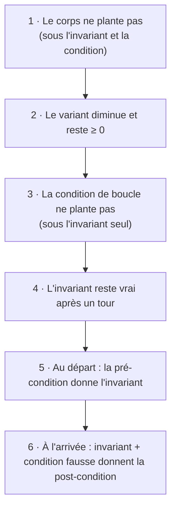

# Chapitre 6 — Les tableaux

[🏠 Accueil](../../00-Commencer-ici.md) · Suite : [Exemples corrigés ➡](2-Exemples-corriges.md) · S'entraîner : [TD6](../../02-TD-TP/TD6-Tableaux/1-Enonce.md)

## ⏱️ Le chapitre en 30 secondes

1. Un programme peut **planter** : division par 0, case de tableau qui n'existe pas…
2. On ajoute donc à nos calculs les **conditions pour ne pas planter**.
3. Quand on **modifie** un tableau, on a une notation pour dire « le même tableau, sauf une case ».
4. On prouve une boucle en **6 étapes** : c'est exactement le format du DS.

---

## Étape 1 — Un programme peut planter 💥

> 🏧 Au distributeur, avant de donner les billets, la machine vérifie **que la carte est valide** et **que le solde est suffisant**. Sinon, l'opération **échoue**.

En Python, certaines opérations échouent aussi :

| Opération | Plante si… | Elle réussit si… |
|---|---|---|
| `a / b`, `a // b`, `a % b` | `b = 0` | `b ≠ 0` |
| `sqrt(x)` | `x < 0` | `x ≥ 0` |
| `log(x)` | `x ≤ 0` | `x > 0` |
| `l[i]` | `i` est hors du tableau | `0 ≤ i < len(l)` |

> 📏 **Nouvelle règle :** dans le calcul de la plus faible pré-condition (chapitre 5), on **ajoute** à chaque ligne la condition pour qu'elle **ne plante pas**.
> Exemple : pour `x = a / b`, la WP devient « (ce qu'on avait) **et** `b ≠ 0` ».

---

## Étape 2 — `and` et `or` sont paresseux 😴

> 🥛 « **Si** le frigo n'est pas vide **et** que le lait n'est pas périmé, je prends du lait. »
> Si le frigo est vide, je ne vais **pas** vérifier la date du lait : je m'arrête tout de suite.

Python fait pareil :
- dans `e1 and e2`, si `e1` est **faux**, `e2` n'est **jamais calculé** ;
- dans `e1 or e2`, si `e1` est **vrai**, `e2` n'est **jamais calculé**.

```python
x != 0 and y / x > 42      # ne plante JAMAIS : si x = 0, on ne fait pas la division
i < len(l) and l[i] > 0    # ne plante JAMAIS si i ≥ 0 : si i est trop grand, on ne lit pas l[i]
```

| Expression | Ne plante pas si… |
|---|---|
| `e1 and e2` | `e1` ne plante pas, **et** (`e1` est faux **ou** `e2` ne plante pas) |
| `e1 or e2` | `e1` ne plante pas, **et** (`e1` est vrai **ou** `e2` ne plante pas) |

---

## Étape 3 — Le tableau : une boîte d'œufs 🥚

> Une boîte de 6 œufs a des cases numérotées **de 0 à 5**. La case 6 **n'existe pas** : demander `l[6]`, c'est chercher un œuf hors de la boîte.

| Opération | Exemple | À vérifier |
|---|---|---|
| lire une case | `x = l[i]` | `0 ≤ i < len(l)` |
| écrire dans une case | `l[i] = 7` | `0 ≤ i < len(l)` |
| les deux | `l[i] = l[i-1] + l[i-2]` | les **trois** indices sont valides |

### Deux notations à connaître

| Notation | L'image | Sens |
|---|---|---|
| `l[i → v]` | la même boîte, mais on a **remplacé l'œuf** de la case `i` par `v` | le tableau `l` modifié en une case |
| `val(l)` | on **vide la boîte dans un sac** : on garde les œufs, on oublie leur place | le multi-ensemble des valeurs de `l` |

Exemple : `l = [4, 9, 2]`. Alors `l[1 → 5] = [4, 5, 2]`, et `val([4, 9, 2]) = val([2, 4, 9])` (mêmes œufs, places différentes).

> 💡 **Échanger deux cases ne change pas le sac.** C'est ce qui permet de prouver qu'un tri « en place » garde les mêmes éléments.

> 📏 **Règle de WP pour une écriture :** pour avoir `P(l)` après `l[i] = e`, il faut `P(l[i → e])` avant (et `0 ≤ i < len(l)`).

---

## Étape 4 — La méthode en 6 étapes (le format du DS) 📋

Au chapitre 5, il y avait 4 vérifications. On en ajoute **2 pour les plantages** :



> 💡 Une fois l'étape 1 faite, on peut calculer les autres WP **sans** se soucier des plantages.

---

## Étape 5 — Deux exemples du cours

### 🏷️ Exemple 1 : trouver le prix le moins cher

> Une liste de prix : `[4, 2, 7, 2]`. On veut la **position** du moins cher. S'il y a égalité, on prend la **première** (ici la position 1, pas 3).

```python
i = 0
res = 0                        # meilleure position trouvée jusqu'ici
while i < len(l):
    if l[res] > l[i]:          # strictement moins cher : on change
        res = i
    i = i + 1
```

| `i` | `l[i]` | `res` après le tour | Pourquoi |
|---|---|---|---|
| 0 | 4 | 0 | `4 > 4` ? non |
| 1 | 2 | **1** | `4 > 2` ? oui |
| 2 | 7 | 1 | `2 > 7` ? non |
| 3 | 2 | 1 | `2 > 2` ? non : on garde le **premier** |

| | |
|---|---|
| **Pré** | `len(l) > 0` (au moins un prix) |
| **Variant** | `len(l) − i` (les prix pas encore regardés) |
| **Invariant** | « parmi les cases `0` à `i − 1`, `res` est la première position du minimum » + les bornes `0 ≤ res ≤ i ≤ len(l)` et `res < len(l)` |
| **Post** | `res` est la première position du minimum de **tout** le tableau |

### 🃏 Exemple 2 : le tri par insertion

> Quand tu ranges des cartes **dans ta main** : la partie gauche est déjà rangée. Tu prends la carte suivante et tu la **fais glisser vers la gauche** tant qu'elle est plus petite que sa voisine.

```python
def insertion(l, i):                       # fait glisser la carte n° i à sa place
    j = i
    while j > 0 and l[j-1] > l[j]:         # tant qu'elle est plus petite que sa voisine de gauche
        v = l[j]                           # on échange les deux cartes
        l[j] = l[j-1]
        l[j-1] = v
        j = j - 1

def tri_insertion(l):
    i = 0
    while i < len(l):
        insertion(l, i)                    # on range la carte n° i
        i = i + 1
```

```text
[3, 7, 5]  →  la carte 5 glisse :  [3, 5, 7]   (5 < 7, on échange ; 3 < 5, on s'arrête)
```

| | `insertion(l, i)` | `tri_insertion(l)` |
|---|---|---|
| **Pré** | cases `0` à `i − 1` triées ; `i < len(l)` | aucune (on note `m` le sac de départ) |
| **Variant** | `j` (la carte avance vers la gauche) | `len(l) − i` |
| **Invariant** | tout est trié **sauf** la carte en `j`, qui est plus petite que tout ce qui est à sa droite ; même sac | cases `0` à `i − 1` triées ; même sac |
| **Post** | cases `0` à `i` triées ; même sac | tout le tableau trié ; même sac |

👉 Les preuves complètes, étape par étape : [Exemples corrigés](2-Exemples-corriges.md).

---

## ✅ Le bilan du module

| Ce que je sais faire | Chapitre |
|---|---|
| écrire une spécification (pré / post) | 1 |
| prouver une fonction récursive par induction sur un variant | 1, 2, 4 |
| écrire une version terminale avec accumulateur et la traduire en `while` | 3 |
| traduire un type `data` en classes Python | 4 |
| calculer une plus faible pré-condition | 5, 6 |
| prouver une boucle (variant + invariant) | 5, 6 |

> 🌍 **Pour aller plus loin :** ces idées servent dans l'industrie (avions, trains automatiques, cartes bancaires) : des outils **prouvent automatiquement** que des programmes ne plantent pas. Le **typage** (Haskell, OCaml, Rust…) est la forme de spécification la plus simple : il vérifie déjà beaucoup de choses.

## ⚠️ Les erreurs classiques

| Erreur | Ce qu'il faut faire |
|---|---|
| Oublier `0 ≤ i < len(l)` pour **chaque** `l[i]` | lister tous les accès au tableau dès l'étape 1 |
| Oublier que `and` est paresseux | la partie droite n'est calculée que si la gauche est vraie |
| Écrire `l` au lieu de `l[i → v]` après une modification | noter le nouveau tableau, puis distinguer `k = i` et `k ≠ i` |
| « Pour tout `k` entre 0 et −1 » : croire que c'est faux | il n'y a **aucun** `k` : c'est **toujours vrai** |

## 🧪 Je vérifie que j'ai compris

1. `i < len(l) and l[i] > 0` peut-il planter ?
2. `l = [5, 8, 1]`. Que vaut `l[0 → 2, 2 → 5]` ? Le sac a-t-il changé ?
3. Trace le tri par insertion sur `[4, 1, 3]`.

<details><summary>▶ Réponses</summary>

1. Seulement si `i < 0` (on met de côté les indices négatifs de Python). Si `i ≥ len(l)`, la partie gauche est fausse et `l[i]` n'est pas lu.
2. `[2, 8, 5]`. Oui : `{|5, 8, 1|}` est devenu `{|2, 8, 5|}`. (Un **échange** des cases 0 et 2 aurait donné `[1, 8, 5]`, avec le même sac.)
3. `i = 0` : `[4, 1, 3]` ; `i = 1` : 1 glisse → `[1, 4, 3]` ; `i = 2` : 3 glisse d'une case → `[1, 3, 4]`.

</details>
