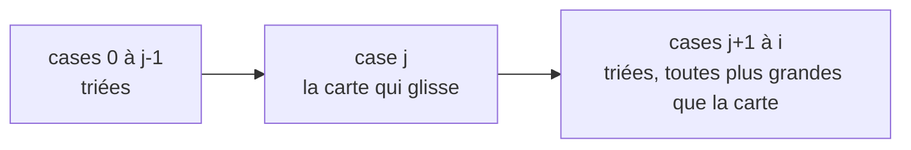

# Chapitre 6 — Exemples corrigés

[⬅ Cours du chapitre 6](1-Cours.md) · [🏠 Accueil](../../README.md) · Méthode : [F4](../../04-Fiches-revision/F4-Methode-boucles.md) · Suite : [Exercices ➡](3-Exercices.md)

> 🏋️ Les deux preuves suivent les **6 étapes**, dans l'ordre du DS.

---

## Exemple 1 ⭐⭐ — Le prix le moins cher 🏷️

```python
i = 0
res = 0
while i < len(l):
    if l[res] > l[i]:
        res = i
    i = i + 1
```

On note `ind_min(l, i, res)` la phrase : « parmi les cases `0` à `i − 1`, `res` est la **première** position du minimum ». Précisément, pour tout `k` entre `0` et `i − 1` :
- (I21) `l[k] ≥ l[res]` (personne n'est moins cher) ;
- (I22) si `l[k] = l[res]`, alors `k ≥ res` (personne d'aussi cher n'est placé avant).

**Invariant** : (I1) `0 ≤ i ≤ len(l)`, `0 ≤ res ≤ i`, `res < len(l)` ; (I2) `ind_min(l, i, res)`.

### 1. Le corps ne plante pas

Le corps lit `l[res]` et `l[i]`. Il faut `0 ≤ res < len(l)` (I1 ✅) et `0 ≤ i < len(l)` (I1 et la condition `i < len(l)` ✅).

### 2. Le variant `len(l) − i` diminue

```python
# i + 1 = a
if l[res] > l[i]:
    res = i
i = i + 1
# i = a
```

`i` augmente de 1, donc `len(l) − i` diminue de 1. Il reste ≥ 0 car `i ≤ len(l)` (I1) ✅

### 3. La condition ne plante pas

`i < len(l)` ne lit aucune case : elle ne plante jamais ✅

### 4. L'invariant reste vrai pendant un tour

Je sais : la condition `i < len(l)`, (I1) et (I2). Le tour regarde **une case de plus**, la case `i`. Deux cas :

- **Cas `l[res] > l[i]`** (la case `i` est strictement moins chère) : `res` devient `i`.
  - Les cases d'avant sont toutes ≥ `l[res]` > `l[i]` : elles sont **strictement** plus chères ✅
  - La case `i` elle-même : `l[i] ≥ l[i]`, et c'est la seule à ce prix ✅
- **Cas `l[res] ≤ l[i]`** : `res` ne change pas.
  - Les cases d'avant : c'est (I2) ✅
  - La case `i` : `l[i] ≥ l[res]` (cas), et si elle est égale, `i ≥ res` (I1) ✅

Les bornes (I1) restent vraies avec `i + 1` grâce à la condition `i < len(l)` ✅

### 5. Au départ

Avec `i = 0` et `res = 0` : il faut `0 < len(l)` (c'est la pré-condition ✅) et `ind_min(l, 0, 0)`.
`ind_min(l, 0, 0)` parle des cases `0` à `−1` : **il n'y en a aucune**, donc c'est vrai ✅

> 💬 « Tous les élèves absents ont eu 20 », quand **personne** n'est absent : c'est vrai, il n'y a personne pour contredire.

### 6. À l'arrivée

La condition est fausse : `i ≥ len(l)`. Avec (I1), `i ≤ len(l)`. Donc `i = len(l)`, et (I2) dit exactement que `res` est la première position du minimum de **tout** le tableau ✅

---

## Exemple 2 ⭐⭐⭐ — Faire glisser une carte 🃏

```python
j = i
while j > 0 and l[j-1] > l[j]:
    v = l[j]
    l[j] = l[j-1]
    l[j-1] = v
    j = j - 1
```

**L'image de l'invariant** (avec `m` = le sac de départ) :



| | |
|---|---|
| (I1) | `0 ≤ j ≤ i` et `0 ≤ i < len(l)` |
| (I2) (a) | les cases `0` à `i` sont triées **si on oublie la case `j`** |
| (I2) (b) | la carte en `j` est **plus petite** que toutes les cases `j+1` à `i` |
| (I3) | `val(l) = m` (même sac) |
| Variant | `j` |

### 1. Le corps ne plante pas

Le corps lit et écrit `l[j]` et `l[j-1]`. Il faut `0 ≤ j − 1` (car `j > 0`, condition ✅) et `j < len(l)` (car `j ≤ i < len(l)`, I1 ✅).

### 2. Le variant `j` diminue

`j` devient `j − 1` à chaque tour ✅. Il reste ≥ 0 par (I1) ✅

### 3. La condition ne plante pas

`j > 0 and l[j-1] > l[j]` : si `j = 0`, la partie droite n'est pas calculée (paresse de `and`). Si `j > 0`, les deux cases existent (comme à l'étape 1) ✅

### 4. L'invariant reste vrai pendant un tour

Le tour **échange** les cases `j − 1` et `j`, puis recule `j`. Notons `l'` le tableau après l'échange : `l' = l[j−1 → l[j], j → l[j−1]]`.

> ℹ️ Les notes d'origine écrivent `l[j-1 -> l[i], …]` : c'est une coquille, la valeur posée en `j − 1` est `v = l[j]`.

Je sais : (I1), (I2), (I3), et la condition : `j > 0` et `l[j−1] > l[j]` (la carte est plus petite que sa voisine).

- **Bornes** : `j − 1 ≥ 0` (car `j > 0`) et `j − 1 ≤ i` ✅
- **Même sac** : un échange ne change pas le sac ✅
- **(a) trié en oubliant la nouvelle place `j − 1`** : la voisine a été déplacée de `j − 1` à `j`. Avant l'échange, (I2 a) disait déjà que la voisine était plus grande que tout ce qui est à sa gauche **et** plus petite que tout ce qui est à droite de `j` (la case `j` étant oubliée). Elle est donc **bien placée** en `j` ✅
- **(b) la carte (maintenant en `j − 1`) est plus petite que tout ce qui est à droite** : la voisine (maintenant en `j`) est plus grande grâce à la condition ; les cases d'après sont plus grandes grâce à (I2 b) ✅

### 5. Au départ

Avec `j = i` : (a) « trié en oubliant la case `i` » = « cases `0` à `i − 1` triées » : c'est la pré-condition ✅. (b) parle des cases entre `i + 1` et `i` : **aucune**, donc c'est vrai ✅

### 6. À l'arrivée : les cases 0 à `i` sont triées

La condition est fausse : **soit** `j = 0`, **soit** `l[j−1] ≤ l[j]`.

- **`j = 0`** : la carte est tout à gauche, et elle est plus petite que tout ce qui suit (I2 b) ; le reste est trié (I2 a) ✅
- **`l[j−1] ≤ l[j]`** : la carte est plus grande que sa voisine de gauche, donc que tout ce qui est à gauche (trié). Elle est plus petite que tout ce qui est à droite (I2 b). Elle est à sa place ✅

Et le sac n'a pas changé (I3) ✅

---

➡ **À toi de jouer :** [Exercices du chapitre](3-Exercices.md) · puis les [corrections](4-Corrections.md).
