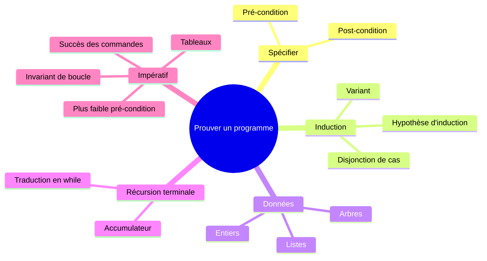

# 📚 Cours

[⬅ Accueil](../README.md)

## Carte des notions

## Les chapitres

Chaque dossier contient **`README.md`** (le cours, court) et **`demonstrations.md`** (preuves rédigées en entier, à refaire seul).

| # | Chapitre | Je saurai… |
|---|---|---|
| C1 | [Induction](C1-Induction/README.md) | lire du Haskell, spécifier, prouver une fonction par induction |
| C2 | [Listes](C2-Listes/README.md) | prouver des propriétés sur les listes et la correction d'un tri |
| C3 | [Récursion terminale](C3-Recursion-terminale/README.md) | écrire une fonction à accumulateur, la traduire en `while`, la prouver |
| C4 | [Arbres](C4-Arbres/README.md) | définir un type algébrique, le coder en Python objet, prouver dessus |
| C5 | [Programmes impératifs](C5-Programmes-imperatifs/README.md) | calculer une plus faible pré-condition, prouver une boucle |
| C6 | [Tableaux](C6-Tableaux/README.md) | garantir l'absence d'erreur et raisonner sur des tableaux modifiés |

## Structure de chaque cours

| Rubrique | Rôle |
|---|---|
| 🎯 Objectifs | ce que je dois savoir faire |
| 💡 L'idée | l'intuition en deux phrases |
| 📖 Cours | définitions, schémas, exemples |
| ⚠️ Pièges | erreurs classiques |
| ✅ À retenir | à connaître par cœur |
| 🧪 Auto-test | questions avec réponses repliées |
