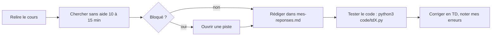

# ✍️ TD / TP — Ton espace de travail

[⬅ Accueil](../README.md)

## Contenu de chaque dossier

```text
TDx-Nom/
├── enonce.md        ← l'énoncé clarifié + des pistes repliées
├── mes-reponses.md  ← TES réponses (squelette déjà prêt à remplir)
└── code/            ← TON code (fichier Python de départ fourni)
```

| TD | Thème | Cours | Exercices |
|---|---|---|---|
| [TD1](TD1-Induction-numerique/enonce.md) | Induction sur les entiers | [C1](../01-Cours/C1-Induction/README.md) | multiplication, exponentiation rapide, plus grand facteur premier |
| [TD2](TD2-Listes-tri-fusion/enonce.md) | Listes | [C2](../01-Cours/C2-Listes/README.md) | tri fusion, PGCD par facteurs premiers |
| [TD3](TD3-Recursion-terminale/enonce.md) | Récursion terminale | [C3](../01-Cours/C3-Recursion-terminale/README.md) | exponentiation terminale, insertion terminale |
| [TD4](TD4-Arbres-tournois/enonce.md) | Arbres | [C4](../01-Cours/C4-Arbres/README.md) | tournois, tri par tas-tournoi |
| [TD5](TD5-Programmes-imperatifs/enonce.md) | Impératif | [C5](../01-Cours/C5-Programmes-imperatifs/README.md) | plus faible pré-condition, division, nombre de diviseurs |
| [TD6](TD6-Tableaux/enonce.md) | Tableaux | [C6](../01-Cours/C6-Tableaux/README.md) | dichotomie, tri par parité |

## Comment travailler un TD



## ➕ Ajouter un nouveau TD / TP

1. Copier le dossier [_MODELE](_MODELE/) et le renommer, par exemple `TD7-Mon-theme`.
2. Remplir `enonce.md` et `mes-reponses.md`.
3. Mettre le code dans `code/`.
4. Ajouter une ligne au tableau ci-dessus.

> 💡 Pour une démonstration, pars toujours du [modèle de preuve par induction](../04-Fiches-revision/F2-Modele-preuve-induction.md) ou de la [méthode des boucles](../04-Fiches-revision/F4-Methode-boucles.md).
