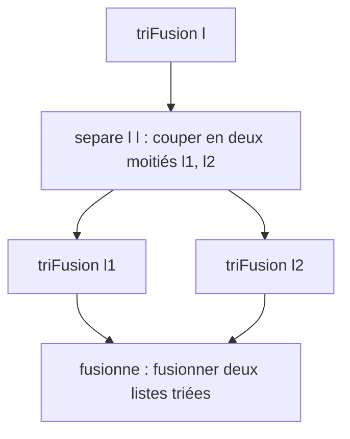

# TD2 — Induction sur les listes : tri fusion

[⬅ TD / TP](../README.md) · Cours : [C2 Listes](../../01-Cours/C2-Listes/README.md) · [Mes réponses](mes-reponses.md) · [Code](code/td2.py)

## 🎯 Objectifs

- Prouver un algorithme découpé en **plusieurs fonctions** (chacune sa spécification).
- Utiliser les axiomes `triée` et `perm`.
- Choisir un variant quand **deux listes** raccourcissent.

## 📏 Les axiomes à utiliser

| Nom | Axiome |
|---|---|
| **TVide** | `triée([])` |
| **TCons** | `triée(x:l)` ssi `triée(l)` et `x` ≤ chaque élément de `l` |
| **PRefl** | `perm(l, l)` |
| **PSym** | `perm(l1, l2)` ssi `perm(l2, l1)` |
| **PTrans** | `perm(l1, l2)` et `perm(l2, l3)` ⇒ `perm(l1, l3)` |
| **PCons** | `perm(l1, l2)` ⇒ `perm(x:l1, x:l2)` |
| **PApp** | `perm(l1, l1')` et `perm(l2, l2')` ⇒ `perm(l1 ++ l2, l1' ++ l2')` |
| **PPerm** | `perm(x:(l1 ++ l2), l1 ++ (x:l2))` |

---

## Exercice 1 : Tri fusion

```haskell
separe :: [Int] -> [Int] -> ([Int], [Int])
separe l []            = ([], l)
separe l [_]           = ([], l)
separe [] _            = ([], [])
separe (x:l) (_:_:cpt) = let (l1, l2) = separe l cpt in (x:l1, l2)

fusionne :: [Int] -> [Int] -> [Int]
fusionne [] l = l
fusionne l [] = l
fusionne (x1:l1) (x2:l2) | x1 <= x2  = x1 : fusionne l1 (x2:l2)
                         | otherwise = x2 : fusionne (x1:l1) l2

triFusion :: [Int] -> [Int]
triFusion []  = []
triFusion [x] = [x]
triFusion l   = let (l1, l2) = separe l l in fusionne (triFusion l1) (triFusion l2)
```



> `separe l1 l2` utilise `l2` comme **compteur** : il avance de 2 dans `l2` quand il prend 1 élément de `l1`.

### Q1.1 — `separe`

| Q | Ce qu'on demande |
|---|---|
| 1.1.1 | Évaluer pas à pas `separe [1,3,2,7,1] [5,3,4,1]`. |
| 1.1.2 | Deux versions Python (récursive, itérative), avec les tranches `l[:i]`, `l[i:]`. |
| 1.1.3 | Par induction sur `length l1`, avec `(l11, l12) = separe l1 l2` : (1) `l11 ++ l12 = l1` ; (2) `length l11 = min (length l1) (length l2 quot 2)`. |

### Q1.2 — `fusionne`

| Q | Ce qu'on demande |
|---|---|
| 1.2.1 | Évaluer pas à pas `fusionne [1,3] [1,2,7]`. |
| 1.2.2 | Deux versions Python (récursive, itérative). |
| 1.2.3 | Pré : `triée(l1)`, `triée(l2)`. Post : `triée(fusionne l1 l2)` et `perm(fusionne l1 l2, l1 ++ l2)`. Induction sur `length l1 + length l2`. |

### Q1.3 — `triFusion`

Montrer par induction sur `length l` : `triée(triFusion l)` et `perm(triFusion l, l)`.

<details><summary>💡 Piste Q1.1.3</summary>

Un cas par équation de `separe`. Attention : le cas `separe [] _` ne s'applique que si `l2` a **au moins 2** éléments (les deux premières équations ont déjà été essayées). Pour le cas récursif, `length cpt quot 2 = (length l2 quot 2) − 1`.

</details>

<details><summary>💡 Piste Q1.2.3</summary>

Quatre cas. La preuve est rédigée dans [C3 — démonstrations](../../01-Cours/C3-Recursion-terminale/demonstrations.md) : essaie d'abord seul !

</details>

<details><summary>💡 Piste Q1.3</summary>

Dans le 3ᵉ cas, `n = length l ≥ 2`. Par Q1.1.3 : `length l1 = n quot 2 < n` et `length l2 = n − n quot 2 < n` (car `n quot 2 ≥ 1`). Pour la permutation : **PApp** puis **PTrans**, avec `l1 ++ l2 = l`.

</details>

---

## Exercice 2 : PGCD par facteurs premiers

Un nombre est représenté par la liste triée de ses facteurs premiers : `36` ↦ `[2,2,3,3]`.

```haskell
produit :: [Int] -> Int
produit []    = 1
produit (x:l) = x * produit l

pgcd :: [Int] -> [Int] -> [Int]
pgcd [] _ = []
pgcd _ [] = []
pgcd (x1:l1) (x2:l2) | x1 == x2  = x1 : pgcd l1 l2
                     | x1 < x2   = pgcd l1 (x2:l2)
                     | otherwise = pgcd (x1:l1) l2
```

| Q | Ce qu'on demande |
|---|---|
| 2.1 | Pré : `l1`, `l2` triées, ne contenant que des nombres premiers. Post : `produit (pgcd l1 l2)` est le PGCD de `produit l1` et `produit l2`. Donner un **variant** et démontrer. |

<details><summary>💡 Piste Q2.1</summary>

Comme pour `fusionne`, une des deux listes raccourcit (ou les deux) : `length l1 + length l2`. Dans le cas `x1 < x2`, pourquoi `x1` ne divise-t-il pas `produit (x2:l2)` ? (Tous les facteurs de `x2:l2` sont premiers et ≥ `x2 > x1`.)

</details>

---

## ✅ Avant de rendre

- [ ] Chaque usage d'un axiome est **nommé** (TCons, PCons…).
- [ ] Le variant est bien `length l1 + length l2` quand les deux listes peuvent raccourcir.
- [ ] `python3 code/td2.py` ne signale aucune erreur.
