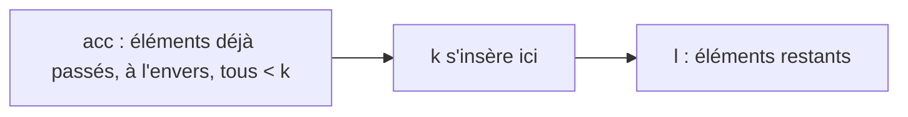

# TD3 — Récursion terminale

[⬅ TD / TP](../README.md) · Cours : [C3 Récursion terminale](../../01-Cours/C3-Recursion-terminale/README.md) · [Mes réponses](mes-reponses.md) · [Code](code/td3.py)

## 🎯 Objectifs

- Traduire une fonction récursive terminale en **boucle `while`** (méthode du cours).
- Prouver une fonction **à accumulateur** puis en **déduire** la fonction principale.

> 🔑 Méthode de traduction : arguments → variables ; condition d'arrêt → `while not (…)` ; appel récursif → **affectation simultanée** `x, y = e1, e2`.

---

## Exercice 1 : Exponentiation rapide terminale

```haskell
expAux :: Int -> Int -> Int -> Int
expAux a b acc | b == 0         = acc
               | b `mod` 2 == 0 = expAux (a*a) (b `quot` 2) acc
               | otherwise      = expAux (a*a) (b `quot` 2) (acc*a)

expR :: Int -> Int -> Int
expR a b = expAux a b 1
```

| Q | Ce qu'on demande |
|---|---|
| 1.1 | Version Python **non récursive** de `expAux`. |
| 1.2 | Pré : `b ≥ 0`. Post : `expAux a b acc = acc × aᵇ`. Variant : `b`. Démontrer (on admet ``b = 2 × (b `quot` 2) + b `mod` 2``). |
| 1.3 | En déduire : pour `b ≥ 0`, `expR a b = aᵇ`. |

<details><summary>💡 Piste Q1.2</summary>

Trois cas (un par garde). Pour `b` pair, posons `q = b quot 2` : `b = 2q`, et l'HI donne `expAux (a*a) q acc = acc × (a²)^q = acc × a^(2q)`. Pour `b` impair : `b = 2q + 1`, et `(acc × a) × (a²)^q = acc × a^(2q+1)`.

</details>

<details><summary>💡 Piste Q1.3</summary>

Une seule ligne : `expR a b = expAux a b 1 = 1 × aᵇ` d'après Q1.2. Pas besoin d'induction !

</details>

---

## Exercice 2 : Insertion triée terminale

```haskell
revAux :: [Int] -> [Int] -> [Int]
revAux [] l      = l
revAux (x:l') l  = revAux l' (x:l)

insererAux :: Int -> [Int] -> [Int] -> [Int]
insererAux k [] acc    = revAux acc [k]
insererAux k (n:l) acc | k <= n    = revAux acc (k:n:l)
                       | otherwise = insererAux k l (n:acc)
```

Rappel (cours) : `revAux l l' = reverse l ++ l'`.



| Q | Ce qu'on demande |
|---|---|
| 2.2 | Versions Python **non récursives** de `revAux` et `insererAux`. |
| 2.3 | Démontrer la spécification ci-dessous. |

- **Pré** : `triée(revAux acc l)` et `k` est **strictement** plus grand que tous les éléments de `acc`.
- **Post** : `triée(insererAux k l acc)` et il existe `l1`, `l2` tels que `l = l1 ++ l2` et `insererAux k l acc = revAux acc (l1 ++ [k] ++ l2)`.
- **Variant** : `length l`.
- **Admis** :
  - si `k` > tous les éléments de `l1`, `k` ≤ tous ceux de `l2`, et `revAux l1 l2` triée, alors `revAux l1 (k:l2)` triée ;
  - si `revAux l1 l2` est triée, alors `l2` est triée.

<details><summary>💡 Piste Q2.3</summary>

Trois cas. Pour `l = []` : `l1 = l2 = []`. Pour `k ≤ n` : `l1 = []`, `l2 = n:l` ; pour `triée`, utilise le 2ᵉ admis (`n:l` est triée) pour savoir que `k ≤` tous les éléments de `n:l`. Pour `k > n` : appel sur `(l, n:acc)` ; vérifie la pré : `revAux (n:acc) l = revAux acc (n:l)` ; puis prends `l1' = n : l1`.

</details>

---

## ✅ Avant de rendre

- [ ] Les boucles Python utilisent des **affectations simultanées**.
- [ ] La spécification est prouvée pour **tout** `acc`.
- [ ] `python3 code/td3.py` ne signale aucune erreur.
