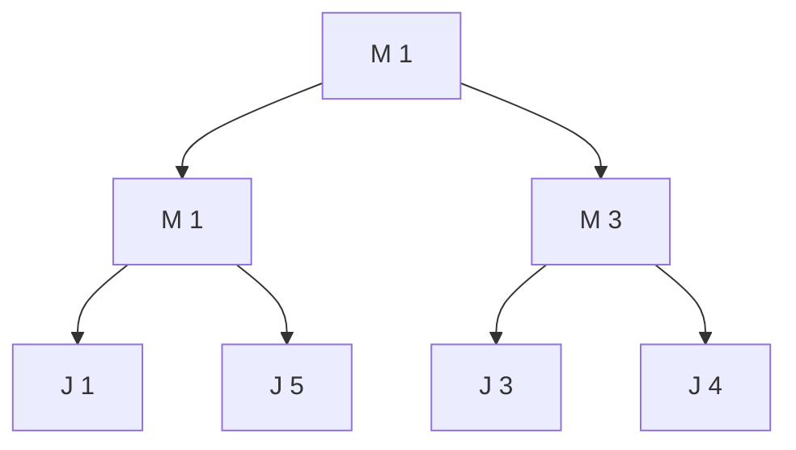
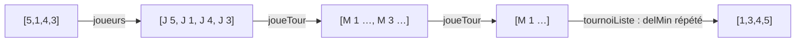

# TD4 — Structures arborescentes : les tournois

[🏠 Accueil](../../00-Commencer-ici.md) · Cours : [C4 Arbres](../../01-Cours/Chapitre-4-Arbres/1-Cours.md) · [Mes réponses](2-Mes-reponses.md) · [Code](code/td4.py)

## 🎯 Objectifs

- Raisonner sur un arbre **bien formé** (invariant de structure).
- Utiliser les **multi-ensembles** dans une spécification.
- Implémenter un type algébrique en **Python objet**.
- Enchaîner plusieurs fonctions prouvées pour obtenir un **tri**.

## Le type `Tournoi`

```haskell
data Tournoi = J Int                  -- Joueur (feuille)
             | M Int Tournoi Tournoi  -- Match : valeur du vainqueur, deux sous-tournois
```

Le vainqueur d'un match est la **plus petite** valeur. Exemple bien formé :



| Définition | Formule |
|---|---|
| Multi-ensemble des joueurs | `⟦J k⟧ = {\|k\|}` et `⟦M k t1 t2⟧ = ⟦t1⟧ ⊔ ⟦t2⟧` (la valeur d'un nœud M n'est **pas** comptée) |
| Vainqueur | `vainqueur (J a) = a` ; `vainqueur (M a _ _) = a` |
| Hauteur | `hauteur (J _) = 1` ; `hauteur (M _ t1 t2) = 1 + max (hauteur t1) (hauteur t2)` |

**Bien formé** : `J n` l'est toujours ; `M k t1 t2` l'est si
1. `k` est **minimal** dans `⟦t⟧` (pour tout `n ∈ ⟦t⟧`, `k ≤ n`) ;
2. `t1` et `t2` sont bien formés ;
3. `k = vainqueur t1` (le vainqueur est **toujours à gauche**).

```haskell
match :: Tournoi -> Tournoi -> Tournoi
match t1 t2 | vainqueur t1 <= vainqueur t2 = M (vainqueur t1) t1 t2
            | otherwise                    = M (vainqueur t2) t2 t1
```

---

## Exercice 1 : La structure tournoi

> 🧠 **En clair :** un tableau de **tournoi de tennis** 🎾. Le joueur au plus petit score gagne chaque match. `delMin`, c'est le **champion qui se retire** : on rejoue seulement les matchs qu'il avait gagnés, pour trouver le nouveau champion.

| Q | Ce qu'on demande |
|---|---|
| 1.1 | Montrer : si `t1` et `t2` sont bien formés, `match t1 t2` l'est. |
| 1.2 | Prouver `delMin` (ci-dessous) par induction sur `hauteur t`. |
| 1.3 | Implémenter `Tournoi` en Python : méthodes `vainqueur`, `hauteur`, `delMin`, `isJ` ; `match` est fait **dans `__init__`** de la classe `M`. |

```haskell
delMin :: Tournoi -> (Int, Tournoi)
delMin (M k (J _) t) = (k, t)
delMin (M _ t1 t2)   = let (k, t1') = delMin t1 in (k, match t1' t2)
```

- **Pré** : `t` bien formé et pas de la forme `J k`.
- **Post** : avec `(k, t') = delMin t` : `k` est le minimum de `⟦t⟧` ; `t'` bien formé et `⟦t'⟧ = ⟦t⟧ − {|k|}` ; `hauteur t' ≤ hauteur t`.
- **Variant** : `hauteur t`.

<details><summary>💡 Piste Q1.1</summary>

Rappel : dans un tournoi bien formé, `vainqueur t` est le minimum de `⟦t⟧` (aussi vrai pour `J n`). Dans le cas `vainqueur t1 ≤ vainqueur t2`, le minimum de `⟦t1⟧ ⊔ ⟦t2⟧` est donc `vainqueur t1`.

</details>

<details><summary>💡 Piste Q1.2</summary>

Cas 1 : `t1 = J _` ; par bonne formation, `k = vainqueur t1` donc `⟦t1⟧ = {|k|}`. Cas 2 : `t1` est un `M` ; appel `delMin t1` : variant `hauteur t1 < hauteur t` ✅, pré : `t1` bien formé et pas un `J` ✅. Puis utilise Q1.1 pour `match t1' t2`. Pour la hauteur : `hauteur (match t1' t2) = 1 + max (hauteur t1') (hauteur t2)`.

</details>

---

## Exercice 2 : Le tri par tas-tournoi

> 🧠 **En clair :** pour classer tous les joueurs, on organise **un tournoi**, on retire le champion (1ᵉʳ), on trouve le nouveau champion (2ᵉ), et ainsi de suite.



Multi-ensembles associés aux listes : `ml` (entiers d'une `[Int]`), `mlt` (joueurs d'une `[Tournoi]`), `tms` (tournois d'une `[Tournoi]`).

```haskell
joueurs :: [Int] -> [Tournoi]
joueurs []    = []
joueurs (a:l) = J a : joueurs l

joueTour :: [Tournoi] -> [Tournoi]
joueTour []         = []
joueTour [t]        = [t]
joueTour (t1:t2:l)  = match t1 t2 : joueTour l

joueTournois :: [Tournoi] -> Tournoi
joueTournois [t] = t
joueTournois l   = joueTournois (joueTour l)

tournoiListe :: Tournoi -> [Int]
tournoiListe (J k) = [k]
tournoiListe t     = let (k, t') = delMin t in k : tournoiListe t'

triTournoi :: [Int] -> [Int]
triTournoi [] = []
triTournoi l  = tournoiListe (joueTournois (joueurs l))
```

| Q | Fonction | Pré | Post | Variant |
|---|---|---|---|---|
| 2.1 | `joueurs l` | aucune | `ml l = mlt (joueurs l)`, même longueur, tous bien formés | `length l` |
| 2.2 | `joueTour l` | tous bien formés | `length = length l quot 2 + length l mod 2`, `mlt` conservé, tous bien formés | `length l` |
| 2.3 | `joueTournois l` | `l ≠ []`, tous bien formés | résultat bien formé, `⟦résultat⟧ = mlt l` | `length l` |
| 2.4 | `tournoiListe t` | `t` bien formé | `ml (résultat) = ⟦t⟧`, résultat trié | nombre d'éléments de `⟦t⟧` |
| 2.5 | `triTournoi l` | aucune | `ml l = ml (résultat)`, résultat trié | — (pas récursive) |

<details><summary>💡 Piste Q2.3</summary>

Dans le 2ᵉ cas, `length l ≥ 2` : il faut montrer `length (joueTour l) < length l`, grâce à Q2.2 (`n quot 2 + n mod 2 < n` pour `n ≥ 2`).

</details>

<details><summary>💡 Piste Q2.4</summary>

Cas `t = M …` : `delMin t` donne `k` minimum et `⟦t'⟧ = ⟦t⟧ − {|k|}` : le variant baisse de 1. Le résultat `k : tournoiListe t'` est trié car `k` ≤ tous les éléments de `⟦t'⟧` (TCons).

</details>

---

## ✅ Avant de rendre

- [ ] À chaque appel récursif, j'ai vérifié que le sous-tournoi est **bien formé**.
- [ ] J'utilise `⊔` et `−` des multi-ensembles correctement.
- [ ] `python3 code/td4.py` ne signale aucune erreur.
