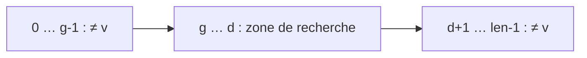
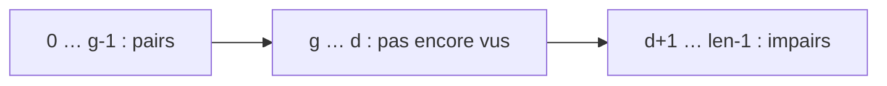

# TD6 — Programmes impératifs et tableaux

[🏠 Accueil](../../00-Commencer-ici.md) · Cours : [C6 Tableaux](../../01-Cours/Chapitre-6-Tableaux/1-Cours.md) · [Mes réponses](2-Mes-reponses.md) · [Code](code/td6.py)

## 🎯 Objectifs

Appliquer la **méthode en 6 étapes** (format du DS) :


> 💡 Pour un variant, on calcule la WP de `x = valeur_fraîche` (ex. `d = x ∧ g = y ∧ r = z`) à travers le corps.
> Pour le succès : WP de `⊤` (vrai) en ajoutant les conditions de succès (`0 ≤ indice < len(t)`).

---

## Exercice 1 : La dichotomie

> 🧠 **En clair :** chercher un mot dans un **dictionnaire** 📖 : on l'ouvre au milieu ; si le mot est avant, on garde la moitié gauche, sinon la moitié droite. `g` et `d` sont les deux mains qui tiennent la partie qui reste.

Recherche de `v` dans un tableau `t` **trié par ordre croissant**. À la fin : `r = −1` (absent) ou `t[r] = v`.

```python
r = -1
g = 0
d = len(t) - 1
while r == -1 and t[g] <= v and v <= t[d]:
    m = (g + d) // 2
    if t[m] < v:
        g = m + 1
    elif t[m] > v:
        d = m - 1
    else:
        r = m
```



| | |
|---|---|
| **Pré** | `len(t) > 0` et `t` trié : pour `0 ≤ k1 < k2 < len(t)`, `t[k1] ≤ t[k2]` |
| **Post** | soit `v ∈ val(t)`, `0 ≤ r < len(t)` et `t[r] = v` ; soit `v ∉ val(t)` et `r = −1` |
| **Variant** | `d − g − r` |
| **I1** | `0 ≤ g ≤ d < len(t)`, `r ≥ −1` |
| **I2** | pour tout `k` avec `0 ≤ k < g` ou `d < k < len(t)` : `t[k] ≠ v` |
| **I3** | si `r ≥ 0` alors `r < len(t)` et `t[r] = v` |

> ℹ️ Coquilles corrigées par rapport à l'énoncé d'origine : I2 écrit `k ≠ v` (il faut `t[k] ≠ v`) et `d < k ≤ len(t)` (il faut `< len(t)`) ; la post écrit `val(l)` pour `val(t)` ; Q1.2 dit « l'invariant est positif » pour « le variant est positif ».

| Q | Ce qu'on demande |
|---|---|
| 1.1 | **Succès du corps** : WP de `⊤` à travers le corps, puis la prouver. |
| 1.2 | **Variant** : WP de `d = x ∧ g = y ∧ r = z` ; décroissance stricte et positivité. |
| 1.3 | **Succès de la condition** sous l'invariant. |
| 1.4 | **Invariant** : WP de `I(g, d, r)` à travers le corps, puis la prouver (on peut utiliser que `t` est trié). |
| 1.5 | **Pré-condition** : WP de `I` à travers l'initialisation. |
| 1.6 | **Post-condition** à la sortie de boucle. |

<details><summary>💡 Piste Q1.2</summary>

Trois branches : `g` augmente, ou `d` diminue, ou `r` passe de `−1` à `m ≥ 0`. Dans chaque cas `d − g − r` baisse. Positivité : sous la condition (`r = −1`) et I1 (`g ≤ d`), `d − g − r = d − g + 1 ≥ 1`.

</details>

<details><summary>💡 Piste Q1.4 (le point délicat : garder g ≤ d)</summary>

`m = (g + d) // 2` vérifie `g ≤ m ≤ d`. Si `t[m] < v` et `m = d`, alors `g = d` (sinon `m < d`) et la condition donne `t[g] ≤ v ≤ t[d] = t[m] < v` : impossible. Donc `m < d` et `g = m + 1 ≤ d`. Symétrique pour `d = m − 1`. Pour I2 : si `t[m] < v`, comme `t` est trié, toutes les cases `≤ m` sont `< v`.

</details>

---

## Exercice 2 : Pairs à gauche, impairs à droite

> 🧠 **En clair :** deux mains rangent une étagère. La main gauche (`g`) avance tant qu'elle voit un nombre pair. Quand elle tombe sur un impair, elle l'**échange** avec la case de la main droite (`d`), qui recule. On s'arrête quand les mains se croisent.

```python
g = 0
d = len(t) - 1
while g <= d:
    if t[g] % 2 == 0:
        g = g + 1
    else:
        v = t[g]
        t[g] = t[d]
        t[d] = v
        d = d - 1
```



| | |
|---|---|
| **Pré** | `val(t) = m` |
| **Post** | `val(t) = m` et il existe `k` avec `0 ≤ k ≤ len(t)` : `t[i]` pair pour `0 ≤ i < k`, impair pour `k ≤ i < len(t)` |
| **Variant** | `d − g` |
| **I1** | `val(t) = m` |
| **I2** | `0 ≤ g ≤ len(t)`, `−1 ≤ d < len(t)` |
| **I3** | `t[i]` pair si `0 ≤ i < g` ; `t[i]` impair si `d < i < len(t)` |

| Q | Ce qu'on demande |
|---|---|
| 2.1 | Succès du corps |
| 2.2 | Variant : WP de `d = x ∧ g = y` ; décroissance et positivité |
| 2.3 | Invariant : WP de `I(g, d, t)` (avec `t[g → t[d], d → t[g]]` dans la branche `else`) |
| 2.4 | Pré-condition |
| 2.5 | Post-condition |

<details><summary>💡 Piste Q2.2 et Q2.5</summary>

Le variant `d − g` peut valoir `−1` à la sortie : il est ≥ 0 **sous la condition** `g ≤ d`, c'est ce qui compte. À la sortie, montre que `g = d + 1` et prends `k = g`.

</details>

---

## ✅ Avant de rendre

- [ ] Les 6 étapes sont dans l'ordre, chacune avec ses hypothèses.
- [ ] Toute lecture/écriture `t[e]` a sa condition `0 ≤ e < len(t)`.
- [ ] Les tableaux modifiés sont notés `t[i → v]`.
- [ ] `python3 code/td6.py` passe.
