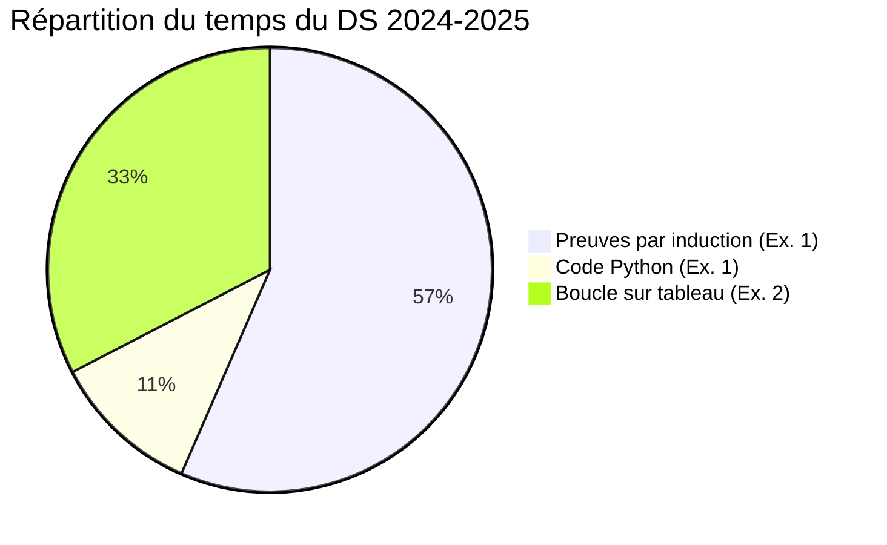

# 📝 Examens

[⬅ Accueil](../README.md)

| Sujet | Contenu | Durée indicative |
|---|---|---|
| [DS 2024-2025](DS-2024-2025/enonce.md) — [mes réponses](DS-2024-2025/mes-reponses.md) | Ex. 1 : listes et arbres de mots binaires (induction) · Ex. 2 : indice du maximum (boucle) | ≈ 3 h |

## 🎯 Ce que le DS évalue

| Compétence | Questions types | Fiche |
|---|---|---|
| Justifier un variant | « Expliquez pourquoi `length l` peut être considéré comme variant » | [F2](../04-Fiches-revision/F2-Modele-preuve-induction.md) |
| Preuve par induction | spécification d'une fonction sur listes / arbres | [F2](../04-Fiches-revision/F2-Modele-preuve-induction.md) |
| Récursion terminale | « Justifiez que la fonction est récursive terminale », version `while` | [C3](../01-Cours/C3-Recursion-terminale/README.md) |
| Python objet | traduire un type algébrique en classes | [F1](../04-Fiches-revision/F1-Haskell-et-Python.md) |
| Boucles | les 6 étapes : succès, variant, invariant, pré, post | [F4](../04-Fiches-revision/F4-Methode-boucles.md) |

## ✅ Règles du jour J

- **Aucun document** autorisé : les modèles de rédaction doivent être **automatiques**.
- La **présentation compte** : utiliser des **couleurs** pour séparer cas, hypothèses, WP.
- **Structure d'abord** : même sans finir un cas, écrire toute la structure de la preuve (variant, HI, liste des cas) **rapporte des points**.
- Le temps indiqué par question est proportionnel aux points : s'en servir pour ne pas s'enliser.

## 🗓️ Plan de révision (dernière semaine)

| Jour | Activité |
|---|---|
| J−7 | Relire les 6 cours, refaire les auto-tests |
| J−6 | Refaire seul 2 démonstrations de C2 et C3 |
| J−5 | Refaire TD1–TD3 sans regarder ses réponses |
| J−4 | Refaire TD4 + démonstrations de C4 |
| J−3 | Refaire TD5–TD6 + démonstrations de C5/C6 |
| J−2 | DS 2024-2025 en **conditions réelles** (chronomètre, sans document) |
| J−1 | Fiches [F2](../04-Fiches-revision/F2-Modele-preuve-induction.md), [F4](../04-Fiches-revision/F4-Methode-boucles.md), [F6](../04-Fiches-revision/F6-Pieges-et-errata.md) |
