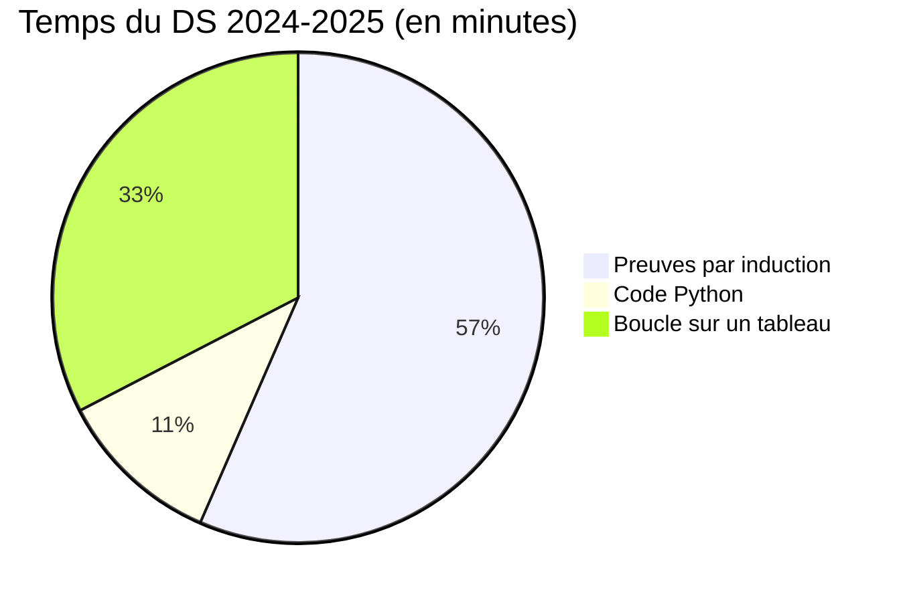

# 📝 Préparer le DS

[🏠 Accueil](../00-Commencer-ici.md) · Sujet : [DS 2024-2025](2-DS-2024-2025-Enonce.md) · [Mes réponses](3-DS-2024-2025-Mes-reponses.md)

## ⏱️ En 30 secondes

- **Aucun document** autorisé : il faut connaître **deux modèles** par cœur, la [preuve par induction](../04-Fiches-revision/F2-Modele-preuve-induction.md) et les [6 étapes des boucles](../04-Fiches-revision/F4-Methode-boucles.md).
- La **structure** de la preuve rapporte des points, même si un cas n'est pas fini.
- Le **temps** indiqué pour chaque question correspond à ses points : il sert de repère.

## 🎯 Ce qui tombe

| Type de question | Exemple | Où réviser |
|---|---|---|
| Justifier un variant | « Pourquoi `length l` peut-il servir de variant ? » | [F2](../04-Fiches-revision/F2-Modele-preuve-induction.md) |
| Preuve par induction | une fonction sur des listes ou des arbres | [Chapitres 1, 2, 4](../01-Cours/Chapitre-1-Prouver-par-induction/1-Cours.md) |
| Récursion terminale | « Justifiez que la fonction est terminale », version `while` | [Chapitre 3](../01-Cours/Chapitre-3-Recursion-terminale/1-Cours.md) |
| Python objet | un type `data` traduit en classes | [Chapitre 4](../01-Cours/Chapitre-4-Arbres/1-Cours.md) · [F1](../04-Fiches-revision/F1-Haskell-et-Python.md) |
| Boucle sur un tableau | les 6 étapes | [Chapitre 6](../01-Cours/Chapitre-6-Tableaux/1-Cours.md) · [F4](../04-Fiches-revision/F4-Methode-boucles.md) |

## ✍️ Le jour J

1. **Lire tout le sujet** (5 min) et repérer les questions faciles.
2. Pour chaque preuve, **écrire d'abord le squelette** : variant, HI, liste des cas. Puis remplir.
3. Utiliser des **couleurs** : une pour les hypothèses, une pour les cas, une pour les calculs de WP.
4. Bloquée sur un cas ? **Écrire ce qu'il faudrait montrer**, puis passer à la suite.
5. Repérer une coquille dans le sujet ? **La signaler en une ligne**, et dire ce que tu utilises à la place.

## 🗓️ La dernière semaine

| Jour | Activité | Durée |
|---|---|---|
| J−7 | Relire les 6 cours et refaire les « Je vérifie que j'ai compris » | 2 h |
| J−6 | Refaire **seule** 2 exemples corrigés des chapitres 2 et 3 | 1 h 30 |
| J−5 | Refaire TD1 à TD3 sans regarder ses réponses | 2 h |
| J−4 | Refaire TD4 + exemples corrigés du chapitre 4 | 1 h 30 |
| J−3 | Refaire TD5 et TD6 + exemples corrigés des chapitres 5 et 6 | 2 h |
| J−2 | Le [DS 2024-2025](2-DS-2024-2025-Enonce.md) en **conditions réelles** (3 h, sans document) | 3 h |
| J−1 | Relire [F2](../04-Fiches-revision/F2-Modele-preuve-induction.md), [F4](../04-Fiches-revision/F4-Methode-boucles.md) et [F6](../04-Fiches-revision/F6-Pieges-et-errata.md) | 1 h |
