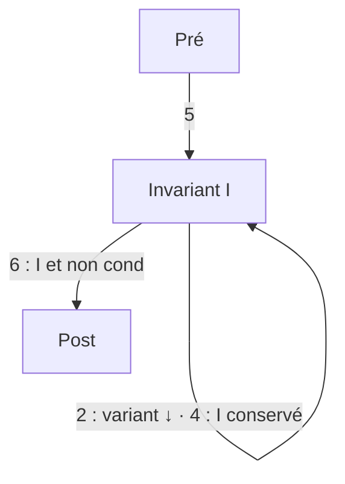

# F4 — Méthode des boucles (6 étapes)

[⬅ Fiches](README.md)

```text
# Pré
initialisation
while cond:
    corps
finalisation
# Post
```

## Les 6 étapes et leurs hypothèses

| # | Étape | Je calcule | J'ai le droit d'utiliser | Je montre |
|---|---|---|---|---|
| 1 | Succès du corps | `WP(corps, ⊤)` avec succès | **I** et **cond** | cette WP |
| 2 | Variant | `WP(corps, x = a, y = b …)` (variables fraîches) | **I** et **cond** | le variant **diminue** et est **≥ 0** |
| 3 | Succès de la condition | succès(`cond`) | **I** seul | succès(`cond`) |
| 4 | Invariant | `WP(corps, I)` | **I** et **cond** | cette WP |
| 5 | Pré-condition | `WP(initialisation, I)` | **Pré** | cette WP |
| 6 | Post-condition | `WP(finalisation, Post)` | **I** et **non cond** | cette WP |



## 📝 Modèle de rédaction (étape 4)

```text
Hypothèses :
  (I1) …   (I2) …        ← invariant
  (CB) …                 ← condition de boucle vraie

Calcul de la WP de I à travers le corps :
  # WP = …
  instruction 1
  # …
  instruction 2
  # I

À montrer : WP.
  Cas (C1 : …) : … par I1 et CB …  ✅
  Cas (C2 : …) : …                ✅
```

## 💡 Astuces

- **Trouver un invariant** : « qu'est-ce que la boucle a déjà accompli ? » + des **bornes** sur les indices.
- L'invariant doit **impliquer la post** à la sortie : il faut souvent une borne (`i ≤ n + 1`, `i > 0`) pour en déduire la valeur exacte de `i` (`i = n + 1`, `i = 1`).
- « Pour tout `k` dans un intervalle vide » est **toujours vrai** (utile à l'étape 5).
- Une fois l'étape 1 faite, les autres WP se calculent **sans** les conditions de succès.
- Tableaux modifiés : noter `t' = t[i → v]` et distinguer les cas `k = i` / `k ≠ i`.

## Bilan des exemples du cours

| Programme | Variant | Invariant (résumé) |
|---|---|---|
| Factorielle | `n − i + 1` | `res = (i−1)!`, `n − i + 1 ≥ 0` |
| Exponentiation rapide | `i` | `rem × resⁱ = aⁿ`, `i > 0` |
| Division (TD5) | `r` | `a = q·b + r`, `r ≥ 0`, `b > 0` |
| Indice du minimum | `len(l) − i` | bornes + `ind_min(l, i, res)` |
| Insertion en place | `j` | bornes + `pseudo_tri(l, i, j)` + `val(l) = m` |
| Dichotomie (TD6) | `d − g − r` | bornes + « `v` absent hors de `[g, d]` » + « si `r ≥ 0`, `t[r] = v` » |
