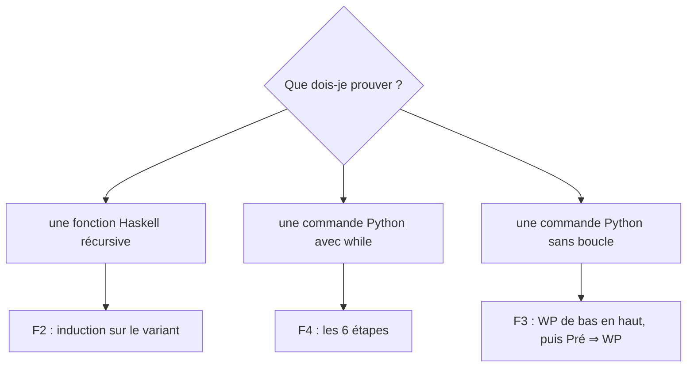

# ⚡ Fiches de révision

[⬅ Accueil](../README.md)

| Fiche | Quand l'utiliser |
|---|---|
| [F1 Haskell et Python](F1-Haskell-et-Python.md) | lire un code Haskell, le traduire en Python (récursif, `while`, objet) |
| [F2 Modèle de preuve par induction](F2-Modele-preuve-induction.md) | **toute** preuve sur une fonction récursive |
| [F3 Plus faible pré-condition](F3-Plus-faible-precondition.md) | code sans boucle, conditions de succès |
| [F4 Méthode des boucles](F4-Methode-boucles.md) | **toute** preuve de boucle `while` |
| [F5 Axiomes et notations](F5-Axiomes-et-notations.md) | `triée`, `perm`, multi-ensembles, `l[i → v]` |
| [F6 Pièges et errata](F6-Pieges-et-errata.md) | dernière relecture avant le DS |

## 🧭 Quelle méthode pour quelle question ?

