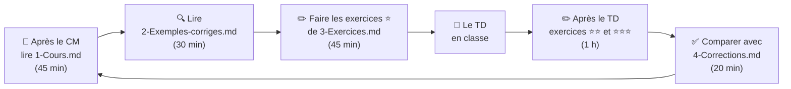
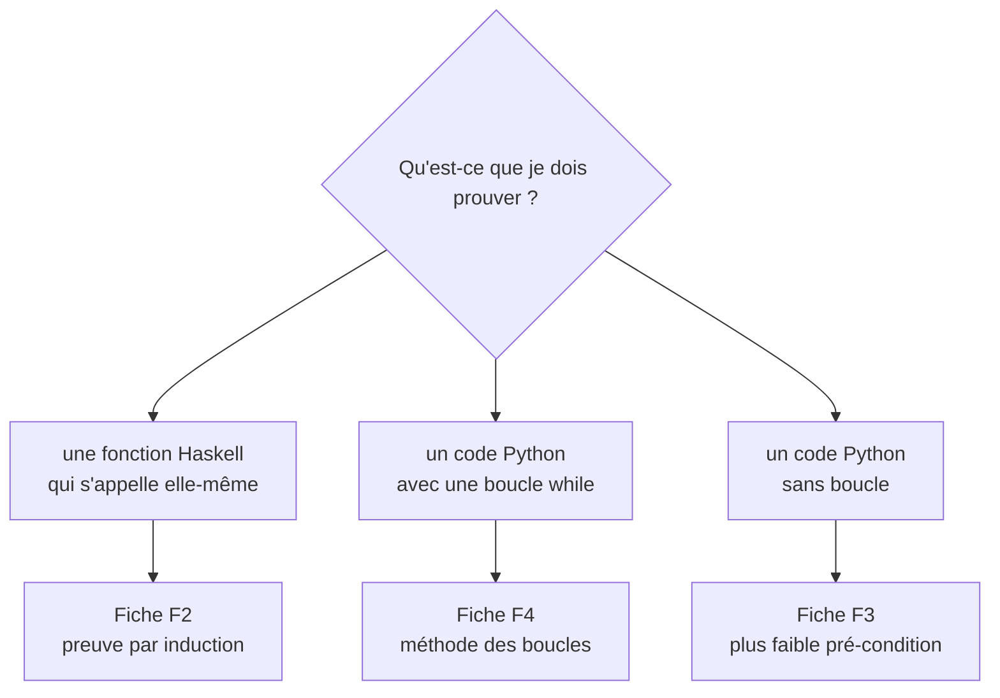

# 🧠 Programmation et raisonnement — L2 Informatique

> **Le module en une phrase :** apprendre à **être sûre** qu'un programme fait ce qu'il doit faire, **sans le tester sur toutes les valeurs**.

**L'image du module.** Un pont : on ne le teste pas en y faisant passer tous les camions du monde. L'ingénieur fait un **calcul** qui **prouve** qu'il tient. Ici, on fait pareil avec les programmes.

---

## 📁 Le dossier en un coup d'œil

Tout est **numéroté** : il suffit de suivre les numéros.

```text
README.md                 ← tu es ici : sommaire + rythme de travail
01-Cours/
   Chapitre-1-…/
      1-Cours.md               l'explication, avec des exemples de la vie réelle
      2-Exemples-corriges.md   des preuves expliquées ligne par ligne
      3-Exercices.md           10 à 12 exercices, du plus facile au plus difficile (67 au total)
      4-Corrections.md         les corrections détaillées
   … (6 chapitres)
02-TD-TP/
   TD1-…/  1-Enonce.md · 2-Mes-reponses.md · code/
   … (6 TD)
   TD-modele/              à copier pour ajouter un nouveau TD ou TP
03-Examens/               préparation du DS, sujet 2024-2025, ma copie
04-Fiches-revision/       F1 à F6 : les résumés pour réviser vite
```

---

## ⏱️ Le rythme de travail

### Chaque semaine, la même boucle



| Moment | Quoi | Fichier | Temps |
|---|---|---|---|
| Le jour du CM | Lire le cours, faire les questions « Je vérifie que j'ai compris » | `1-Cours.md` | 45 min |
| Le lendemain | Lire les exemples corrigés en cachant la suite | `2-Exemples-corriges.md` | 30 min |
| Avant le TD | Exercices **⭐** (échauffement) + le TPA à rendre | `3-Exercices.md` | 45 min |
| Le TD | Travailler l'énoncé, noter ses réponses | `02-TD-TP/TDx/` | 1 h 30 |
| Après le TD | Exercices **⭐⭐** et **⭐⭐⭐** + le TR à rendre | `3-Exercices.md` | 1 h |
| Fin de semaine | Comparer avec les corrections, noter ses erreurs | `4-Corrections.md` | 20 min |

> 💡 **Règle d'or :** chercher **au moins 10 minutes** avant d'ouvrir une correction. Une correction lue trop vite ne s'apprend pas.

### Le semestre

| Semaine | Chapitre | L'image à retenir | Exercices | TD |
|---|---|---|---|---|
| 1 | [1 · Prouver par induction](01-Cours/Chapitre-1-Prouver-par-induction/1-Cours.md) | 🍬 partager des bonbons · 🚀 compte à rebours | [12 exercices](01-Cours/Chapitre-1-Prouver-par-induction/3-Exercices.md) | [TD1](02-TD-TP/TD1-Induction-numerique/1-Enonce.md) |
| 2 | [2 · Listes](01-Cours/Chapitre-2-Listes/1-Cours.md) | 🚂 un train de wagons | [12 exercices](01-Cours/Chapitre-2-Listes/3-Exercices.md) | [TD2](02-TD-TP/TD2-Listes-tri-fusion/1-Enonce.md) |
| 3 | [3 · Récursion terminale](01-Cours/Chapitre-3-Recursion-terminale/1-Cours.md) | 🧮 la calculatrice au lieu des post-it | [10 exercices](01-Cours/Chapitre-3-Recursion-terminale/3-Exercices.md) | [TD3](02-TD-TP/TD3-Recursion-terminale/1-Enonce.md) |
| 4 | [4 · Arbres](01-Cours/Chapitre-4-Arbres/1-Cours.md) | 🔢 « plus grand / plus petit » · 📱 l'autocomplétion | [11 exercices](01-Cours/Chapitre-4-Arbres/3-Exercices.md) | [TD4](02-TD-TP/TD4-Arbres-tournois/1-Enonce.md) |
| 5 | [5 · Programmes impératifs](01-Cours/Chapitre-5-Programmes-imperatifs/1-Cours.md) | ⏰ l'heure de départ · 💶 le budget | [12 exercices](01-Cours/Chapitre-5-Programmes-imperatifs/3-Exercices.md) | [TD5](02-TD-TP/TD5-Programmes-imperatifs/1-Enonce.md) |
| 6 | [6 · Tableaux](01-Cours/Chapitre-6-Tableaux/1-Cours.md) | 🥚 la boîte d'œufs · 🃏 les cartes en main | [10 exercices](01-Cours/Chapitre-6-Tableaux/3-Exercices.md) | [TD6](02-TD-TP/TD6-Tableaux/1-Enonce.md) |
| Révisions | [Préparer le DS](03-Examens/1-Preparer-le-DS.md) | | [DS 2024-2025](03-Examens/2-DS-2024-2025-Enonce.md) | |

### Les niveaux des exercices

| Niveau | Ce qu'on demande | Quand |
|---|---|---|
| ⭐ | exécuter à la main, reconnaître, appliquer une règle | avant le TD |
| ⭐⭐ | écrire une fonction, une spécification, une preuve courte | après le TD |
| ⭐⭐⭐ | une preuve complète, du niveau du DS | après le TD et en révision |

---

## 🔑 Les 5 mots du module

| Mot | En clair | Dans la vie réelle |
|---|---|---|
| **Pré-condition** | ce qu'on suppose sur les entrées | « mettre une capsule dans la machine à café » |
| **Post-condition** | ce que le programme garantit | « on obtient un café » |
| **Variant** | un nombre ≥ 0 qui baisse à chaque étape : le calcul s'arrête | un compte à rebours |
| **Hypothèse d'induction** | « je suppose que ça marche pour les cas plus petits » | dans une file, chacun s'appuie sur les personnes devant lui |
| **Invariant** | ce qui reste vrai à chaque tour de boucle | « dépensé + restant = budget de départ » |

## 🧭 Quelle méthode pour quelle question ?



| Fiche | Contenu |
|---|---|
| [F1](04-Fiches-revision/F1-Haskell-et-Python.md) | lire du Haskell, le traduire en Python |
| [F2](04-Fiches-revision/F2-Modele-preuve-induction.md) | le modèle de preuve par induction |
| [F3](04-Fiches-revision/F3-Plus-faible-precondition.md) | la plus faible pré-condition |
| [F4](04-Fiches-revision/F4-Methode-boucles.md) | les 6 étapes pour une boucle |
| [F5](04-Fiches-revision/F5-Axiomes-et-notations.md) | les règles `triée` / `perm` et les notations |
| [F6](04-Fiches-revision/F6-Pieges-et-errata.md) | les erreurs fréquentes et les coquilles des documents |

---

## ✍️ Les TD et TP

| Fichier | À quoi il sert |
|---|---|
| `1-Enonce.md` | l'énoncé expliqué, avec des indices à déplier |
| `2-Mes-reponses.md` | **tes** réponses, avec un squelette prêt |
| `code/` | **ton** code Python, testé avec `python3 code/tdX.py` |

**Ajouter un TD ou un TP :** copier [TD-modele](02-TD-TP/TD-modele/1-Enonce.md), le renommer (par exemple `TD7-Mon-theme`), puis le remplir.

## 📊 La notation

| Élément | Détail |
|---|---|
| Cours | 6 CM et 12 TD de 1h30, **présence obligatoire** |
| TPA | travail préparatoire : donné en fin de CM, rendu au TD suivant |
| TR | travail de révision : donné en TD, rendu la semaine suivante (non rendu = 0) |
| Note finale | `(2 × DS + TxP × TxR × NTR) / 3` |
| 2ᵉ chance | `(3 × DS + TxP × TxR × NTR) / 4` |

`TxP` = taux de présence, `TxR` = taux de TPA rendus, `NTR` = note des TR.
En cas d'absence : prévenir le chargé de TD **et** le secrétariat (avec justificatif).

## 💡 Affichage

- Schémas en **Mermaid** : dans VS Code, aperçu avec `Cmd+Shift+V`. S'ils ne s'affichent pas, installer l'extension *Markdown Preview Mermaid Support*.
- Les blocs **▶** se déplient : chercher d'abord, regarder ensuite.
